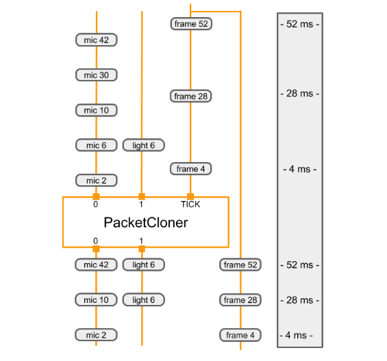

# 计算器 (Calculators)

> 本文译自官方文档:[原文链接](https://developers.google.com/edge/mediapipe/framework/framework_concepts/calculators)
> 为保持内容与版式一致,图片位置、章节顺序、代码示例均与原页对齐。

每个计算器都是计算图中的一个节点。下面我们描述如何创建新的计算器、如何初始化计算器、如何执行其计算,以及输入流、输出流、时间戳和选项。计算图中的每个节点都由一个 `Calculator` 实现。计算图执行的绝大部分工作都发生在计算器内部。一个计算器可以接收零个或多个输入流和/或边包,并产生零个或多个输出流和/或边包。

## CalculatorBase

计算器通过定义 [`CalculatorBase`](https://github.com/google/mediapipe/tree/master/mediapipe/framework/calculator_base.cc) 类的一个新子类来创建,该子类实现若干方法,并将新子类注册到 MediaPipe。至少,一个新的计算器必须实现以下四个方法:

-   `GetContract()`
    -   计算器作者可以在 GetContract() 中指定计算器输入和输出的预期类型。当计算图初始化时,框架会调用一个静态方法来验证所连接的输入和输出的数据包类型是否与此规范中的信息匹配。
-   `Open()`
    -   计算图启动后,框架调用 `Open()`。此时,输入边包对计算器可用。`Open()` 解释节点配置操作(参见[计算图 (Graphs)](graphs.md)),并准备计算器每次计算图运行的状态。此函数还可以向计算器输出写入数据包。`Open()` 期间的错误可以终止计算图运行。
-   `Process()`
    -   对于有输入的计算器,只要至少一个输入流有可用的数据包,框架就会重复调用 `Process()`。框架默认保证所有输入具有相同的时间戳(更多信息请参阅[同步 (Synchronization)](synchronization.md))。当启用并行执行时,可以同时调用多个 `Process()`。如果 `Process()` 期间发生错误,框架会调用 `Close()`,计算图运行终止。
-   `Close()`
    -   在所有 `Process()` 调用结束或所有输入流关闭后,框架调用 `Close()`。只要 `Open()` 被调用且成功,此函数就一定会被调用,即使计算图运行因错误而终止也是如此。`Close()` 期间没有任何输入流可用的输入,但它仍然可以访问输入边包,因此可能写入输出。`Close()` 返回后,计算器应被视为死节点。计算图运行结束后,计算器对象会立即被销毁。

以下是来自 [CalculatorBase.h](https://github.com/google/mediapipe/tree/master/mediapipe/framework/calculator_base.h) 的代码片段。

```
class CalculatorBase {
 public:
  ...

  // The subclasses of CalculatorBase must implement GetContract.
  // ...
  static absl::Status GetContract(CalculatorContract* cc);

  // Open is called before any Process() calls, on a freshly constructed
  // calculator.  Subclasses may override this method to perform necessary
  // setup, and possibly output Packets and/or set output streams' headers.
  // ...
  virtual absl::Status Open(CalculatorContext* cc) {
    return absl::OkStatus();
  }

  // Processes the incoming inputs. May call the methods on cc to access
  // inputs and produce outputs.
  // ...
  virtual absl::Status Process(CalculatorContext* cc) = 0;

  // Is called if Open() was called and succeeded.  Is called either
  // immediately after processing is complete or after a graph run has ended
  // (if an error occurred in the graph).  ...
  virtual absl::Status Close(CalculatorContext* cc) {
    return absl::OkStatus();
  }

  ...
};
```

## 计算器的生命周期 (Life of a calculator)

在 MediaPipe 计算图初始化期间,框架会调用 `GetContract()` 静态方法来确定需要哪些类型的数据包。

框架会在每次计算图运行(例如,每处理一个视频或一张图像)时构造并销毁整个计算器。在多次计算图运行之间保持不变的大对象或昂贵对象应作为输入边包提供,以免在后续运行中重复计算。

初始化之后,对于计算图的每次运行,会发生以下顺序:

-   `Open()`
-   `Process()`(重复调用)
-   `Close()`

框架调用 `Open()` 来初始化计算器。`Open()` 应解释所有选项并设置计算器的每次计算图运行状态。`Open()` 可以获取输入边包并向计算器输出写入数据包。如果合适,它应调用 `SetOffset()` 以减少输入流可能的数据包缓冲。

如果在 `Open()` 或 `Process()` 期间发生错误(以其中之一返回非 `Ok` 状态为标志),则计算图运行终止,不再调用计算器的任何方法,计算器被销毁。

对于有输入的计算器,只要至少一个输入有可用的数据包,框架就会调用 `Process()`。框架保证所有输入具有相同的时间戳、时间戳随每次 `Process()` 调用而增加,并且所有数据包都会被送达。因此,当调用 `Process()` 时,某些输入可能没有任何数据包。缺少数据包的输入表现为产生一个空数据包(没有时间戳)。

框架在所有 `Process()` 调用结束后调用 `Close()`。此时所有输入都已耗尽,但 `Close()` 可以访问输入边包,并可能写入输出。Close 返回后,计算器被销毁。

没有输入的计算器称为源 (source) 计算器。只要源计算器返回 `Ok` 状态,框架就会持续调用其 `Process()`。源计算器通过返回停止状态(即 [`mediaPipe::tool::StatusStop()`](https://github.com/google/mediapipe/tree/master/mediapipe/framework/tool/status_util.cc))来表示已耗尽。

## 识别输入和输出 (Identifying inputs and outputs)

计算器的公共接口由一组输入流和输出流组成。在 CalculatorGraphConfiguration 中,某些计算器的输出通过命名流连接到其它计算器的输入。流名通常为小写,而输入和输出标签 (tag) 通常为大写。在下面的示例中,标签名为 `VIDEO` 的输出通过名为 `video_stream` 的流连接到标签名为 `VIDEO_IN` 的输入。

```
# Graph describing calculator SomeAudioVideoCalculator
node {
  calculator: "SomeAudioVideoCalculator"
  input_stream: "INPUT:combined_input"
  output_stream: "VIDEO:video_stream"
}
node {
  calculator: "SomeVideoCalculator"
  input_stream: "VIDEO_IN:video_stream"
  output_stream: "VIDEO_OUT:processed_video"
}
```

输入流和输出流可以通过索引号、标签名或标签名与索引号的组合来标识。您可以在下面的示例中看到一些输入和输出标识符的示例。`SomeAudioVideoCalculator` 通过标签标识其视频输出,通过标签与索引的组合标识其音频输出。标签为 `VIDEO` 的输入连接到名为 `video_stream` 的流。标签为 `AUDIO` 且索引为 `0` 和 `1` 的输出分别连接到名为 `audio_left` 和 `audio_right` 的流。`SomeAudioCalculator` 仅通过索引标识其音频输入(不需要标签)。

```
# Graph describing calculator SomeAudioVideoCalculator
node {
  calculator: "SomeAudioVideoCalculator"
  input_stream: "combined_input"
  output_stream: "VIDEO:video_stream"
  output_stream: "AUDIO:0:audio_left"
  output_stream: "AUDIO:1:audio_right"
}

node {
  calculator: "SomeAudioCalculator"
  input_stream: "audio_left"
  input_stream: "audio_right"
  output_stream: "audio_energy"
}
```

在计算器实现中,输入和输出也通过标签名和索引号来标识。在下面的函数中,输入和输出通过以下方式标识:

-   按索引号:组合输入流仅通过索引 `0` 标识。
-   按标签名:视频输出流通过标签名 "VIDEO" 标识。
-   按标签名和索引号:输出音频流通过标签名 `AUDIO` 与索引号 `0` 和 `1` 的组合来标识。

```
// c++ Code snippet describing the SomeAudioVideoCalculator GetContract() method
class SomeAudioVideoCalculator : public CalculatorBase {
 public:
  static absl::Status GetContract(CalculatorContract* cc) {
    cc->Inputs().Index(0).SetAny();
    // SetAny() is used to specify that whatever the type of the
    // stream is, it's acceptable.  This does not mean that any
    // packet is acceptable.  Packets in the stream still have a
    // particular type.  SetAny() has the same effect as explicitly
    // setting the type to be the stream's type.
    cc->Outputs().Tag("VIDEO").Set<ImageFrame>();
    cc->Outputs().Get("AUDIO", 0).Set<Matrix>();
    cc->Outputs().Get("AUDIO", 1).Set<Matrix>();
    return absl::OkStatus();
  }
```

## 处理 (Processing)

在非源节点上调用 `Process()` 必须返回 `absl::OkStatus()` 表示一切正常,或返回任意其它状态码以表示出错。

如果非源计算器返回 `tool::StatusStop()`,则表示计算图将被提前取消。在这种情况下,所有源计算器和计算图输入流都将被关闭(其余数据包将继续在计算图中传播)。

计算图中的源节点只要返回 `absl::OkStatus()` 就会持续被调用 `Process()`。若表示不再有数据需要生成,则返回 `tool::StatusStop()`。任何其它状态都表示发生了错误。

`Close()` 返回 `absl::OkStatus()` 表示成功。任何其它状态都表示失败。

以下是基本的 `Process()` 函数。它使用 `Input()` 方法(仅当计算器有单个输入时才能使用)请求其输入数据。然后使用 `std::unique_ptr` 为输出数据包分配所需内存,并执行计算。完成后,在将指针添加到输出流时释放它。

```
absl::Status MyCalculator::Process() {
  const Matrix& input = Input()->Get<Matrix>();
  std::unique_ptr<Matrix> output(new Matrix(input.rows(), input.cols()));
  // do your magic here....
  //    output->row(n) =  ...
  Output()->Add(output.release(), InputTimestamp());
  return absl::OkStatus();
}
```

## 计算器选项 (Calculator options)

计算器通过以下三种方式接收处理参数:(1) 输入流数据包,(2) 输入边包,(3) 计算器选项。计算器选项(如果指定)在 `CalculatorGraphConfiguration.Node` 消息的 `node_options` 字段中以字面值形式出现。

  ```
  node {
    calculator: "TfLiteInferenceCalculator"
    input_stream: "TENSORS:main_model_input"
    output_stream: "TENSORS:main_model_output"
    node_options: {
      [type.googleapis.com/mediapipe.TfLiteInferenceCalculatorOptions] {
        model_path: "mediapipe/models/detection_model.tflite"
      }
    }
  }
```

`node_options` 字段接受 proto3 语法。另外,计算器选项也可以在 `options` 字段中使用 proto2 语法指定。

  ```
  node {
    calculator: "TfLiteInferenceCalculator"
    input_stream: "TENSORS:main_model_input"
    output_stream: "TENSORS:main_model_output"
    node_options: {
      [type.googleapis.com/mediapipe.TfLiteInferenceCalculatorOptions] {
        model_path: "mediapipe/models/detection_model.tflite"
      }
    }
  }
```

并非所有计算器都接受计算器选项。为了接受选项,计算器通常需要定义一个新的 protobuf 消息类型来表示其选项,例如 `PacketClonerCalculatorOptions`。然后,计算器在其 `CalculatorBase::Open` 方法中读取该 protobuf 消息,也可能在其 `CalculatorBase::GetContract` 函数或其 `CalculatorBase::Process` 方法中读取。通常,新的 protobuf 消息类型使用 ".proto" 文件并通过 `mediapipe_proto_library()` 构建规则定义为 protobuf 模式。

  ```
  mediapipe_proto_library(
      name = "packet_cloner_calculator_proto",
      srcs = ["packet_cloner_calculator.proto"],
      visibility = ["//visibility:public"],
      deps = [
          "//mediapipe/framework:calculator_options_proto",
          "//mediapipe/framework:calculator_proto",
      ],
  )
```

## 示例计算器 (Example calculator)

本节讨论 `PacketClonerCalculator` 的实现,它执行相对简单的工作,并用于许多计算器计算图。`PacketClonerCalculator` 只是按需生成其最近输入数据包的副本。

当到达的数据包的时间戳不完全对齐时,`PacketClonerCalculator` 会很有用。假设我们有一个房间,里面有一个麦克风、一个光传感器和一个正在收集感觉数据的视频摄像头。每个传感器独立运行并间歇性地收集数据。假设每个传感器的输出是:

-   麦克风 = 房间内声音的响度,单位为分贝 (Integer)
-   光传感器 = 房间的亮度 (Integer)
-   视频摄像头 = 房间的 RGB 图像帧 (ImageFrame)

我们简单的感知流水线被设计为处理来自这 3 个传感器的感觉数据,以便在任何时刻,当我们拥有来自摄像头的图像帧数据时,它与最近收集的麦克风响度数据和光传感器亮度数据同步。为此,使用 MediaPipe,我们的感知流水线有 3 个输入流:

-   room\_mic\_signal - 此输入流中的每个数据包都是整数数据,表示某一时刻房间内音频的响度(带有时间戳)。
-   room\_lightening\_sensor - 此输入流中的每个数据包都是整数数据,表示某一时刻房间被照明的亮度(带有时间戳)。
-   room\_video\_tick\_signal - 此输入流中的每个数据包都是视频数据的图像帧,表示从房间中的摄像头采集的视频(带有时间戳)。

下面是 `PacketClonerCalculator` 的实现。您可以看到 `GetContract()`、`Open()` 和 `Process()` 方法,以及保存最近输入数据包的实例变量 `current_`。

```
// This takes packets from N+1 streams, A_1, A_2, ..., A_N, B.
// For every packet that appears in B, outputs the most recent packet from each
// of the A_i on a separate stream.

#include <vector>

#include "absl/strings/str_cat.h"
#include "mediapipe/framework/calculator_framework.h"

namespace mediapipe {

// For every packet received on the last stream, output the latest packet
// obtained on all other streams. Therefore, if the last stream outputs at a
// higher rate than the others, this effectively clones the packets from the
// other streams to match the last.
//
// Example config:
// node {
//   calculator: "PacketClonerCalculator"
//   input_stream: "first_base_signal"
//   input_stream: "second_base_signal"
//   input_stream: "tick_signal"
//   output_stream: "cloned_first_base_signal"
//   output_stream: "cloned_second_base_signal"
// }
//
class PacketClonerCalculator : public CalculatorBase {
 public:
  static absl::Status GetContract(CalculatorContract* cc) {
    const int tick_signal_index = cc->Inputs().NumEntries() - 1;
    // cc->Inputs().NumEntries() returns the number of input streams
    // for the PacketClonerCalculator
    for (int i = 0; i < tick_signal_index; ++i) {
      cc->Inputs().Index(i).SetAny();
      // cc->Inputs().Index(i) returns the input stream pointer by index
      cc->Outputs().Index(i).SetSameAs(&cc->Inputs().Index(i));
    }
    cc->Inputs().Index(tick_signal_index).SetAny();
    return absl::OkStatus();
  }

  absl::Status Open(CalculatorContext* cc) final {
    tick_signal_index_ = cc->Inputs().NumEntries() - 1;
    current_.resize(tick_signal_index_);
    // Pass along the header for each stream if present.
    for (int i = 0; i < tick_signal_index_; ++i) {
      if (!cc->Inputs().Index(i).Header().IsEmpty()) {
        cc->Outputs().Index(i).SetHeader(cc->Inputs().Index(i).Header());
        // Sets the output stream of index i header to be the same as
        // the header for the input stream of index i
      }
    }
    return absl::OkStatus();
  }

  absl::Status Process(CalculatorContext* cc) final {
    // Store input signals.
    for (int i = 0; i < tick_signal_index_; ++i) {
      if (!cc->Inputs().Index(i).Value().IsEmpty()) {
        current_[i] = cc->Inputs().Index(i).Value();
      }
    }

    // Output if the tick signal is non-empty.
    if (!cc->Inputs().Index(tick_signal_index_).Value().IsEmpty()) {
      for (int i = 0; i < tick_signal_index_; ++i) {
        if (!current_[i].IsEmpty()) {
          cc->Outputs().Index(i).AddPacket(
              current_[i].At(cc->InputTimestamp()));
          // Add a packet to output stream of index i a packet from inputstream i
          // with timestamp common to all present inputs
        } else {
          cc->Outputs().Index(i).SetNextTimestampBound(
              cc->InputTimestamp().NextAllowedInStream());
          // if current_[i], 1 packet buffer for input stream i is empty, we will set
          // next allowed timestamp for input stream i to be current timestamp + 1
        }
      }
    }
    return absl::OkStatus();
  }

 private:
  std::vector<Packet> current_;
  int tick_signal_index_;
};

REGISTER_CALCULATOR(PacketClonerCalculator);
}  // namespace mediapipe
```

通常,计算器只有一个 .cc 文件。不需要 .h 文件,因为 mediapipe 使用注册机制让计算器被它知晓。定义计算器类之后,通过宏调用 REGISTER\_CALCULATOR(calculator\_class\_name) 注册它。

下面是一个简单的 MediaPipe 计算图,它有 3 个输入流、1 个节点 (PacketClonerCalculator) 和 2 个输出流。

```
input_stream: "room_mic_signal"
input_stream: "room_lighting_sensor"
input_stream: "room_video_tick_signal"

node {
   calculator: "PacketClonerCalculator"
   input_stream: "room_mic_signal"
   input_stream: "room_lighting_sensor"
   input_stream: "room_video_tick_signal"
   output_stream: "cloned_room_mic_signal"
   output_stream: "cloned_lighting_sensor"
 }
```

下面的图展示了 `PacketClonerCalculator` 如何基于其一系列输入数据包(顶部)来定义其输出数据包(底部)。



*每次在其 TICK 输入流上收到一个数据包时,PacketClonerCalculator 都会输出其每个输入流中最新的数据包。输出数据包序列(底部)由输入数据包序列(顶部)及其时间戳决定。时间戳显示在图解的右侧。*

---

*页面内容遵循 [CC BY 4.0](https://creativecommons.org/licenses/by/4.0/) 许可;代码示例遵循 [Apache 2.0](https://www.apache.org/licenses/LICENSE-2.0) 许可。*