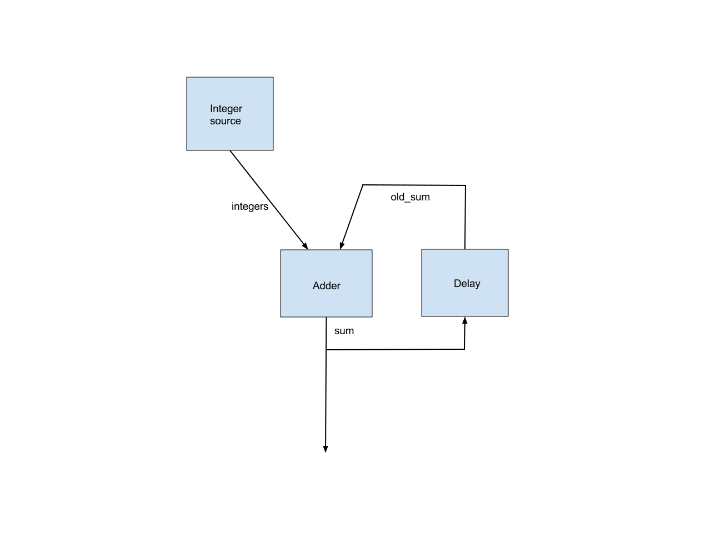

# 计算图 (Graphs)

> 本文译自官方文档:[原文链接](https://developers.google.com/edge/mediapipe/framework/framework_concepts/graphs)
> 为保持内容与版式一致,图片位置、章节顺序、代码示例均与原页对齐。

## 计算图 (Graph)

`CalculatorGraphConfig` proto 指定了 MediaPipe 计算图(框架语境 graph)的拓扑结构与功能。计算图中的每个 `node`(节点)代表一个特定的计算器(calculator)或子图(subgraph),并指定必要的配置,如已注册的计算器/子图类型、输入、输出,以及可选字段(如节点专属选项、输入策略(input policy)和执行器(executor)),详见 [Synchronization(同步)](synchronization.md)。

`CalculatorGraphConfig` 还有若干其他字段用于配置全局的计算图级设置,例如计算图执行器配置、线程数、输入流的最大队列大小。一些计算图级设置对于在不同平台(例如桌面端与移动端)上调优计算图性能很有用。例如,在移动端,把重型模型推理计算器挂载到独立的执行器上可以提高实时应用的性能,因为这能够实现线程局部性(thread locality)。

下面是一个简单的 `CalculatorGraphConfig` 示例,其中包含一系列直通计算器(passthrough calculators):

```
# This graph named main_pass_throughcals_nosubgraph.pbtxt contains 4
# passthrough calculators.
# 该计算图名为 main_pass_throughcals_nosubgraph.pbtxt,包含 4 个直通计算器。
input_stream: "in"
output_stream: "out"
node {
    calculator: "PassThroughCalculator"
    input_stream: "in"
    output_stream: "out1"
}
node {
    calculator: "PassThroughCalculator"
    input_stream: "out1"
    output_stream: "out2"
}
node {
    calculator: "PassThroughCalculator"
    input_stream: "out2"
    output_stream: "out3"
}
node {
    calculator: "PassThroughCalculator"
    input_stream: "out3"
    output_stream: "out"
}
```

MediaPipe 为复杂计算图(例如 ML 流水线、模型元数据处理、可选节点等)提供了另一种 `C++` 表示形式。上述计算图可以表示为:

```
CalculatorGraphConfig BuildGraphConfig() {
  Graph graph;

  // Graph inputs
  // 计算图输入
  Stream<AnyType> in = graph.In(0).SetName("in");

  auto pass_through_fn = [](Stream<AnyType> in,
                            Graph& graph) -> Stream<AnyType> {
    auto& node = graph.AddNode("PassThroughCalculator");
    in.ConnectTo(node.In(0));
    return node.Out(0);
  };

  Stream<AnyType> out1 = pass_through_fn(in, graph);
  Stream<AnyType> out2 = pass_through_fn(out1, graph);
  Stream<AnyType> out3 = pass_through_fn(out2, graph);
  Stream<AnyType> out4 = pass_through_fn(out3, graph);

  // Graph outputs
  // 计算图输出
  out4.SetName("out").ConnectTo(graph.Out(0));

  return graph.GetConfig();
}
```

更多详细信息见 [使用 C++ 构建计算图 (Building Graphs in C++)](graphs_cpp.md)。

## 子图 (Subgraph)

为了把 `CalculatorGraphConfig` 模块化为子模块并便于感知解决方案的重用,MediaPipe 计算图可以被定义为一个 `Subgraph`(子图)。子图的公共接口由一组输入流和输出流组成,与计算器的公共接口类似。随后,子图可以像计算器一样被包含在 `CalculatorGraphConfig` 中。当从一个 `CalculatorGraphConfig` 加载 MediaPipe 计算图时,每个子图节点都会被替换为对应的计算器计算图。因此,子图的语义和性能与对应的计算器计算图完全相同。

下面是一个创建名为 `TwoPassThroughSubgraph` 的子图的示例。

1.  定义子图。

    ```
    # This subgraph is defined in two_pass_through_subgraph.pbtxt
    # and is registered as "TwoPassThroughSubgraph"
    # 该子图定义于 two_pass_through_subgraph.pbtxt,
    # 注册为 "TwoPassThroughSubgraph"。

    type: "TwoPassThroughSubgraph"
    input_stream: "out1"
    output_stream: "out3"

    node {
        calculator: "PassThroughCalculator"
        input_stream: "out1"
        output_stream: "out2"
    }
    node {
        calculator: "PassThroughCalculator"
        input_stream: "out2"
        output_stream: "out3"
    }
    ```

    子图的公共接口由以下部分组成:

    -   计算图输入流
    -   计算图输出流
    -   计算图输入边包(旁路数据包)
    -   计算图输出边包(旁路数据包)

2.  使用 BUILD 规则 `mediapipe_simple_subgraph` 注册子图。参数 `register_as` 定义新子图的组件名。

    ```
    # Small section of BUILD file for registering the "TwoPassThroughSubgraph"
    # subgraph for use by main graph main_pass_throughcals.pbtxt
    # BUILD 文件片段,用于注册 "TwoPassThroughSubgraph" 子图,
    # 供主计算图 main_pass_throughcals.pbtxt 使用。

    mediapipe_simple_subgraph(
        name = "twopassthrough_subgraph",
        graph = "twopassthrough_subgraph.pbtxt",
        register_as = "TwoPassThroughSubgraph",
        deps = [
                "//mediapipe/calculators/core:pass_through_calculator",
                "//mediapipe/framework:calculator_graph",
        ],
    )
    ```

3.  在主计算图中使用该子图。

    ```
    # This main graph is defined in main_pass_throughcals.pbtxt
    # using subgraph called "TwoPassThroughSubgraph"
    # 该主计算图定义于 main_pass_throughcals.pbtxt,
    # 使用名为 "TwoPassThroughSubgraph" 的子图。

    input_stream: "in"
    node {
        calculator: "PassThroughCalculator"
        input_stream: "in"
        output_stream: "out1"
    }
    node {
        calculator: "TwoPassThroughSubgraph"
        input_stream: "out1"
        output_stream: "out3"
    }
    node {
        calculator: "PassThroughCalculator"
        input_stream: "out3"
        output_stream: "out4"
    }
    ```

## 计算图选项 (Graph Options)

可以为 MediaPipe 计算图指定一个 "graph options"(计算图选项)protobuf,类似于为 MediaPipe 计算器指定的 [`Calculator Options`(计算器选项)](calculators.md#calculator-options) protobuf。这些 "graph options" 可以在调用计算图的位置指定,并用于填充计算图内的计算器选项和子图选项。

在 `CalculatorGraphConfig` 中,可以像指定计算器选项一样为子图指定计算图选项,如下所示:

```
node {
  calculator: "FlowLimiterCalculator"
  input_stream: "image"
  output_stream: "throttled_image"
  node_options: {
    [type.googleapis.com/mediapipe.FlowLimiterCalculatorOptions] {
      max_in_flight: 1
    }
  }
}

node {
  calculator: "FaceDetectionSubgraph"
  input_stream: "IMAGE:throttled_image"
  node_options: {
    [type.googleapis.com/mediapipe.FaceDetectionOptions] {
      tensor_width: 192
      tensor_height: 192
    }
  }
}
```

在 `CalculatorGraphConfig` 中,可以接受计算图选项并使用它们来填充计算器选项,如下所示:

```
graph_options: {
  [type.googleapis.com/mediapipe.FaceDetectionOptions] {}
}

node: {
  calculator: "ImageToTensorCalculator"
  input_stream: "IMAGE:image"
  node_options: {
    [type.googleapis.com/mediapipe.ImageToTensorCalculatorOptions] {
        keep_aspect_ratio: true
        border_mode: BORDER_ZERO
    }
  }
  option_value: "output_tensor_width:options/tensor_width"
  option_value: "output_tensor_height:options/tensor_height"
}

node {
  calculator: "InferenceCalculator"
  node_options: {
    [type.googleapis.com/mediapipe.InferenceCalculatorOptions] {}
  }
  option_value: "delegate:options/delegate"
  option_value: "model_path:options/model_path"
}
```

在此示例中,`FaceDetectionSubgraph` 接受计算图选项 protobuf `FaceDetectionOptions`。`FaceDetectionOptions` 用于定义计算器选项 `ImageToTensorCalculatorOptions` 中的一些字段值,以及子图选项 `InferenceCalculatorOptions` 中的一些字段值。这些字段值使用 `option_value:` 语法定义。

在 `CalculatorGraphConfig::Node` protobuf 中,`node_options:` 与 `option_value:` 字段共同定义了一个计算器(如 `ImageToTensorCalculator`)的选项值。`node_options:` 字段使用文本 protobuf 语法定义一组字面常量值。每个 `option_value:` 字段使用来自所在计算图的信息——具体来说是所在计算图的计算图选项字段值——为一个 protobuf 字段定义值。在上面的示例中,`option_value:` `"output_tensor_width:options/tensor_width"` 使用 `FaceDetectionOptions.tensor_width` 的值定义了字段 `ImageToTensorCalculatorOptions.output_tensor_width`。

`option_value:` 的语法类似于 `input_stream:` 的语法。其语法为 `option_value: "LHS:RHS"`。LHS 标识一个计算器选项字段,RHS 标识一个计算图选项字段。更具体地说,LHS 与 RHS 各自由一串用 '/' 分隔的 protobuf 字段名组成,用于标识嵌套的 protobuf 消息与字段。这被称为 "ProtoPath" 语法。LHS 或 RHS 中引用的嵌套消息必须已在所在 protobuf 中定义,才能通过 `option_value:` 进行遍历。

## 循环 (Cycles)

默认情况下,MediaPipe 要求计算器计算图是无环的,并将图中的循环视为错误。如果计算图有意包含循环,则需要在图配置中注明这些循环。本页介绍如何做到这一点。

> **注意:** 当前方法仍是实验性的,可能会发生变化。我们欢迎您的反馈。

请使用 `mediapipe/framework/calculator_graph_test.cc` 中的 `CalculatorGraphTest.Cycle` 单元测试作为示例代码。下方为测试中的循环计算图。加法器的 `sum` 输出是整数源计算器生成的整数之和。



这个简单的计算图展示了支持循环计算图的所有问题。

### 回边标注 (Back Edge Annotation)

我们要求每个循环中的一条边被标注为回边(back edge)。这样,在移除所有回边之后,MediaPipe 的拓扑排序就可以正常工作。

通常有多种方式来选择回边。哪些边被标记为回边会影响哪些节点被视为上游节点、哪些节点被视为下游节点,进而影响 MediaPipe 分配给各节点的优先级。

例如,`CalculatorGraphTest.Cycle` 测试将 `old_sum` 边标记为回边,因此 Delay 节点被视为加法器节点的下游节点,并获得更高的优先级。或者,我们也可以把 delay 节点的 `sum` 输入标记为回边,在这种情况下,delay 节点将被视为加法器节点的上游节点并获得较低的优先级。

### 初始数据包 (Initial Packet)

为了使加法器计算器在整数源的第一个整数到达时可运行,我们需要在加法器的 `old_sum` 输入流上有一个初始数据包,其值为 0 且带有相同的时间戳。这个初始数据包应由 delay 计算器在 `Open()` 方法中输出。

### 循环中的延迟 (Delay in a Loop)

每个循环都应该引入延迟,以使上一个 `sum` 输出与下一个整数输入对齐。这也是由 delay 节点完成的。因此,delay 节点需要知道整数源计算器的以下时间戳信息:

-   第一个输出的时间戳。

-   连续输出之间的时间戳增量。

我们计划添加一种仅关心数据包顺序而忽略数据包时间戳的替代调度策略,这将消除这一不便。

### 当一个输入流结束时提前终止计算器 (Early Termination of a Calculator When One Input Stream is Done)

默认情况下,当非源计算器的所有输入流都结束时,MediaPipe 会调用该计算器的 `Close()` 方法。在示例计算图中,我们希望在整数源一结束就立即停止加法器节点。这通过为加法器节点配置替代输入流处理器 `EarlyCloseInputStreamHandler` 来实现。

### 相关源码 (Relevant Source Code)

#### Delay 计算器 (Delay Calculator)

注意 `Open()` 中输出初始数据包的代码,以及 `Process()` 中为输入数据包添加(单位)延迟的代码。如上所述,这个 delay 节点假定其输出流与一个数据包时间戳为 0, 1, 2, 3, ... 的输入流一起使用。

```
class UnitDelayCalculator : public Calculator {
 public:
  static absl::Status FillExpectations(
      const CalculatorOptions& extendable_options, PacketTypeSet* inputs,
      PacketTypeSet* outputs, PacketTypeSet* input_side_packets) {
    inputs->Index(0)->Set<int>("An integer.");
    outputs->Index(0)->Set<int>("The input delayed by one time unit.");
    return absl::OkStatus();
  }

  absl::Status Open() final {
    Output()->Add(new int(0), Timestamp(0));
    return absl::OkStatus();
  }

  absl::Status Process() final {
    const Packet& packet = Input()->Value();
    Output()->AddPacket(packet.At(packet.Timestamp().NextAllowedInStream()));
    return absl::OkStatus();
  }
};
```

#### 图配置 (Graph Config)

注意 `back_edge` 标注和替代 `input_stream_handler`。

```
node {
  calculator: 'GlobalCountSourceCalculator'
  input_side_packet: 'global_counter'
  output_stream: 'integers'
}
node {
  calculator: 'IntAdderCalculator'
  input_stream: 'integers'
  input_stream: 'old_sum'
  input_stream_info: {
    tag_index: ':1'  # 'old_sum'
    back_edge: true
  }
  output_stream: 'sum'
  input_stream_handler {
    input_stream_handler: 'EarlyCloseInputStreamHandler'
  }
}
node {
  calculator: 'UnitDelayCalculator'
  input_stream: 'sum'
  output_stream: 'old_sum'
}
```

---

*页面内容遵循 [CC BY 4.0](https://creativecommons.org/licenses/by/4.0/) 许可;代码示例遵循 [Apache 2.0](https://www.apache.org/licenses/LICENSE-2.0) 许可。*