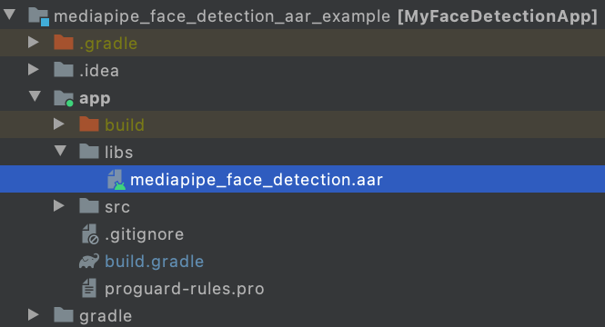
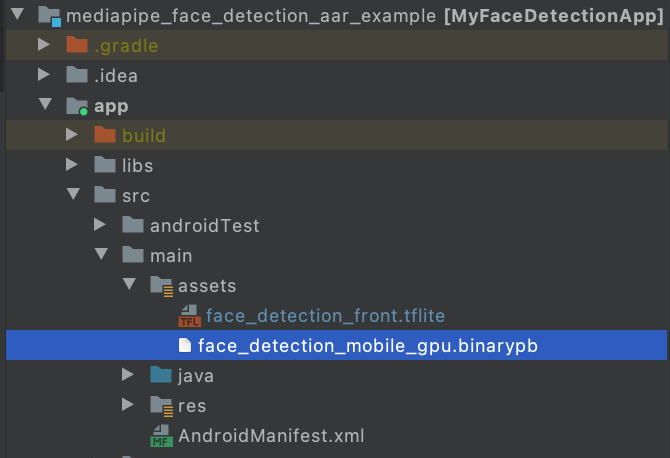

# MediaPipe Framework Android 归档库 (MediaPipe Framework Android Archive)

> 本文译自官方文档:[原文链接](https://developers.google.com/edge/mediapipe/framework/getting_started/android_archive_library)
> 为保持内容与版式一致,图片位置、章节顺序、代码示例均与原页对齐。

MediaPipe Framework Android Archive(AAR)库是在 Android Studio 和 Gradle 中使用 MediaPipe Framework 的一种便捷方式。MediaPipe Framework 不会发布一个可供所有项目使用的通用 AAR。相反,开发者需要创建一个 mediapipe\_aar() 目标,为各自的项目生成自定义的 AAR 文件。这是必要的,因为每个项目都需要包含特定的资源,例如项目所需的 MediaPipe 计算器(calculator)。

## 构建 MediaPipe Framework AAR 的步骤

1. 创建一个 mediapipe\_aar() 目标。

   在 MediaPipe 目录中,在一个 BUILD 文件中创建新的 mediapipe\_aar() 目标。你需要弄清楚计算图中使用了哪些计算器,并把计算器依赖提供给 mediapipe\_aar()。例如,要为一个人脸检测计算图构建 AAR,你可以把以下代码放到 mediapipe/examples/android/src/java/com/google/mediapipe/apps/aar\_example/BUILD 中。

   ```
   load("//mediapipe/java/com/google/mediapipe:mediapipe_aar.bzl", "mediapipe_aar")

   mediapipe_aar(
       name = "mediapipe_face_detection",
       calculators = ["//mediapipe/graphs/face_detection:mobile_calculators"],
   )
   ```
2. 运行 Bazel 构建命令以生成 AAR。

   ```
   bazel build -c opt --strip=ALWAYS \
       --host_crosstool_top=@bazel_tools//tools/cpp:toolchain \
       --fat_apk_cpu=arm64-v8a,armeabi-v7a \
       --legacy_whole_archive=0 \
       --features=-legacy_whole_archive \
       --copt=-fvisibility=hidden \
       --copt=-ffunction-sections \
       --copt=-fdata-sections \
       --copt=-fstack-protector \
       --copt=-Oz \
       --copt=-fomit-frame-pointer \
       --copt=-DABSL_MIN_LOG_LEVEL=2 \
       --linkopt=-Wl,--gc-sections,--strip-all \
       //path/to/the/aar/build/file:aar_name.aar
   ```

   对于我们在第 1 步中创建的这个人脸检测 AAR 目标,运行:

   ```
   bazel build -c opt --strip=ALWAYS \
       --host_crosstool_top=@bazel_tools//tools/cpp:toolchain \
       --fat_apk_cpu=arm64-v8a,armeabi-v7a \
       --legacy_whole_archive=0 \
       --features=-legacy_whole_archive \
       --copt=-fvisibility=hidden \
       --copt=-ffunction-sections \
       --copt=-fdata-sections \
       --copt=-fstack-protector \
       --copt=-Oz \
       --copt=-fomit-frame-pointer \
       --copt=-DABSL_MIN_LOG_LEVEL=2 \
       --linkopt=-Wl,--gc-sections,--strip-all \
       //mediapipe/examples/android/src/java/com/google/mediapipe/apps/aar_example:mediapipe_face_detection.aar

   # 它应当打印:
   # Target //mediapipe/examples/android/src/java/com/google/mediapipe/apps/aar_example:mediapipe_face_detection.aar up-to-date:
   # bazel-bin/mediapipe/examples/android/src/java/com/google/mediapipe/apps/aar_example/mediapipe_face_detection.aar
   ```
3. (可选)把 AAR 保存到你喜欢的位置。

   ```
   cp bazel-bin/mediapipe/examples/android/src/java/com/google/mediapipe/apps/aar_example/mediapipe_face_detection.aar
   /absolute/path/to/your/preferred/location
   ```

## 在 Android Studio 中通过 Gradle 使用 MediaPipe Framework AAR 的步骤

1. 启动 Android Studio 并进入你的项目。
2. 把 AAR 复制到 app/libs 中。

   ```
   cp bazel-bin/mediapipe/examples/android/src/java/com/google/mediapipe/apps/aar_example/mediapipe_face_detection.aar
   /path/to/your/app/libs/
   ```

   
3. 创建 app/src/main/assets 目录,并把资源(计算图、模型等)复制到 app/src/main/assets 中。

   构建 MediaPipe 二进制计算图,并把资源复制到 app/src/main/assets 中。例如,对于人脸检测计算图,你需要构建并复制[二进制计算图](https://github.com/google/mediapipe/blob/master/mediapipe/examples/android/src/java/com/google/mediapipe/apps/facedetectiongpu/BUILD#L41)以及人脸检测 tflite 模型。

   ```
   bazel build -c opt mediapipe/graphs/face_detection:face_detection_mobile_gpu_binary_graph
   cp bazel-bin/mediapipe/graphs/face_detection/face_detection_mobile_gpu.binarypb /path/to/your/app/src/main/assets/
   cp mediapipe/modules/face_detection/face_detection_short_range.tflite /path/to/your/app/src/main/assets/
   ```

   
4. 修改 app/build.gradle,添加 MediaPipe 依赖和 MediaPipe AAR。

   ```
   dependencies {
       implementation fileTree(dir: 'libs', include: ['*.jar', '*.aar'])
       implementation 'androidx.appcompat:appcompat:1.0.2'
       implementation 'androidx.constraintlayout:constraintlayout:1.1.3'
       testImplementation 'junit:junit:4.12'
       androidTestImplementation 'androidx.test.ext:junit:1.1.0'
       androidTestImplementation 'androidx.test.espresso:espresso-core:3.1.1'
       // MediaPipe deps
       implementation 'com.google.flogger:flogger:latest.release'
       implementation 'com.google.flogger:flogger-system-backend:latest.release'
       implementation 'com.google.code.findbugs:jsr305:latest.release'
       implementation 'com.google.guava:guava:27.0.1-android'
       implementation 'com.google.protobuf:protobuf-javalite:3.19.1'
       // CameraX core library
       def camerax_version = "1.0.0-beta10"
       implementation "androidx.camera:camera-core:$camerax_version"
       implementation "androidx.camera:camera-camera2:$camerax_version"
       implementation "androidx.camera:camera-lifecycle:$camerax_version"
       // AutoValue
       def auto_value_version = "1.8.1"
       implementation "com.google.auto.value:auto-value-annotations:$auto_value_version"
       annotationProcessor "com.google.auto.value:auto-value:$auto_value_version"
   }
   ```
5. 参考我们的 Android 应用示例,在 Android Studio 中针对你的用例使用 MediaPipe。如果你在寻找示例,人脸检测示例可以[在这里](https://github.com/jiuqiant/mediapipe_face_detection_aar_example)找到,多手部跟踪示例可以[在这里](https://github.com/jiuqiant/mediapipe_multi_hands_tracking_aar_example)找到。

---

*页面内容遵循 [CC BY 4.0](https://creativecommons.org/licenses/by/4.0/) 许可;代码示例遵循 [Apache 2.0](https://www.apache.org/licenses/LICENSE-2.0) 许可。*