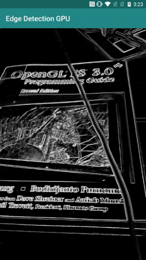
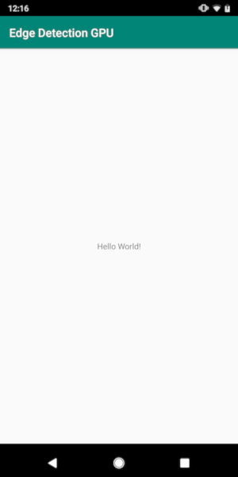
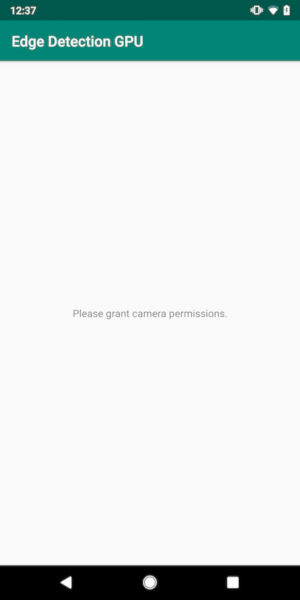

# Android 上的 Hello World!(Hello World! on Android)

> 本文译自官方文档:[原文链接](https://developers.google.com/edge/mediapipe/framework/getting_started/hello_world_android)
> 为保持内容与版式一致,图片位置、章节顺序、代码示例均与原页对齐。

## 简介

本 Hello World!(入门示例)教程使用 MediaPipe Framework(框架)开发一个在 Android 上运行 MediaPipe 计算图(graph)的 Android 应用。

### 你将构建什么

一个简单的相机应用,在 Android 设备上对实时视频流执行实时的 Sobel 边缘检测。



## 环境配置

1.  在你的系统上安装 MediaPipe Framework,详见[框架安装指南](install.md)。
2.  安装 Android Development SDK 和 Android NDK。如何安装同样参见[框架安装指南](install.md)。
3.  在你的 Android 设备上启用[开发者选项](https://developer.android.com/studio/debug/dev-options)。
4.  在你的系统上配置 [Bazel](https://bazel.build/),用于构建和部署 Android 应用。

## 边缘检测计算图

我们将使用下面的计算图,[`edge_detection_mobile_gpu.pbtxt`](https://github.com/google/mediapipe/tree/master/mediapipe/graphs/edge_detection/edge_detection_mobile_gpu.pbtxt):

```
# MediaPipe graph that performs GPU Sobel edge detection on a live video stream.
# Used in the examples in
# mediapipe/examples/android/src/java/com/mediapipe/apps/basic and
# mediapipe/examples/ios/edgedetectiongpu.

# Images coming into and out of the graph.
input_stream: "input_video"
output_stream: "output_video"

# Converts RGB images into luminance images, still stored in RGB format.
node: {
  calculator: "LuminanceCalculator"
  input_stream: "input_video"
  output_stream: "luma_video"
}

# Applies the Sobel filter to luminance images stored in RGB format.
node: {
  calculator: "SobelEdgesCalculator"
  input_stream: "luma_video"
  output_stream: "output_video"
}
```

该计算图的可视化效果如下所示:


该计算图有一个名为 `input_video` 的单一输入流,用于接收所有来自设备相机的输入帧。

计算图中的第一个节点 `LuminanceCalculator` 接收单个数据包(packet)(图像帧),并使用 OpenGL 着色器进行亮度变换。处理后的图像帧被发送到 `luma_video` 输出流。

第二个节点 `SobelEdgesCalculator` 对来自 `luma_video` 流的输入数据包执行边缘检测,并将结果输出到 `output_video` 输出流。

我们的 Android 应用将显示 `output_video` 流的输出图像帧。

## 初始的最简应用配置

我们首先从一个在屏幕上显示 "Hello World!" 文本的简单 Android 应用开始。如果你已经熟悉使用 `bazel` 构建 Android 应用,可以跳过此步骤。

创建一个新目录,用于存放你要创建的 Android 应用。例如,本教程的完整代码位于 `mediapipe/examples/android/src/java/com/google/mediapipe/apps/basic`。在整篇教程中,我们将该路径称为 `$APPLICATION_PATH`。

请注意应用路径中的:

-   应用名为 `helloworld`。
-   应用的 `$PACKAGE_PATH` 为 `com.google.mediapipe.apps.basic`。这会在本教程的代码片段中使用,因此当你复制/使用这些代码片段时,请记得使用你自己的 `$PACKAGE_PATH`。

在 `$APPLICATION_PATH/res/layout` 中添加文件 `activity_main.xml`。该文件在应用的整个屏幕上显示一个包含字符串 `Hello World!` 的 [`TextView`](https://developer.android.com/reference/android/widget/TextView):

```
<?xml version="1.0" encoding="utf-8"?>
<android.support.constraint.ConstraintLayout xmlns:android="http://schemas.android.com/apk/res/android"
    xmlns:app="http://schemas.android.com/apk/res-auto"
    xmlns:tools="http://schemas.android.com/tools"
    android:layout_width="match_parent"
    android:layout_height="match_parent">

  <TextView
    android:layout_width="wrap_content"
    android:layout_height="wrap_content"
    android:text="Hello World!"
    app:layout_constraintBottom_toBottomOf="parent"
    app:layout_constraintLeft_toLeftOf="parent"
    app:layout_constraintRight_toRightOf="parent"
    app:layout_constraintTop_toTopOf="parent" />

</android.support.constraint.ConstraintLayout>
```

在 `$APPLICATION_PATH` 中添加一个简单的 `MainActivity.java`,用于加载 `activity_main.xml` 布局的内容,如下所示:

```
package com.google.mediapipe.apps.basic;

import android.os.Bundle;
import androidx.appcompat.app.AppCompatActivity;

/** Bare-bones main activity. */
public class MainActivity extends AppCompatActivity {

  @Override
  protected void onCreate(Bundle savedInstanceState) {
    super.onCreate(savedInstanceState);
    setContentView(R.layout.activity_main);
  }
}
```

在 `$APPLICATION_PATH` 中添加清单文件 `AndroidManifest.xml`,用于在应用启动时启动 `MainActivity`:

```
<?xml version="1.0" encoding="utf-8"?>
<manifest xmlns:android="http://schemas.android.com/apk/res/android"
    package="com.google.mediapipe.apps.basic">

  <uses-sdk
      android:minSdkVersion="19"
      android:targetSdkVersion="19" />

  <application
      android:allowBackup="true"
      android:label="${appName}"
      android:supportsRtl="true"
      android:theme="@style/AppTheme">
      <activity
          android:name="${mainActivity}"
          android:exported="true"
          android:screenOrientation="portrait">
          <intent-filter>
              <action android:name="android.intent.action.MAIN" />
              <category android:name="android.intent.category.LAUNCHER" />
          </intent-filter>
      </activity>
  </application>

</manifest>
```

在我们的应用中使用了 `Theme.AppCompat` 主题,因此需要相应的主题引用。在 `$APPLICATION_PATH/res/values/` 中添加 `colors.xml`:

```
<?xml version="1.0" encoding="utf-8"?>
<resources>
    <color name="colorPrimary">#008577</color>
    <color name="colorPrimaryDark">#00574B</color>
    <color name="colorAccent">#D81B60</color>
</resources>
```

在 `$APPLICATION_PATH/res/values/` 中添加 `styles.xml`:

```
<resources>

    <!-- Base application theme. -->
    <style name="AppTheme" parent="Theme.AppCompat.Light.DarkActionBar">
        <!-- Customize your theme here. -->
        <item name="colorPrimary">@color/colorPrimary</item>
        <item name="colorPrimaryDark">@color/colorPrimaryDark</item>
        <item name="colorAccent">@color/colorAccent</item>
    </style>

</resources>
```

要构建该应用,请在 `$APPLICATION_PATH` 中添加 `BUILD` 文件,清单中的 `${appName}` 和 `${mainActivity}` 将被替换为 `BUILD` 中指定的字符串,如下所示:

```
android_library(
    name = "basic_lib",
    srcs = glob(["*.java"]),
    manifest = "AndroidManifest.xml",
    resource_files = glob(["res/**"]),
    deps = [
        "@maven//:androidx_appcompat_appcompat",
        "@maven//:androidx_constraintlayout_constraintlayout",
    ],
)

android_binary(
    name = "helloworld",
    manifest = "AndroidManifest.xml",
    manifest_values = {
        "applicationId": "com.google.mediapipe.apps.basic",
        "appName": "Hello World",
        "mainActivity": ".MainActivity",
    },
    multidex = "native",
    deps = [
        ":basic_lib",
    ],
)
```

`android_library` 规则为 `MainActivity`、资源文件和 `AndroidManifest.xml` 添加依赖。

`android_binary` 规则使用生成的 `basic_lib` Android 库来构建一个二进制 APK,用于安装到你的 Android 设备上。

要构建该应用,请使用以下命令:

```
bazel build -c opt --config=android_arm64 $APPLICATION_PATH:helloworld
```

使用 `adb install` 安装生成的 APK 文件。例如:

```
adb install bazel-bin/$APPLICATION_PATH/helloworld.apk
```

在你的设备上打开该应用。它应该会显示一个带有文本 `Hello World!` 的屏幕。



## 通过 `CameraX` 使用相机

### 相机权限

要在我们的应用中使用相机,我们需要请求用户授予相机访问权限。要请求相机权限,请在 `AndroidManifest.xml` 中添加以下内容:

```
<!-- For using the camera -->
<uses-permission android:name="android.permission.CAMERA" />
<uses-feature android:name="android.hardware.camera" />
```

在同一个文件中,将最低 SDK 版本改为 `21`,目标 SDK 版本改为 `27`:

```
<uses-sdk
    android:minSdkVersion="21"
    android:targetSdkVersion="27" />
```

这样可以确保用户被提示请求相机权限,并使我们能够使用 [CameraX](https://developer.android.com/training/camerax) 库进行相机访问。

要请求相机权限,我们可以使用 MediaPipe Framework(框架)组件提供的一个工具,即 [`PermissionHelper`](https://github.com/google/mediapipe/tree/master/mediapipe/java/com/google/mediapipe/components/PermissionHelper.java)。要使用它,请在 `BUILD` 的 `mediapipe_lib` 规则中添加依赖 `"//mediapipe/java/com/google/mediapipe/components:android_components"`。

要在 `MainActivity` 中使用 `PermissionHelper`,请在 `onCreate` 函数中添加以下一行代码:

```
PermissionHelper.checkAndRequestCameraPermissions(this);
```

这会在屏幕上向用户弹出一个对话框,请求授予该应用使用相机的权限。

添加以下代码来处理用户的响应:

```
@Override
public void onRequestPermissionsResult(
    int requestCode, String[] permissions, int[] grantResults) {
  super.onRequestPermissionsResult(requestCode, permissions, grantResults);
  PermissionHelper.onRequestPermissionsResult(requestCode, permissions, grantResults);
}

@Override
protected void onResume() {
  super.onResume();
  if (PermissionHelper.cameraPermissionsGranted(this)) {
    startCamera();
  }
}

public void startCamera() {}
```

我们暂时将 `startCamera()` 方法留空。当用户响应提示后,`MainActivity` 将恢复执行并调用 `onResume()`。代码将确认使用相机的权限已被授予,然后启动相机。

重新构建并安装该应用。你现在应该会看到一个请求该应用访问相机的提示。

> **注意:** 如果没有出现对话框提示,请卸载并重新安装应用。如果你没有修改 `AndroidManifest.xml` 文件中的 `minSdkVersion` 和 `targetSdkVersion`,也可能会出现这种情况。

### 相机访问

有了相机权限后,我们就可以开始从相机获取帧了。

为了查看相机的帧,我们将使用一个 [`SurfaceView`](https://developer.android.com/reference/android/view/SurfaceView)。相机中的每一帧都将存储在一个 [`SurfaceTexture`](https://developer.android.com/reference/android/graphics/SurfaceTexture) 对象中。要使用它们,我们首先需要更改应用的布局。

从 `$APPLICATION_PATH/res/layout/activity_main.xml` 中删除整个 [`TextView`](https://developer.android.com/reference/android/widget/TextView) 代码块,并添加以下代码:

```
<FrameLayout
    android:id="@+id/preview_display_layout"
    android:layout_width="fill_parent"
    android:layout_height="fill_parent"
    android:layout_weight="1">
    <TextView
        android:id="@+id/no_camera_access_view"
        android:layout_height="fill_parent"
        android:layout_width="fill_parent"
        android:gravity="center"
        android:text="@string/no_camera_access" />
</FrameLayout>
```

该代码块包含一个名为 `preview_display_layout` 的新 [`FrameLayout`](https://developer.android.com/reference/android/widget/FrameLayout),以及嵌套在其中的一个 [`TextView`](https://developer.android.com/reference/android/widget/TextView),名为 `no_camera_access_preview`。当相机访问权限未被授予时,我们的应用将显示这个 [`TextView`](https://developer.android.com/reference/android/widget/TextView),其中的消息字符串存储在变量 `no_camera_access` 中。在 `$APPLICATION_PATH/res/values/strings.xml` 文件中添加以下一行:

```
<string name="no_camera_access" translatable="false">Please grant camera permissions.</string>
```

当用户未授予相机权限时,屏幕将如下所示:



现在,我们将 [`SurfaceTexture`](https://developer.android.com/reference/android/graphics/SurfaceTexture) 和 [`SurfaceView`](https://developer.android.com/reference/android/view/SurfaceView) 对象添加到 `MainActivity`:

```
private SurfaceTexture previewFrameTexture;
private SurfaceView previewDisplayView;
```

在 `onCreate(Bundle)` 函数中,在请求相机权限*之前*添加以下两行代码:

```
previewDisplayView = new SurfaceView(this);
setupPreviewDisplayView();
```

现在添加定义 `setupPreviewDisplayView()` 的代码:

```
private void setupPreviewDisplayView() {
  previewDisplayView.setVisibility(View.GONE);
  ViewGroup viewGroup = findViewById(R.id.preview_display_layout);
  viewGroup.addView(previewDisplayView);
}
```

我们定义一个新的 [`SurfaceView`](https://developer.android.com/reference/android/view/SurfaceView) 对象,并将其添加到 `preview_display_layout` [`FrameLayout`](https://developer.android.com/reference/android/widget/FrameLayout) 对象中,这样我们就可以使用名为 `previewFrameTexture` 的 [`SurfaceTexture`](https://developer.android.com/reference/android/graphics/SurfaceTexture) 对象来显示相机帧。

为了使用 `previewFrameTexture` 获取相机帧,我们将使用 [CameraX](https://developer.android.com/training/camerax)。框架提供一个名为 [`CameraXPreviewHelper`](https://github.com/google/mediapipe/tree/master/mediapipe/java/com/google/mediapipe/components/CameraXPreviewHelper.java) 的工具来使用 [CameraX](https://developer.android.com/training/camerax)。该类在相机通过 `onCameraStarted(@Nullable SurfaceTexture)` 启动时会更新一个监听器。

要使用这个工具,请修改 `BUILD` 文件,添加对 `"//mediapipe/java/com/google/mediapipe/components:android_camerax_helper"` 的依赖。

现在导入 [`CameraXPreviewHelper`](https://github.com/google/mediapipe/tree/master/mediapipe/java/com/google/mediapipe/components/CameraXPreviewHelper.java),并在 `MainActivity` 中添加以下一行:

```
private CameraXPreviewHelper cameraHelper;
```

现在,我们可以在 `startCamera()` 中添加实现:

```
public void startCamera() {
  cameraHelper = new CameraXPreviewHelper();
  cameraHelper.setOnCameraStartedListener(
    surfaceTexture -> {
      previewFrameTexture = surfaceTexture;
      // Make the display view visible to start showing the preview.
      previewDisplayView.setVisibility(View.VISIBLE);
    });
}
```

这会创建一个新的 [`CameraXPreviewHelper`](https://github.com/google/mediapipe/tree/master/mediapipe/java/com/google/mediapipe/components/CameraXPreviewHelper.java) 对象,并在该对象上添加一个匿名监听器。当 `cameraHelper` 发出信号表示相机已启动并且有可用于获取帧的 `surfaceTexture` 时,我们将该 `surfaceTexture` 保存为 `previewFrameTexture`,并使 `previewDisplayView` 可见,这样我们就可以开始看到来自 `previewFrameTexture` 的帧。

但是,在启动相机之前,我们需要决定使用哪个相机。[`CameraXPreviewHelper`](https://github.com/google/mediapipe/tree/master/mediapipe/java/com/google/mediapipe/components/CameraXPreviewHelper.java) 继承自 [`CameraHelper`](https://github.com/google/mediapipe/tree/master/mediapipe/java/com/google/mediapipe/components/CameraHelper.java),后者提供两个选项:`FRONT` 和 `BACK`。我们可以通过 `BUILD` 文件将选择作为元数据传入,这样构建使用不同相机的应用版本时无需修改代码。

假设我们要使用 `BACK` 相机对从相机看到的实时场景进行边缘检测,请在 `AndroidManifest.xml` 中添加元数据:

      ```
      ...
      <meta-data android:name="cameraFacingFront" android:value="${cameraFacingFront}"/>
  </application>
</manifest>
```

并在 `BUILD` 的 `helloworld` android 二进制规则中,通过 `manifest_values` 的新条目来指定选择:

```
manifest_values = {
    "applicationId": "com.google.mediapipe.apps.basic",
    "appName": "Hello World",
    "mainActivity": ".MainActivity",
    "cameraFacingFront": "False",
},
```

现在,在 `MainActivity` 中,为了检索 `manifest_values` 中指定的元数据,添加一个 [`ApplicationInfo`](https://developer.android.com/reference/android/content/pm/ApplicationInfo) 对象:

```
private ApplicationInfo applicationInfo;
```

在 `onCreate()` 函数中,添加:

```
try {
  applicationInfo =
      getPackageManager().getApplicationInfo(getPackageName(), PackageManager.GET_META_DATA);
} catch (NameNotFoundException e) {
  Log.e(TAG, "Cannot find application info: " + e);
}
```

现在在 `startCamera()` 函数的末尾添加以下一行:

```
CameraHelper.CameraFacing cameraFacing =
    applicationInfo.metaData.getBoolean("cameraFacingFront", false)
        ? CameraHelper.CameraFacing.FRONT
        : CameraHelper.CameraFacing.BACK;
cameraHelper.startCamera(this, cameraFacing, /*unusedSurfaceTexture=*/ null);
```

到此为止,应用应该可以成功构建了。但是,当你在设备上运行应用时,你会看到一个黑屏(即使相机权限已被授予)。这是因为即使我们保存了 [`CameraXPreviewHelper`](https://github.com/google/mediapipe/tree/master/mediapipe/java/com/google/mediapipe/components/CameraXPreviewHelper.java) 提供的 `surfaceTexture` 变量,`previewSurfaceView` 也还没有使用它的输出并将其显示在屏幕上。

由于我们计划在 MediaPipe 计算图中使用帧,本教程中不会添加直接查看相机输出的代码。相反,我们直接进入下一步:如何将相机帧发送给 MediaPipe 计算图进行处理,并在屏幕上显示计算图的输出。

## `ExternalTextureConverter` 配置

[`SurfaceTexture`](https://developer.android.com/reference/android/graphics/SurfaceTexture) 将来自数据流的图像帧捕获为 OpenGL ES 纹理。要使用 MediaPipe 计算图,从相机捕获的帧应存储在常规的 OpenGL 纹理对象中。框架提供了一个类,即 [`ExternalTextureConverter`](https://github.com/google/mediapipe/tree/master/mediapipe/java/com/google/mediapipe/components/ExternalTextureConverter.java),用于将存储在 [`SurfaceTexture`](https://developer.android.com/reference/android/graphics/SurfaceTexture) 对象中的图像转换为常规的 OpenGL 纹理对象。

要使用 [`ExternalTextureConverter`](https://github.com/google/mediapipe/tree/master/mediapipe/java/com/google/mediapipe/components/ExternalTextureConverter.java),我们还需要一个 `EGLContext`,它由 [`EglManager`](https://github.com/google/mediapipe/tree/master/mediapipe/java/com/google/mediapipe/glutil/EglManager.java) 对象创建和管理。在 `BUILD` 文件中添加一个依赖来使用 [`EglManager`](https://github.com/google/mediapipe/tree/master/mediapipe/java/com/google/mediapipe/glutil/EglManager.java),即 `"//mediapipe/java/com/google/mediapipe/glutil"`。

在 `MainActivity` 中添加以下声明:

```
private EglManager eglManager;
private ExternalTextureConverter converter;
```

在 `onCreate(Bundle)` 函数中,在请求相机权限之前添加一条语句来初始化 `eglManager` 对象:

```
eglManager = new EglManager(null);
```

回顾一下,我们在 `MainActivity` 中定义了 `onResume()` 函数,用于确认相机权限已被授予并调用 `startCamera()`。在此检查之前,在 `onResume()` 中添加以下一行来初始化 `converter` 对象:

```
converter = new ExternalTextureConverter(eglManager.getContext());
```

这个 `converter` 现在使用由 `eglManager` 管理的 `GLContext`。

我们还需要覆写 `MainActivity` 中的 `onPause()` 函数,这样当应用进入暂停状态时,我们可以正确关闭 `converter`:

```
@Override
protected void onPause() {
  super.onPause();
  converter.close();
}
```

要将 `previewFrameTexture` 的输出传递给 `converter`,请将以下代码块添加到 `setupPreviewDisplayView()`:

```
previewDisplayView
 .getHolder()
 .addCallback(
     new SurfaceHolder.Callback() {
       @Override
       public void surfaceCreated(SurfaceHolder holder) {}

       @Override
       public void surfaceChanged(SurfaceHolder holder, int format, int width, int height) {
         // (Re-)Compute the ideal size of the camera-preview display (the area that the
         // camera-preview frames get rendered onto, potentially with scaling and rotation)
         // based on the size of the SurfaceView that contains the display.
         Size viewSize = new Size(width, height);
         Size displaySize = cameraHelper.computeDisplaySizeFromViewSize(viewSize);

         // Connect the converter to the camera-preview frames as its input (via
         // previewFrameTexture), and configure the output width and height as the computed
         // display size.
         converter.setSurfaceTextureAndAttachToGLContext(
             previewFrameTexture, displaySize.getWidth(), displaySize.getHeight());
       }

       @Override
       public void surfaceDestroyed(SurfaceHolder holder) {}
     });
```

在这段代码块中,我们为 `previewDisplayView` 添加了一个自定义的 [`SurfaceHolder.Callback`](https://developer.android.com/reference/android/view/SurfaceHolder.Callback.html),并实现了 `surfaceChanged(SurfaceHolder holder, int format, int width, int height)` 函数,用于计算相机帧在设备屏幕上的合适显示尺寸,并将 `previewFrameTexture` 对象绑定起来,把计算出的 `displaySize` 的帧发送给 `converter`。

我们现在就可以在 MediaPipe 计算图中使用相机帧了。

## 在 Android 中使用 MediaPipe 计算图

### 添加相关依赖

要使用 MediaPipe 计算图,我们需要在 Android 上添加对 MediaPipe 框架的依赖。我们首先添加一个构建规则,使用 MediaPipe 框架的 JNI 代码构建 `cc_binary`,然后添加一个 `cc_library` 规则,在我们的应用中使用这个二进制。请在 `BUILD` 文件中添加以下代码块:

```
cc_binary(
    name = "libmediapipe_jni.so",
    linkshared = 1,
    linkstatic = 1,
    deps = [
        "//mediapipe/java/com/google/mediapipe/framework/jni:mediapipe_framework_jni",
    ],
)

cc_library(
    name = "mediapipe_jni_lib",
    srcs = [":libmediapipe_jni.so"],
    alwayslink = 1,
)
```

在 `BUILD` 文件的 `mediapipe_lib` 构建规则中添加依赖 `":mediapipe_jni_lib"`。

接下来,我们需要添加与我们要在应用中使用的 MediaPipe 计算图相关的依赖。

首先,在 `libmediapipe_jni.so` 构建规则中添加所有计算器(calculator)代码的依赖:

```
"//mediapipe/graphs/edge_detection:mobile_calculators",
```

MediaPipe 计算图是 `.pbtxt` 文件,但要在应用中使用它们,我们需要使用 `mediapipe_binary_graph` 构建规则生成一个 `.binarypb` 文件。

在 `helloworld` android 二进制构建规则中,将与计算图对应的 `mediapipe_binary_graph` 目标作为资产添加:

```
assets = [
  "//mediapipe/graphs/edge_detection:mobile_gpu_binary_graph",
],
assets_dir = "",
```

在 `assets` 构建规则中,你还可以添加其他资产,例如计算图中使用的 TensorFlowLite 模型。

此外,为与计算图相关的属性添加额外的 `manifest_values`,稍后在 `MainActivity` 中检索它们:

```
manifest_values = {
    "applicationId": "com.google.mediapipe.apps.basic",
    "appName": "Hello World",
    "mainActivity": ".MainActivity",
    "cameraFacingFront": "False",
    "binaryGraphName": "mobile_gpu.binarypb",
    "inputVideoStreamName": "input_video",
    "outputVideoStreamName": "output_video",
},
```

请注意,`binaryGraphName` 表示二进制计算图的文件名,由 `mediapipe_binary_graph` 目标中的 `output_name` 字段决定。`inputVideoStreamName` 和 `outputVideoStreamName` 分别是在计算图中指定的输入和输出视频流名称。

现在,`MainActivity` 需要加载 MediaPipe 框架。此外,框架使用 OpenCV,因此 `MainActvity` 还应该加载 `OpenCV`。在 `MainActivity` 中使用以下代码(在类内部,但不在任何函数内部)来加载这两个依赖:

```
static {
  // Load all native libraries needed by the app.
  System.loadLibrary("mediapipe_jni");
  System.loadLibrary("opencv_java3");
}
```

### 在 `MainActivity` 中使用计算图

首先,我们需要加载包含由计算图 `.pbtxt` 文件编译出的 `.binarypb` 的资产。为此,我们可以使用 MediaPipe 的一个工具 [`AndroidAssetUtil`](https://github.com/google/mediapipe/tree/master/mediapipe/java/com/google/mediapipe/framework/AndroidAssetUtil.java)。

在初始化 `eglManager` 之前,在 `onCreate(Bundle)` 中初始化资产管理器:

```
// Initialize asset manager so that MediaPipe native libraries can access the app assets, e.g.,
// binary graphs.
AndroidAssetUtil.initializeNativeAssetManager(this);
```

现在,我们需要配置一个 [`FrameProcessor`](https://github.com/google/mediapipe/tree/master/mediapipe/java/com/google/mediapipe/components/FrameProcessor.java) 对象,它将由 `converter` 准备好的相机帧发送给 MediaPipe 计算图并运行计算图,准备好输出,然后更新 `previewDisplayView` 以显示输出。添加以下代码来声明 `FrameProcessor`:

```
private FrameProcessor processor;
```

并在初始化 `eglManager` 之后,在 `onCreate(Bundle)` 中初始化它:

```
processor =
    new FrameProcessor(
        this,
        eglManager.getNativeContext(),
        applicationInfo.metaData.getString("binaryGraphName"),
        applicationInfo.metaData.getString("inputVideoStreamName"),
        applicationInfo.metaData.getString("outputVideoStreamName"));
```

`processor` 需要消费来自 `converter` 的转换后帧进行处理。在初始化 `converter` 之后,在 `onResume()` 中添加以下一行:

```
converter.setConsumer(processor);
```

`processor` 应该将其输出发送到 `previewDisplayView`。为此,请在我们的自定义 [`SurfaceHolder.Callback`](https://developer.android.com/reference/android/view/SurfaceHolder.Callback.html) 中添加以下函数定义:

```
@Override
public void surfaceCreated(SurfaceHolder holder) {
  processor.getVideoSurfaceOutput().setSurface(holder.getSurface());
}

@Override
public void surfaceDestroyed(SurfaceHolder holder) {
  processor.getVideoSurfaceOutput().setSurface(null);
}
```

当 `SurfaceHolder` 被创建时,我们将 `Surface` 交给 `processor` 的 `VideoSurfaceOutput`。当它被销毁时,我们从 `processor` 的 `VideoSurfaceOutput` 中移除它。

就这样!你现在应该能够在设备上成功构建并运行应用,看到实时相机画面上的 Sobel 边缘检测了!恭喜!


如果你遇到了任何问题,请查看[这里](https://github.com/google/mediapipe/tree/master/mediapipe/examples/android/src/java/com/google/mediapipe/apps/basic)的教程完整代码。

---

*页面内容遵循 [CC BY 4.0](https://creativecommons.org/licenses/by/4.0/) 许可;代码示例遵循 [Apache 2.0](https://www.apache.org/licenses/LICENSE-2.0) 许可。*