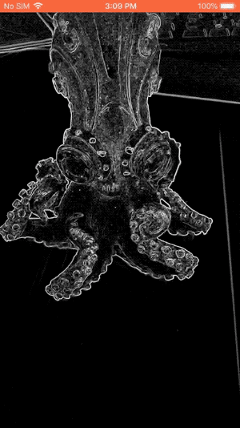
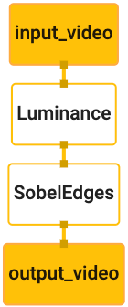

# Hello World!(iOS 入门示例) (Hello World! on iOS)

> 本文译自官方文档:[原文链接](https://developers.google.com/edge/mediapipe/framework/getting_started/hello_world_ios)
> 为保持内容与版式一致,图片位置、章节顺序、代码示例均与原页对齐。

## 简介

本 Hello World! 教程使用 MediaPipe Framework 开发一个在 iOS 上运行 MediaPipe 计算图(graph)的 iOS 应用。

### 你将构建什么

一个简单的相机应用,在 iOS 设备上对实时视频数据流执行实时的 Sobel 边缘检测。



## 环境配置

1. 在你的系统上安装 MediaPipe Framework,详见 [Framework 安装指南](install.md)。
2. 将你的 iOS 设备设置为开发模式。
3. 在你的系统上安装 [Bazel](https://bazel.build/),用于构建和部署 iOS 应用。

## 用于边缘检测的计算图

我们将使用以下计算图 [`edge_detection_mobile_gpu.pbtxt`](https://github.com/google/mediapipe/tree/master/mediapipe/graphs/edge_detection/edge_detection_mobile_gpu.pbtxt):

```
# MediaPipe graph that performs GPU Sobel edge detection on a live video stream.
# Used in the examples
# mediapipe/examples/android/src/java/com/google/mediapipe/apps/basic:helloworld
# and mediapipe/examples/ios/helloworld.

# Images coming into and out of the graph.
input_stream: "input_video"
output_stream: "output_video"

# Converts RGB images into luminance images, still stored in RGB format.
node: {
  calculator: "LuminanceCalculator"
  input_stream: "input_video"
  output_stream: "luma_video"
}

# Applies the Sobel filter to luminance images stored in RGB format.
node: {
  calculator: "SobelEdgesCalculator"
  input_stream: "luma_video"
  output_stream: "output_video"
}
```

该计算图的示意图如下:



该计算图只有一个输入数据流 `input_video`,用于接收设备摄像头提供的所有输入帧。

计算图中的第一个节点 `LuminanceCalculator` 接收单个数据包(packet,图像帧),并使用 OpenGL shader 进行亮度变换。处理后的图像帧被发送到 `luma_video` 输出数据流。

第二个节点 `SobelEdgesCalculator` 对 `luma_video` 数据流中传入的数据包执行边缘检测,并将结果输出到 `output_video` 输出数据流。

我们的 iOS 应用将显示 `output_video` 数据流输出的图像帧。

## 初始极简应用设置

我们首先从一个简单的 iOS 应用开始,并演示如何使用 `bazel` 构建它。

首先,通过 File > New > Single View App 创建一个 XCode 项目。

将产品名设置为 "HelloWorld",并使用合适的组织标识符(organization identifier),例如 `com.google.mediapipe`。组织标识符与产品名组合起来就是该应用的 `bundle_id`,例如 `com.google.mediapipe.HelloWorld`。

将语言设置为 Objective-C。

将项目保存到合适的位置。我们称之为 `$PROJECT_TEMPLATE_LOC`。这样你的项目就会位于 `$PROJECT_TEMPLATE_LOC/HelloWorld` 目录中。该目录下还有一个名为 `HelloWorld` 的目录和一个 `HelloWorld.xcodeproj` 文件。

本教程中不会用到 `HelloWorld.xcodeproj`,因为我们将使用 bazel 构建该 iOS 应用。`$PROJECT_TEMPLATE_LOC/HelloWorld/HelloWorld` 目录的内容如下:

1. `AppDelegate.h` 和 `AppDelegate.m`
2. `ViewController.h` 和 `ViewController.m`
3. `main.m`
4. `Info.plist`
5. `Main.storyboard` 和 `Launch.storyboard`
6. `Assets.xcassets` 目录。

> **注意:** 在较新版本的 Xcode 中,你可能会看到额外的文件 `SceneDelegate.h` 和 `SceneDelegate.m`。请务必也把它们复制过来,并添加到下面的 `BUILD` 文件中。

把这些文件复制到一个名为 `HelloWorld` 的目录中,并放在能访问 MediaPipe Framework 源代码的位置。例如,本教程中要构建的应用源代码位于 `mediapipe/examples/ios/HelloWorld`。在后面的教程中,我们将这个路径称为 `$APPLICATION_PATH`。

> **注意:** MediaPipe Framework 为 iOS 提供了 Objective-C 绑定。本教程中的边缘检测应用,以及所有使用 Framework 的 iOS 示例,都是在 `.mm` 文件中混用 Objective-C 与 C++。

在 `$APPLICATION_PATH` 中创建一个 `BUILD` 文件,并添加以下构建规则:

```
MIN_IOS_VERSION = "11.0"

load(
    "@build_bazel_rules_apple//apple:ios.bzl",
    "ios_application",
)

ios_application(
    name = "HelloWorldApp",
    bundle_id = "com.google.mediapipe.HelloWorld",
    families = [
        "iphone",
        "ipad",
    ],
    infoplists = ["Info.plist"],
    minimum_os_version = MIN_IOS_VERSION,
    provisioning_profile = "//mediapipe/examples/ios:developer_provisioning_profile",
    deps = [":HelloWorldAppLibrary"],
)

objc_library(
    name = "HelloWorldAppLibrary",
    srcs = [
        "AppDelegate.m",
        "ViewController.m",
        "main.m",
    ],
    hdrs = [
        "AppDelegate.h",
        "ViewController.h",
    ],
    data = [
        "Base.lproj/LaunchScreen.storyboard",
        "Base.lproj/Main.storyboard",
    ],
    sdk_frameworks = [
        "UIKit",
    ],
    deps = [],
)
```

`objc_library` 规则为 `AppDelegate` 和 `ViewController` 类、`main.m` 及应用 storyboard 添加了依赖。模板化应用只依赖 `UIKit` SDK。

`ios_application` 规则使用生成的 `HelloWorldAppLibrary` Objective-C 库来构建一个可安装到 iOS 设备上的 iOS 应用。

> **注意:** 你需要指向自己的 iOS 开发者配置描述文件(provisioning profile),才能在 iOS 设备上运行该应用。

在终端中使用以下命令构建应用:

```
bazel build -c opt --config=ios_arm64 <$APPLICATION_PATH>:HelloWorldApp'
```

例如,要构建 `mediapipe/examples/ios/helloworld` 中的 `HelloWorldApp` 应用,使用以下命令:

```
bazel build -c opt --config=ios_arm64 mediapipe/examples/ios/helloworld:HelloWorldApp
```

然后,回到 XCode,打开 Window > Devices and Simulators,选择你的设备,并将上述命令生成的 `.ipa` 文件添加到设备上。关于[设置与编译](ios.md)iOS Framework 应用的文档在此。

在设备上打开该应用。由于应用是空的,它应该显示一个空白屏幕。

## 使用相机获取实时预览画面

在本教程中,我们将使用 `MPPCameraInputSource` 类来访问相机并抓取帧。该类使用 `AVCaptureSession` API 从相机获取帧。

但在使用这个类之前,先修改 `Info.plist` 文件,以支持应用中的相机使用。

在 `ViewController.m` 中添加以下导入行:

```
#import "mediapipe/objc/MPPCameraInputSource.h"
```

在其实现块中添加以下内容,以创建对象 `_cameraSource`:

```
@implementation ViewController {
  // Handles camera access via AVCaptureSession library.
  MPPCameraInputSource* _cameraSource;
}
```

在 `viewDidLoad()` 中添加以下代码:

```
-(void)viewDidLoad {
  [super viewDidLoad];

  _cameraSource = [[MPPCameraInputSource alloc] init];
  _cameraSource.sessionPreset = AVCaptureSessionPresetHigh;
  _cameraSource.cameraPosition = AVCaptureDevicePositionBack;
  // The frame's native format is rotated with respect to the portrait orientation.
  _cameraSource.orientation = AVCaptureVideoOrientationPortrait;
}
```

该代码初始化了 `_cameraSource`,设置了采集会话预设值以及要使用的相机。

我们需要把 `_cameraSource` 获取到的帧传入应用中的 `ViewController` 进行显示。`MPPCameraInputSource` 是 `MPPInputSource` 的子类,后者为其回调(delegate)提供协议,即 `MPPInputSourceDelegate`。因此,我们应用中的 `ViewController` 可以作为 `_cameraSource` 的回调(delegate)。

相应地更新 `ViewController` 的接口定义:

```
@interface ViewController () <MPPInputSourceDelegate>
```

为了处理相机的设置与传入的帧,我们应该使用一个与主队列不同的队列。在 `ViewController` 的实现块中添加以下内容:

```
// Process camera frames on this queue.
dispatch_queue_t _videoQueue;
```

在 `viewDidLoad()` 中,在初始化 `_cameraSource` 对象之后添加以下行:

```
[_cameraSource setDelegate:self queue:_videoQueue];
```

并在设置 `_cameraSource` 对象之前添加以下代码来初始化该队列:

```
dispatch_queue_attr_t qosAttribute = dispatch_queue_attr_make_with_qos_class(
      DISPATCH_QUEUE_SERIAL, QOS_CLASS_USER_INTERACTIVE, /*relative_priority=*/0);
_videoQueue = dispatch_queue_create(kVideoQueueLabel, qosAttribute);
```

我们将使用优先级为 `QOS_CLASS_USER_INTERACTIVE` 的串行队列来处理相机帧。

在文件顶部导入头文件之后、`ViewController` 的接口/实现之前,添加以下行:

```
static const char* kVideoQueueLabel = "com.google.mediapipe.example.videoQueue";
```

在实现 `MPPInputSourceDelegate` 协议的任何方法之前,我们必须先设置一种在屏幕上显示相机帧的方式。MediaPipe Framework 提供了另一个实用工具 `MPPLayerRenderer`,用于在屏幕上显示图像。该工具可用于显示 `CVPixelBufferRef` 对象,这正是 `MPPCameraInputSource` 提供给其回调(delegate)的图像类型。

在 `ViewController.m` 中添加以下导入行:

```
#import "mediapipe/objc/MPPLayerRenderer.h"
```

为了在屏幕上显示图像,我们需要向 `ViewController` 添加一个名为 `_liveView` 的新 `UIView` 对象。

在 `ViewController` 的实现块中添加以下行:

```
// Display the camera preview frames.
IBOutlet UIView* _liveView;
// Render frames in a layer.
MPPLayerRenderer* _renderer;
```

前往 `Main.storyboard`,从对象库(object library)中把一个 `UIView` 对象添加到 `ViewController` 类的 `View` 上。将这个视图添加一个引用出口(referencing outlet)到你刚添加到 `ViewController` 类的 `_liveView` 对象上。调整视图大小,使其居中并覆盖整个应用屏幕。

回到 `ViewController.m`,在 `viewDidLoad()` 中添加以下代码来初始化 `_renderer` 对象:

```
_renderer = [[MPPLayerRenderer alloc] init];
_renderer.layer.frame = _liveView.layer.bounds;
[_liveView.layer addSublayer:_renderer.layer];
_renderer.frameScaleMode = MPPFrameScaleModeFillAndCrop;
```

为了从相机获取帧,我们将实现以下方法:

```
// Must be invoked on _videoQueue.
-   (void)processVideoFrame:(CVPixelBufferRef)imageBuffer
                timestamp:(CMTime)timestamp
               fromSource:(MPPInputSource*)source {
  if (source != _cameraSource) {
    NSLog(@"Unknown source: %@", source);
    return;
  }
  // Display the captured image on the screen.
  CFRetain(imageBuffer);
  dispatch_async(dispatch_get_main_queue(), ^{
    [_renderer renderPixelBuffer:imageBuffer];
    CFRelease(imageBuffer);
  });
}
```

这是 `MPPInputSource` 的一个回调(delegate)方法。我们首先检查帧是否来自正确的数据源,即 `_cameraSource`。然后通过 `_renderer` 在主队列上显示从相机接收到的帧。

现在,我们需要在显示帧的视图即将出现时立即启动相机。为此,我们将实现 `viewWillAppear:(BOOL)animated` 函数:

```
-(void)viewWillAppear:(BOOL)animated {
  [super viewWillAppear:animated];
}
```

在开始运行相机之前,我们需要获得用户访问相机的权限。`MPPCameraInputSource` 提供了函数 `requestCameraAccessWithCompletionHandler:(void (^_Nullable)(BOOL granted))handler`,用于请求相机访问权限,并在用户响应后做一些工作。在 `viewWillAppear:animated` 中添加以下代码:

```
[_cameraSource requestCameraAccessWithCompletionHandler:^void(BOOL granted) {
  if (granted) {
    dispatch_async(_videoQueue, ^{
      [_cameraSource start];
    });
  }
}];
```

在构建应用之前,在 `BUILD` 文件中添加以下依赖:

```
sdk_frameworks = [
    "AVFoundation",
    "CoreGraphics",
    "CoreMedia",
],
deps = [
    "//mediapipe/objc:mediapipe_framework_ios",
    "//mediapipe/objc:mediapipe_input_sources_ios",
    "//mediapipe/objc:mediapipe_layer_renderer",
],
```

现在在 iOS 设备上构建并运行应用。在接受相机权限后,你应该能看到实时相机预览画面。

我们现在已经准备好把相机帧用于 MediaPipe 计算图了。

## 在 iOS 中使用 MediaPipe 计算图

### 添加相关依赖

我们已经添加了包含 iOS API、可用于运行 MediaPipe 计算图的 MediaPipe framework 代码的依赖。要使用 MediaPipe 计算图,我们还需要添加对应用打算使用的计算图的依赖。在 `BUILD` 文件的 `data` 列表中添加以下行:

```
"//mediapipe/graphs/edge_detection:mobile_gpu_binary_graph",
```

然后在 `BUILD` 文件的 `deps` 字段中添加对该计算图所用计算器(calculator)的依赖:

```
"//mediapipe/graphs/edge_detection:mobile_calculators",
```

最后,把文件 `ViewController.m` 重命名为 `ViewController.mm`,以支持 Objective-C++。

### 在 `ViewController` 中使用计算图

在 `ViewController.m` 中添加以下导入行:

```
#import "mediapipe/objc/MPPGraph.h"
```

声明一个包含计算图名称、输入数据流和输出数据流的静态常量:

```
static NSString* const kGraphName = @"mobile_gpu";

static const char* kInputStream = "input_video";
static const char* kOutputStream = "output_video";
```

在 `ViewController` 的接口中添加以下属性:

```
// The MediaPipe graph currently in use. Initialized in viewDidLoad, started in viewWillAppear: and
// sent video frames on _videoQueue.
@property(nonatomic) MPPGraph* mediapipeGraph;
```

如上注释所述,我们将首先在 `viewDidLoad` 中初始化该计算图。为此,我们需要使用以下函数从 `.pbtxt` 文件加载计算图:

```
+   (MPPGraph*)loadGraphFromResource:(NSString*)resource {
  // Load the graph config resource.
  NSError* configLoadError = nil;
  NSBundle* bundle = [NSBundle bundleForClass:[self class]];
  if (!resource || resource.length == 0) {
    return nil;
  }
  NSURL* graphURL = [bundle URLForResource:resource withExtension:@"binarypb"];
  NSData* data = [NSData dataWithContentsOfURL:graphURL options:0 error:&configLoadError];
  if (!data) {
    NSLog(@"Failed to load MediaPipe graph config: %@", configLoadError);
    return nil;
  }

  // Parse the graph config resource into mediapipe::CalculatorGraphConfig proto object.
  mediapipe::CalculatorGraphConfig config;
  config.ParseFromArray(data.bytes, data.length);

  // Create MediaPipe graph with mediapipe::CalculatorGraphConfig proto object.
  MPPGraph* newGraph = [[MPPGraph alloc] initWithGraphConfig:config];
  [newGraph addFrameOutputStream:kOutputStream outputPacketType:MPPPacketTypePixelBuffer];
  return newGraph;
}
```

在 `viewDidLoad` 中使用该函数初始化计算图,如下所示:

```
self.mediapipeGraph = [[self class] loadGraphFromResource:kGraphName];
```

计算图应该把相机帧处理的结果发回 `ViewController`。在初始化计算图之后添加以下行,将 `ViewController` 设置为 `mediapipeGraph` 对象的回调(delegate):

```
self.mediapipeGraph.delegate = self;
```

为避免处理实时视频帧时产生内存竞争,添加以下行:

```
// Set maxFramesInFlight to a small value to avoid memory contention for real-time processing.
self.mediapipeGraph.maxFramesInFlight = 2;
```

现在,当用户授予使用相机的权限后,在应用中启动计算图:

```
[_cameraSource requestCameraAccessWithCompletionHandler:^void(BOOL granted) {
  if (granted) {
    // Start running self.mediapipeGraph.
    NSError* error;
    if (![self.mediapipeGraph startWithError:&error]) {
      NSLog(@"Failed to start graph: %@", error);
    }
    else if (![self.mediapipeGraph waitUntilIdleWithError:&error]) {
      NSLog(@"Failed to complete graph initial run: %@", error);
    }

    dispatch_async(_videoQueue, ^{
      [_cameraSource start];
    });
  }
}];
```

> **注意:** 重要的是在启动相机之前启动计算图并等待其完成,这样计算图才能在相机一开始发送帧时就准备好处理这些帧。

之前,当我们在 `processVideoFrame` 函数中收到相机的帧时,我们用 `_renderer` 把它们显示在 `_liveView` 中。现在,我们需要把这些帧发送给计算图,并渲染结果。修改该函数的实现,使其完成以下操作:

```
-   (void)processVideoFrame:(CVPixelBufferRef)imageBuffer
                timestamp:(CMTime)timestamp
               fromSource:(MPPInputSource*)source {
  if (source != _cameraSource) {
    NSLog(@"Unknown source: %@", source);
    return;
  }
  [self.mediapipeGraph sendPixelBuffer:imageBuffer
                            intoStream:kInputStream
                            packetType:MPPPacketTypePixelBuffer];
}
```

我们以 `MPPPacketTypePixelBuffer` 类型的数据包把 `imageBuffer` 发送到 `self.mediapipeGraph` 的输入数据流 `kInputStream` 中,即 "input\_video"。

计算图将使用该输入数据包运行,并在 `kOutputStream`(即 "output\_video")中输出结果。我们可以实现以下回调(delegate)方法,在该输出数据流上接收数据包并显示在屏幕上:

```
-   (void)mediapipeGraph:(MPPGraph*)graph
   didOutputPixelBuffer:(CVPixelBufferRef)pixelBuffer
             fromStream:(const std::string&)streamName {
  if (streamName == kOutputStream) {
    // Display the captured image on the screen.
    CVPixelBufferRetain(pixelBuffer);
    dispatch_async(dispatch_get_main_queue(), ^{
      [_renderer renderPixelBuffer:pixelBuffer];
      CVPixelBufferRelease(pixelBuffer);
    });
  }
}
```

用 `MPPGraphDelegate` 更新 `ViewController` 的接口定义:

```
@interface ViewController () <MPPGraphDelegate, MPPInputSourceDelegate>
```

这样就完成了!在你的 iOS 设备上构建并运行该应用。你应该能在实时视频画面上看到边缘检测计算图的运行结果。恭喜!


请注意,iOS 示例现在使用一个[通用](https://github.com/google/mediapipe/tree/master/mediapipe/examples/ios/common)模板应用。本教程中的代码用于[通用](https://github.com/google/mediapipe/tree/master/mediapipe/examples/ios/common)模板应用。[helloworld](https://github.com/google/mediapipe/tree/master/mediapipe/examples/ios/helloworld) 应用中包含针对边缘检测计算图的相应 `BUILD` 文件依赖。

---

*页面内容遵循 [CC BY 4.0](https://creativecommons.org/licenses/by/4.0/) 许可;代码示例遵循 [Apache 2.0](https://www.apache.org/licenses/LICENSE-2.0) 许可。*