# 可视化工具 (Visualizer)

> 本文译自官方文档:[原文链接](https://developers.google.com/edge/mediapipe/framework/tools/visualizer)
> 为保持内容与版式一致,图片位置、章节顺序、代码示例均与原页对齐。

为了帮助用户理解其计算器(calculator)计算图的结构,以及理解其机器学习推理管线的整体行为,我们构建了在线可用的 [MediaPipe Visualizer](https://viz.mediapipe.dev/)。

-   计算图视图允许用户查看一个连接的计算器计算图,该计算图通过粘贴到计算图编辑器或上传的计算图配置来表达。用户可以对其创建的计算图进行可视化和排查。

    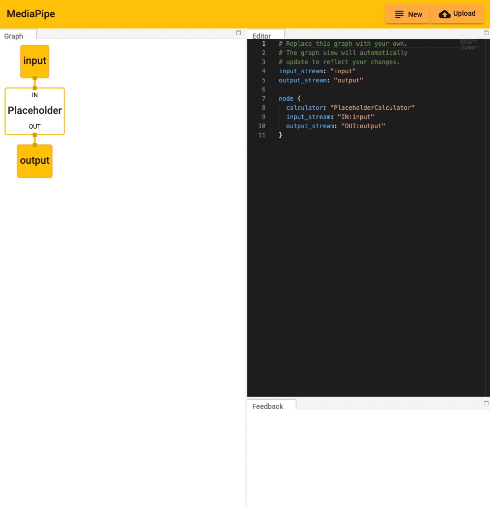

## 在编辑器中工作 (Working within the Editor)

快速开始:

可以通过在编辑器视图中添加和编辑代码来修改计算图。

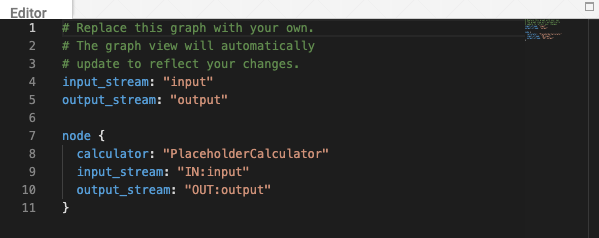

-   按下右上角的「New」按钮将清除编辑器窗口中的现有代码。

    

-   按下「Upload」按钮将提示用户选择一个本地 PBTXT 文件,该文件将覆盖编辑器中的当前代码。

-   或者,代码可以直接粘贴到编辑器窗口中。

-   错误和信息性消息将显示在 Feedback 窗口中。

    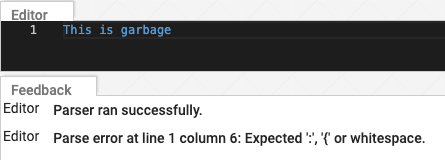

## 理解计算图 (Understanding the Graph)

可视化工具计算图显示了计算器节点之间的连接。

-   数据流从产生数据流的计算器底部流出,并进入接收该数据流的任何计算器的顶部。(注意使用了键 "input_stream" 和 "output_stream"。)

    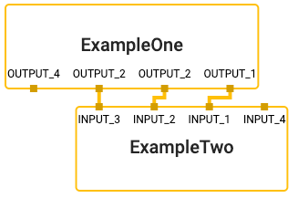

    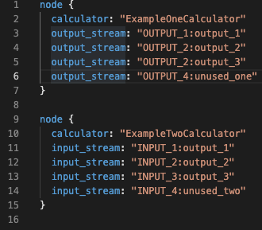

-   边包的工作方式相同,区别在于它们从节点的右侧流出,并从左侧进入。(注意使用了键 "input_side_packet" 和 "output_side_packet"。)

    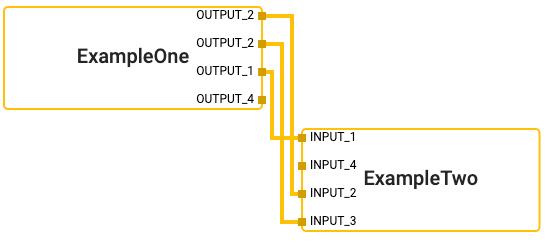

    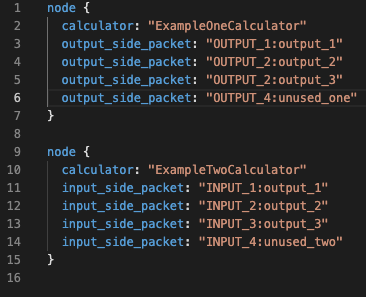

-   有一些特殊节点代表计算图的输入和输出,可以提供边包或数据流。

    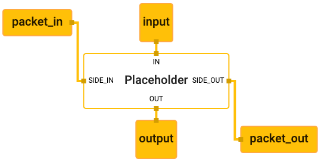

    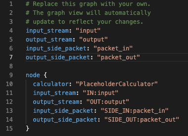

## 子图可视化 (Visualizing Subgraphs)

MediaPipe 可视化工具可以在单独的标签页中显示多个计算图。如果某个计算图的文本 proto 定义的顶层具有 `type` 字段,并且该图 `type` 的值被用作另一个计算图中的计算器名称,那么它就被可视化工具视为子图,并在使用处做相应着色。点击某个子图将导航到包含该子图定义的对应标签页。

例如,MediaPipe Hands 涉及两个计算图:主计算图([源 pbtxt 文件](https://github.com/google/mediapipe/blob/master/mediapipe/graphs/hand_tracking/hand_detection_mobile.pbtxt))及其关联的子图([源 pbtxt 文件](https://github.com/google/mediapipe/blob/master/mediapipe/graphs/hand_tracking/subgraphs/hand_renderer_gpu.pbtxt))。要对其进行可视化:

-   在 MediaPipe 可视化工具中,点击上传计算图按钮,选择 2 个要可视化的 pbtxt 文件(主计算图及其关联子图)。

    

    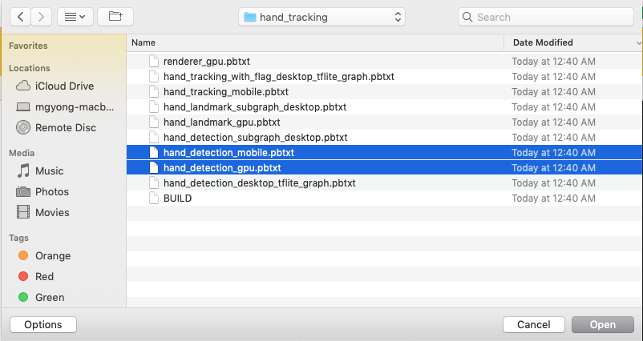

-   将出现 2 个额外的标签页。主计算图标签页是 `hand_detection_mobile.pbtxt`。

    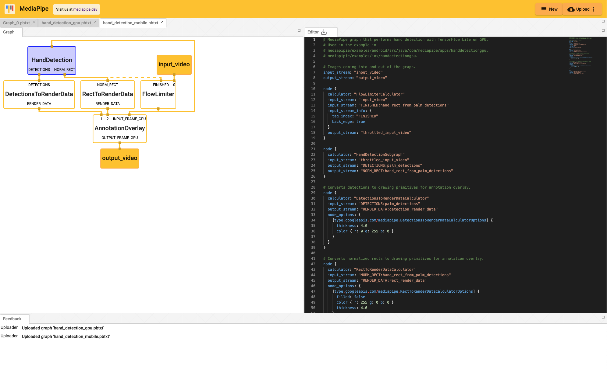

-   点击紫色的 `HandDetection` 节点会将视图重定向到 `hand_detection_gpu.pbtxt` 标签页。

    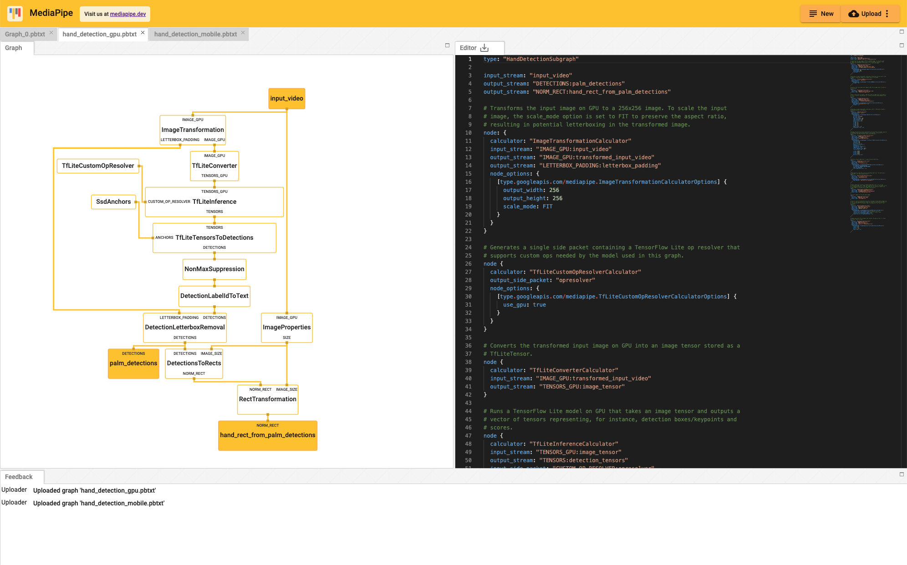

---

*页面内容遵循 [CC BY 4.0](https://creativecommons.org/licenses/by/4.0/) 许可;代码示例遵循 [Apache 2.0](https://www.apache.org/licenses/LICENSE-2.0) 许可。*