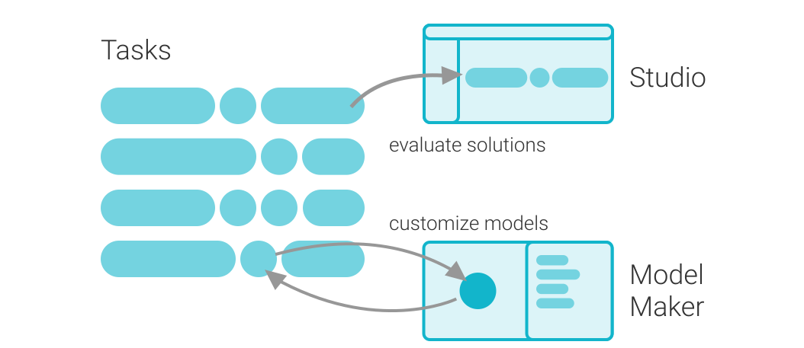

# MediaPipe Solutions 指南

> 本文译自官方文档:[原文链接](https://developers.google.com/edge/mediapipe/solutions/guide)
> 为保持内容与版式一致,图片位置、章节顺序、代码示例均与原页对齐。

MediaPipe Solutions 提供一套库和工具,供你在应用程序中快速应用人工智能(AI)和机器学习(ML)技术。你可以将这些解决方案直接接入应用程序、按需定制,并在多种开发平台上使用。MediaPipe Solutions 是 MediaPipe [开源项目](https://github.com/google-ai-edge/mediapipe)的一部分,因此你可以进一步定制解决方案代码以满足应用需求。MediaPipe Solutions 套件包括以下组件:

以下库和资源为每个 MediaPipe Solution 提供核心功能:

- **MediaPipe Tasks**:用于部署解决方案的跨平台 API 和库。[了解更多](tasks.md)
- **MediaPipe Models**:与每个解决方案配套的、开箱即用的预训练模型。

以下工具用于定制和评估解决方案:

- **MediaPipe Model Maker**:使用你自己的数据为解决方案定制模型。[了解更多](model_maker.md)
- **MediaPipe Studio**:在浏览器中可视化、评估并对解决方案进行基准测试。[了解更多](studio.md)

## 可用解决方案

MediaPipe Solutions 支持多种平台。每个解决方案包含一个或多个模型,部分解决方案还支持使用 Model Maker 定制模型。下表列出了每个受支持平台上可用的解决方案,以及是否可以使用 Model Maker 定制模型:

> 图例:● 表示支持;— 表示不支持。

| 解决方案 | Android | Web | Python | iOS | 定制模型 |
|---|---|---|---|---|---|
| [音频分类](audio/audio_classifier.md) | ● | ● | ● | ● | — |
| [人脸检测](vision/face_detector.md) | ● | ● | ● | ● | — |
| [面部关键点检测](vision/face_landmarker.md) | ● | ● | ● | ● | — |
| [手势识别](vision/gesture_recognizer.md) | ● | ● | ● | ● | ● |
| [手部关键点检测](vision/hand_landmarker.md) | ● | ● | ● | ● | — |
| [整体关键点检测](vision/holistic_landmarker.md) | ● | ● | ● | ● | — |
| [图像分类](vision/image_classifier.md) | ● | ● | ● | ● | ● |
| [图像嵌入](vision/image_embedder.md) | ● | ● | ● | ● | — |
| [图像分割](vision/image_segmenter.md) | ● | ● | ● | ● | — |
| [交互式分割](vision/interactive_segmenter.md) | ● | ● | ● | ● | — |
| [语言检测器](text/language_detector.md) | ● | ● | ● | ● | — |
| [LLM 推理 API](genai/llm_inference.md) | ● | ● | — | — | — |
| [物体检测](vision/object_detector.md) | ● | ● | ● | ● | ● |
| [姿态关键点检测](vision/pose_landmarker.md) | ● | ● | ● | ● | — |
| [文本分类](text/text_classifier.md) | ● | ● | ● | ● | ● |
| [文本嵌入](text/text_embedder.md) | ● | ● | ● | ● | — |
| [文本校对](text/text_proofreader.md) | ● | — | ● | ● | — |
| [文本摘要](text/text_summarizer.md) | ● | — | ● | ● | — |

## 开始使用

你可以通过选择左侧导航树中列出的任意任务开始使用 MediaPipe Solutions,包括:

- [audio(音频)](audio/audio_classifier.md)
- [decision(决策)](decision/decision_maker.md)
- [genai(生成式 AI)](genai/llm_inference.md)
- [retrieval(检索)](retrieval/semantic_retriever.md)
- [text(文本)](text/text_classifier.md)
- [vision(视觉)](vision/object_detector.md)

如果你需要为 MediaPipe Tasks 搭建开发环境,请按照以下配置指南操作:

- [Android](setup_android.md)
- [iOS](setup_ios.md)
- [Python](setup_python.md)
- [Web 应用](setup_web.md)

## 遗留解决方案

自 2023 年 3 月 1 日起,我们对下文列出的 MediaPipe 遗留解决方案(MediaPipe Legacy Solutions)停止支持。其余所有 MediaPipe 遗留解决方案都将升级为新的 MediaPipe Solution。详见本节表格。所有 MediaPipe 遗留解决方案的 [MediaPipe 代码仓库](https://github.com/google-ai-edge/mediapipe)以及预构建二进制文件将继续按"原样"(as-is)提供。

| 遗留解决方案 | 状态 | 新的 MediaPipe Solution |
|---|---|---|
| 人脸检测 Face Detection([信息](https://github.com/google/mediapipe/blob/master/docs/solutions/face_detection.md)) | [已升级](vision/face_detector.md) | [人脸检测](vision/face_detector.md) |
| 人脸网格 Face Mesh([信息](https://github.com/google/mediapipe/blob/master/docs/solutions/face_mesh.md)) | [已升级](vision/face_landmarker.md) | [面部关键点检测](vision/face_landmarker.md) |
| 虹膜 Iris([信息](https://github.com/google/mediapipe/blob/master/docs/solutions/iris.md)) | [已升级](vision/face_landmarker.md) | [面部关键点检测](vision/face_landmarker.md) |
| 手部 Hands([信息](https://github.com/google/mediapipe/blob/master/docs/solutions/hands.md)) | [已升级](vision/hand_landmarker.md) | [手部关键点检测](vision/hand_landmarker.md) |
| 姿态 Pose([信息](https://github.com/google/mediapipe/blob/master/docs/solutions/pose.md)) | [已升级](vision/pose_landmarker.md) | [姿态关键点检测](vision/pose_landmarker.md) |
| 整体 Holistic([信息](https://github.com/google/mediapipe/blob/master/docs/solutions/holistic.md)) | [已升级](vision/holistic_landmarker.md) | [整体关键点检测](vision/holistic_landmarker.md) |
| 自拍分割 Selfie segmentation([信息](https://github.com/google/mediapipe/blob/master/docs/solutions/selfie_segmentation.md)) | [已升级](vision/image_segmenter.md) | [图像分割](vision/image_segmenter.md) |
| 头发分割 Hair segmentation([信息](https://github.com/google/mediapipe/blob/master/docs/solutions/hair_segmentation.md)) | [已升级](vision/image_segmenter.md) | [图像分割](vision/image_segmenter.md) |
| 物体检测 Object detection([信息](https://github.com/google/mediapipe/blob/master/docs/solutions/object_detection.md)) | [已升级](vision/object_detector.md) | [物体检测](vision/object_detector.md) |
| 框跟踪 Box tracking([信息](https://github.com/google/mediapipe/blob/master/docs/solutions/box_tracking.md)) | 停止支持 | — |
| 即时运动跟踪 Instant motion tracking([信息](https://github.com/google/mediapipe/blob/master/docs/solutions/instant_motion_tracking.md)) | 停止支持 | — |
| Objectron([信息](https://github.com/google/mediapipe/blob/master/docs/solutions/objectron.md)) | 停止支持 | — |
| KNIFT([信息](https://github.com/google/mediapipe/blob/master/docs/solutions/knift.md)) | 停止支持 | — |
| AutoFlip([信息](https://github.com/google/mediapipe/blob/master/docs/solutions/autoflip.md)) | 停止支持 | — |
| MediaSequence([信息](https://github.com/google/mediapipe/blob/master/docs/solutions/media_sequence.md)) | 停止支持 | — |
| YouTube 8M([信息](https://github.com/google/mediapipe/blob/master/docs/solutions/youtube_8m.md)) | 停止支持 | — |

---

*页面内容遵循 [CC BY 4.0](https://creativecommons.org/licenses/by/4.0/) 许可;代码示例遵循 [Apache 2.0](https://www.apache.org/licenses/LICENSE-2.0) 许可。*