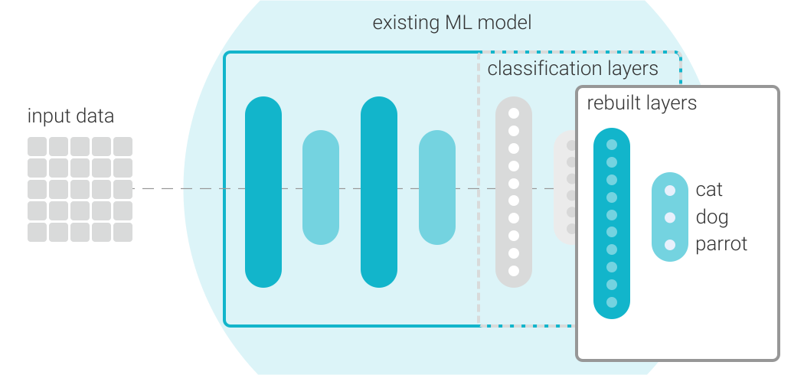

# MediaPipe Model Maker(模型定制工具)

> 本文译自官方文档:[原文链接](https://developers.google.com/edge/mediapipe/solutions/model_maker)
> 为保持内容与版式一致,图片位置、章节顺序、代码示例均与原页对齐。

> **已弃用:** MediaPipe Model Maker 仍然可用,但不再积极维护。

MediaPipe Model Maker 是一款用于定制现有机器学习(ML)模型以适配你的数据和应用程序的工具。你可以将此工具作为构建和训练新 ML 模型的更快替代方案。Model Maker 使用一种称为[迁移学习](https://en.wikipedia.org/wiki/Transfer_learning)的 ML 训练技术,该技术使用新数据对现有模型进行再训练。此技术会复用现有模型逻辑中的很大一部分,这意味着训练时间少于训练新模型所需的时间,并且可以用更少的数据完成。

Model Maker 适用于多种类型的模型,包括物体检测、手势识别,以及图像、文本或音频数据的分类器。该工具通过移除模型中用于将数据分类到具体类别的最后几层,并使用你提供的新数据重建这些层,来实现模型再训练。Model Maker 还支持某些选项,用于微调模型层以提高准确性和性能。

**图 1.Model Maker 会移除现有模型的末尾几层,并使用新数据重建它们。**

使用 Model Maker 再训练模型通常会使模型更小,尤其是当你再训练新模型以识别更少的类别时。这意味着你可以使用 Model Maker 创建更聚焦于你的应用程序且效果更好的模型。该工具还可以帮助你应用量化等 ML 技术,使你的模型占用更少资源并运行得更高效。

## 训练数据要求

你可以使用 Model Maker 以远少于训练新模型所需的数据量来再训练模型。使用新数据再训练模型时,每个训练类别应大约有 100 个数据样本。例如,如果你要再训练一个图像分类模型来识别猫、狗和鹦鹉,你应该准备大约 100 张猫的图片、100 张狗的图片和 100 张鹦鹉的图片。根据你的应用程序,即使每个类别使用的数据更少,也可能再训练出有用的模型,不过更大的数据集通常能提高模型的准确性。在创建训练数据集时,请记住训练数据在再训练过程中会被拆分,通常 80% 用于训练,10% 用于测试,其余用于验证。

## 定制的局限性

由于再训练过程会移除之前的分类层,生成的模型只能识别新数据中提供的条目或类别。如果旧模型经过训练可以识别 30 种不同的条目类别,而你使用 Model Maker 用 10 种不同条目的数据进行再训练,那么生成的模型只能识别这 10 种新条目。

使用 Model Maker 再训练模型无法改变原始 ML 模型本来要解决的问题,即使这些任务相似也是如此。例如,你不能使用该工具让图像分类模型执行物体检测,即使这些任务有一些相似之处。

## 开始使用

你可以通过运行 MediaPipe Solutions 的解决方案定制教程之一来开始使用 MediaPipe Model Maker,例如[图像分类](vision/image_classifier/customize.md)。

---

*页面内容遵循 [CC BY 4.0](https://creativecommons.org/licenses/by/4.0/) 许可;代码示例遵循 [Apache 2.0](https://www.apache.org/licenses/LICENSE-2.0) 许可。*