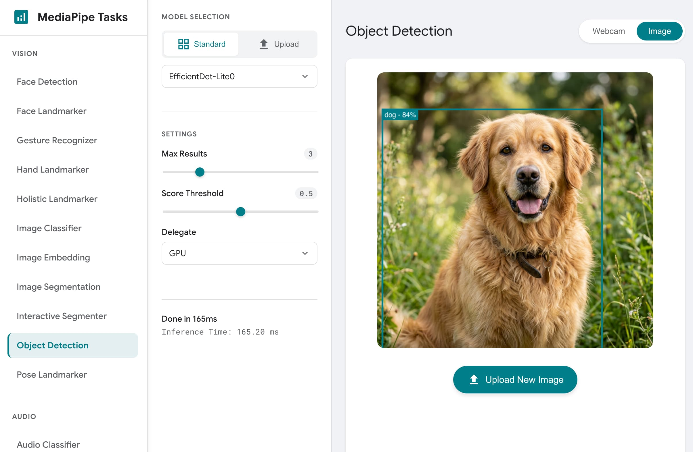
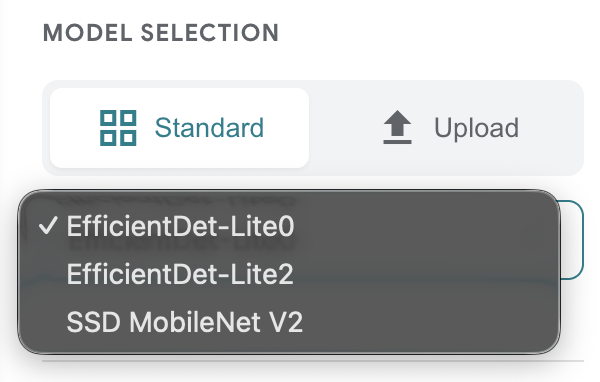

# MediaPipe Studio(可视化调试工具)

> 本文译自官方文档:[原文链接](https://developers.google.com/edge/mediapipe/solutions/studio)
> 为保持内容与版式一致,图片位置、章节顺序、代码示例均与原页对齐。

借助我们的交互式游乐场,可即时预览我们的 GitHub Web 示例,该游乐场让你能够评估我们的端侧(设备端)ML 模型和流水线。我们的 Web 应用让你可以在浏览器中使用自己的数据快速测试 MediaPipe 解决方案,体验愉快。对于每个任务,你都可以试验模型设置(例如结果总数)、自定义报告结果的最低置信度阈值,并调整更多内容。

[立即试用!arrow_forward](https://google-ai-edge.github.io/mediapipe-samples-web/)

本页提供在 MediaPipe Studio 中使用解决方案的一些快速说明。

 **图 1.MediaPipe Samples Web 应用程序主页。**

## 自定义模型

 你可以在**模型选择**选项中使用**选择模型文件**并从文件存储中选择一个模型来在 MediaPipe 中使用自定义模型,如截图所示。

你选择的模型必须符合所用 MediaPipe Tasks API 的模型输入和输出要求,并包含兼容的模型元数据。创建你自己的模型以与 MediaPipe Tasks API 配合使用的最快捷方式是使用 MediaPipe Model Maker 工具,用你自己的数据修改兼容的解决方案模型。有关详细信息,请参阅 [MediaPipe Model Maker](model_maker.md)。

## 自定义输入数据

你可以在 MediaPipe Studio 的每个解决方案页面中使用自己的数据。对于基于文本的任务,你可以在提供的字段中输入文本。视觉任务允许你使用网络摄像头作为输入,也可以上传你自己的图像。

## 开始使用

你可以通过运行其中一个解决方案演示(例如图像分类)来与我们的 API 交互,然后使用相关的[开发者指南](vision/image_classifier.md)将此功能构建到你自己的应用程序中。

---

*页面内容遵循 [CC BY 4.0](https://creativecommons.org/licenses/by/4.0/) 许可;代码示例遵循 [Apache 2.0](https://www.apache.org/licenses/LICENSE-2.0) 许可。*