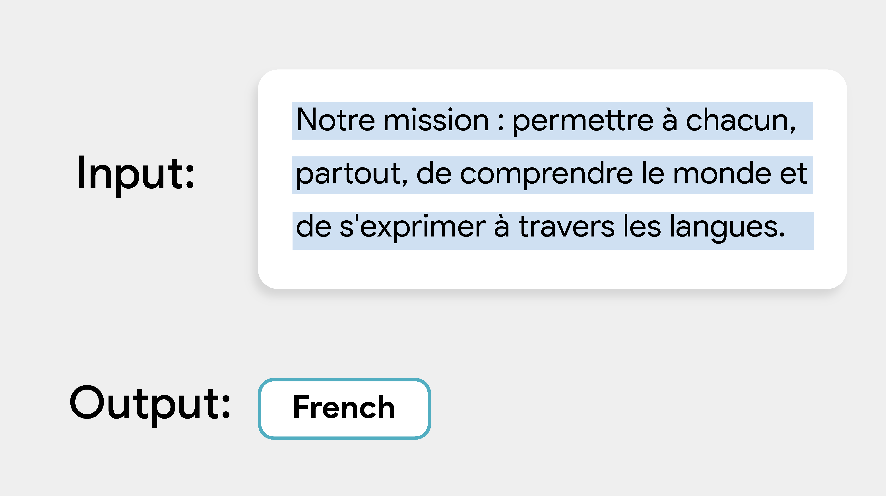

# 语言检测 (Language Detection)

> 本文译自官方文档:[原文链接](https://developers.google.com/edge/mediapipe/solutions/text/language_detector)
> 为保持内容与版式一致,图片位置、章节顺序、代码示例均与原页对齐。

MediaPipe 语言检测器任务(Language Detector)可识别一段文本的语言。该任务基于机器学习(ML)模型处理文本数据,并输出一组预测结果,每条预测包含一个 [ISO 639-1](https://en.wikipedia.org/wiki/List_of_ISO_639-1_codes) 语言代码和一个概率值。

[立即尝试!](https://google-ai-edge.github.io/mediapipe-samples-web/#/text/language_detector)

## 入门(Get Started)

按照以下面向目标平台的实现指南之一开始使用此任务。这些平台专属指南会引导你完成此任务的基础实现,包括推荐模型,以及带推荐配置选项的代码示例:

| 平台 | 代码示例 | 指南 |
| --- | --- | --- |
| Android | [代码示例](https://github.com/google-ai-edge/mediapipe-samples/tree/main/examples/language_detector/android) | [指南](android.md) |
| iOS | [代码示例](https://github.com/google-ai-edge/mediapipe-samples/tree/main/examples/language_detector/ios) | [指南](ios.md) |
| Python | [Colab](https://colab.research.google.com/github/googlesamples/mediapipe/blob/main/examples/language_detector/python/%5BMediaPipe_Python_Tasks%5D_Language_Detector.ipynb) | [指南](python.md) |
| Web | [代码示例](https://github.com/google-ai-edge/mediapipe-samples-web/blob/main/src/tasks/language-detector.ts) | [指南](web_js.md) |

## 任务详情(Task details)

本节介绍此任务的能力、输入、输出与配置选项。

### 特性(Features)

- **分数阈值(Score threshold)** - 基于预测分数过滤结果
- **标签允许列表与拒绝列表(Label allowlist and denylist)** - 指定要检测的类别

| 任务输入 | 任务输出 |
| --- | --- |
| 语言检测器接受以下输入数据类型:- 字符串(String) | 语言检测器输出一组预测结果,包含:- 语言代码:一个 ISO 639-1 (https://en.wikipedia.org/wiki/List_of_ISO_639-1_codes) 语言/区域代码(如英语为 "en"、乌兹别克语为 "uz"、日语(罗马字)为 "ja-Latn"),以字符串形式给出。- 概率:该预测的置信度分数,以 0 到 1 之间的浮点数值表示。 |

### 配置选项(Configurations options)

此任务具有以下配置选项:

| 选项名 | 说明 | 取值范围 | 默认值 |
| --- | --- | --- | --- |
| `max_results` | 设置可选返回的最高分语言预测的最大条数。若该值小于零,则返回所有可用结果。 | 任意正数 | `-1` |
| `score_threshold` | 设置预测分数阈值,用于覆盖模型元数据中提供的阈值(如有)。低于此值的结果将被拒绝。 | 任意浮点数 | 未设置 |
| `category_allowlist` | 设置可选的允许语言代码列表。若非空,则语言代码不在此集合中的语言预测将被过滤掉。此选项与 `category_denylist` 互斥,同时使用两者会导致错误。 | 任意字符串 | 未设置 |
| `category_denylist` | 设置可选的不允许的语言代码列表。若非空,则语言代码在此集合中的语言预测将被过滤掉。此选项与 `category_allowlist` 互斥,同时使用两者会导致错误。 | 任意字符串 | 未设置 |

## 模型(Models)

我们为使用此任务开始开发提供默认的推荐模型。

### 语言检测器模型(推荐)

该模型专为轻量级(315 KB)设计,采用基于嵌入的神经网络分类架构。模型使用 [ISO 639-1](https://en.wikipedia.org/wiki/List_of_ISO_639-1_codes) 语言代码识别语言,可识别 110 种语言。有关模型支持的语言列表,请参阅[标签文件](https://storage.googleapis.com/mediapipe-tasks/language_detector/labels.txt),该文件按 ISO 639-1 代码列出语言。

| 模型名 | 输入形状 | 量化类型 | 模型卡 | 版本 |
| --- | --- | --- | --- | --- |
| [语言检测器](https://storage.googleapis.com/mediapipe-models/language_detector/language_detector/float32/1/language_detector.tflite) | string UTF-8 | none (float32) | [info](https://storage.googleapis.com/mediapipe-assets/LanguageDetector%20Model%20Card.pdf) | [最新版](https://storage.googleapis.com/mediapipe-models/language_detector/language_detector/float32/1/language_detector.tflite) |

## 任务基准(Task benchmarks)

以下为基于上述预训练模型的整体管线的任务基准。延迟结果为 Pixel 6 上使用 CPU / GPU 的平均延迟。

| 模型名 | CPU 延迟 | GPU 延迟 |
| --- | --- | --- |
| 语言检测器 | 0.31ms | - |

---

*页面内容遵循 [CC BY 4.0](https://creativecommons.org/licenses/by/4.0/) 许可;代码示例遵循 [Apache 2.0](https://www.apache.org/licenses/LICENSE-2.0) 许可。*