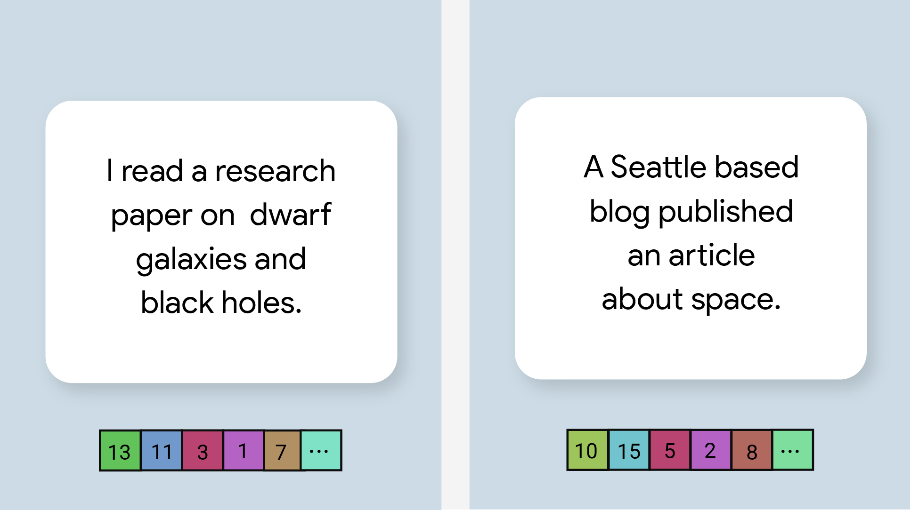

# 文本嵌入指南 (Text Embedding Guide)

> 本文译自官方文档:[原文链接](https://developers.google.com/edge/mediapipe/solutions/text/text_embedder)
> 为保持内容与版式一致,图片位置、章节顺序、代码示例均与原页对齐。

MediaPipe 文本嵌入器(Text Embedder)任务可以为文本数据创建数值表示,以捕获其语义含义。该功能常用于借助余弦相似度(Cosine Similarity)等数学比较技术,比较两段文本的语义相似度。该任务通过机器学习(ML)模型处理文本数据,并输出文本数据的数值表示——即一组高维特征向量,也称为嵌入向量(embedding vector),形式可以是浮点数或量化值。

[立即试用](https://google-ai-edge.github.io/mediapipe-samples-web/#/text/text_embedder)

## 开始使用 (Get Started)

要开始使用本任务,请根据你的目标平台选择以下实现指南之一。这些平台专属指南将引导你完成本任务的基础实现,包括推荐的模型以及带有推荐配置选项的代码示例:

| 平台 (Platform) | 代码示例 (Code Example) | 指南 (Guide) |
|---|---|---|
| Android | [代码示例](https://github.com/google-ai-edge/mediapipe-samples/tree/main/examples/text_embedder/android) | [指南](text_embedder/android.md) |
| Python | [Colab](https://colab.research.google.com/github/googlesamples/mediapipe/blob/main/examples/text_embedder/python/text_embedder.ipynb) | [指南](text_embedder/python.md) |
| Web | [代码示例](https://github.com/google-ai-edge/mediapipe-samples-web/blob/main/src/tasks/text-embedder.ts) | [指南](text_embedder/web_js.md) |

## 任务详情 (Task details)

本节介绍该任务的功能、输入、输出及配置选项。

### 功能特性 (Features)

- **输入文本处理 (Input text processing)** - 支持对没有图内分词(in-graph tokenization)能力的模型执行图外分词(out-of-graph tokenization)。
- **嵌入相似度计算 (Embedding similarity computation)** - 内置工具函数,用于计算两个特征向量之间的[余弦相似度](https://en.wikipedia.org/wiki/Cosine_similarity)。
- **量化 (Quantization)** - 支持对特征向量进行标量量化(scalar quantization)。

任务输入 (Task inputs)

文本嵌入器接受以下输入进行处理:

- 文本(`String`)
- 可选的格式上下文(`TextFormatContext`),适用于 EmbeddingGemma 300m 等受支持的模型。

任务输出 (Task outputs)

文本嵌入器输出一个嵌入列表,其中包含:

- **嵌入 (Embedding)**:特征向量本身,采用浮点形式或标量量化(scalar-quantized)形式。
- **头部索引 (Head index)**:生成该嵌入的头部(head)的索引。
- **头部名称 (Head name,可选)**:生成该嵌入的头部(head)的名称。

### 配置选项 (Configurations options)

该任务具有以下配置选项:

| 选项名称 (Option Name) | 描述 (Description) | 取值范围 (Value Range) | 默认值 (Default Value) |
|---|---|---|---|
| `l2_normalize` | 是否使用 L2 范数对返回的特征向量进行归一化。仅当模型本身不包含原生的 L2_NORMALIZATION TFLite 算子时,才使用此选项。大多数情况下模型已包含该算子,L2 归一化已通过 TFLite 推理完成,无需使用此选项。 | `Boolean` | `False` |
| `quantize` | 返回的嵌入是否应通过标量量化转换为字节。嵌入被默认假定为单位范数,因此任何维度的值都保证处于 [-1.0, 1.0] 范围内。若情况并非如此,请使用 `l2_normalize` 选项。 | `Boolean` | `False` |

## 模型 (Models)

我们支持较小的 UniversalSentenceEncoder 模型,以及在开始使用本任务进行开发时适用于更高级使用场景、能力更强的 EmbeddingModel。

### Embedding Gemma 300m 模型 (Embedding Gemma 300m model)

TextEmbedder SDK 支持 [embeddinggemma-300m](https://huggingface.co/litert-community/embeddinggemma-300m)。所提供的任务文件使用最大序列长度 512 个 token。

该模型根据你提供的任务类型和上下文格式,以不同的方式处理输入。对于查询(query)格式,模板遵循 `task: <task> | query: <text>`;对于文档(document)格式,则遵循 `title: <title> | text: <text>`。这些格式遵循官方 EmbeddingGemma 的[提示词说明](https://huggingface.co/google/embeddinggemma-300m#prompt-instructions)。

| 任务类型 (Task Type) | 格式化方式 (Formatting) |
|---|---|
| `RETRIEVAL_DOCUMENT` | 使用带有所提供标题的文档格式。 |
| `RETRIEVAL_QUERY` | 使用查询格式,`<task>` 为 "search result"。 |
| `SEMANTIC_SIMILARITY` | 使用查询格式,`<task>` 为 "sentence similarity"。 |
| `CLASSIFICATION` | 使用查询格式,`<task>` 为 "classification"。 |
| `CLUSTERING` | 使用查询格式,`<task>` 为 "clustering"。 |
| `QUESTION_ANSWERING` / `FACT_CHECKING` / `CODE_RETRIEVAL` | 根据角色是查询还是文档,分别使用相应的格式。作为查询时,`<task>` 字符串分别对应 "question answering"、"fact checking" 或 "code retrieval"。 |
| **默认 (Default)** | 任何其他任务类型都回退到查询格式,`<task>` 为 "search result"。 |

| 模型名称 (Model name) | 输入 (Input) | 量化类型 (Quantization type) | 版本 (Versions) |
|---|---|---|---|
| [Embedding Gemma](https://storage.googleapis.com/mediapipe-models/text_embedder/embedding_gemma/int4int8/latest/embedding_gemma.task) | string | 混合精度 (int4+int8) | [最新 (Latest)](https://storage.googleapis.com/mediapipe-models/text_embedder/embedding_gemma/int4int8/latest/embedding_gemma.task) |

### Universal Sentence Encoder 模型 (Universal Sentence Encoder model)

该模型采用[双编码器架构](https://aclanthology.org/2022.emnlp-main.640.pdf),并在多个问答数据集上进行了训练。

请考虑以下句子对:

- ("it's a charming and often affecting journey", "what a great and fantastic trip")
- ("I like my phone", "I hate my phone")
- ("This restaurant has a great gimmick", "We need to double-check the details of our plan")

前两个句子对中的文本嵌入,其余弦相似度会高于第三个句子对中的嵌入,因为前两个句子对分别共享"旅行感受"和"手机看法"这两个共同主题,而第三个句子对中的句子并不共享共同主题。

请注意,尽管第二对中的两个句子情感倾向相反,但由于它们共享共同主题,相似度分数仍然很高。

| 模型名称 (Model name) | 输入 (Input) | 量化类型 (Quantization type) | 版本 (Versions) |
|---|---|---|---|
| [Universal Sentence Encoder](https://storage.googleapis.com/mediapipe-models/text_embedder/universal_sentence_encoder/float32/latest/universal_sentence_encoder.tflite) | string, string, string | 无 (float32) | [最新 (Latest)](https://storage.googleapis.com/mediapipe-models/text_embedder/universal_sentence_encoder/float32/latest/universal_sentence_encoder.tflite) |

## 任务基准测试 (Task benchmarks)

以下是基于上述预训练模型的整个流水线的任务基准测试结果。延迟结果为三星 S26 Ultra CPU 上使用 4 个线程时的平均延迟。关于 [EmbeddingGemma](https://huggingface.co/litert-community/embeddinggemma-300m#performance) 更详细的性能基准,请参见其模型卡。

| 模型名称 (Model Name) | CPU 延迟 (CPU Latency)(ms) |
|---|---|
| Universal Sentence Encoder | 10 |
| Embedding Gemma 300m | 200 |

---

*页面内容遵循 [CC BY 4.0](https://creativecommons.org/licenses/by/4.0/) 许可;代码示例遵循 [Apache 2.0](https://www.apache.org/licenses/LICENSE-2.0) 许可。*