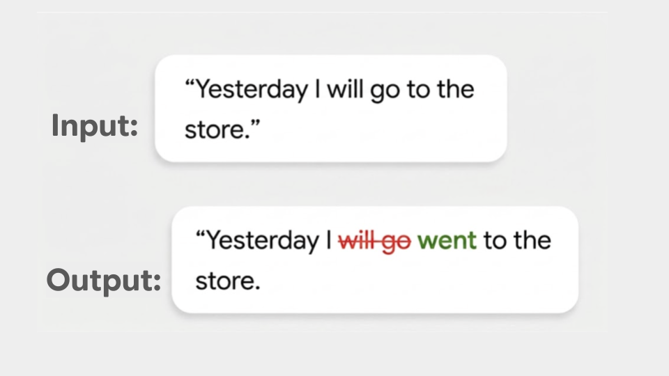

# 文本校对 (Text Proofreading)

> 本文译自官方文档:[原文链接](https://developers.google.com/edge/mediapipe/solutions/text/text_proofreader)
> 为保持内容与版式一致,图片位置、章节顺序、代码示例均与原页对齐。

MediaPipe 文本校对器(Text Proofreader)任务可以识别文本中的拼写、语法和文体错误,并在保持原意不变的前提下生成修正后的版本。该任务使用机器学习(ML)模型处理文本数据,并输出修正后的文本。

## 快速入门 (Get Started)

请按照以下针对目标平台的实现指南之一开始使用此任务。这些平台专属指南将带你完成此任务的基本实现,包括推荐的模型以及带有推荐配置选项的代码示例:

| 平台 | 代码示例 | 指南 |
|---|---|---|
| Android | [代码示例](https://github.com/google-ai-edge/mediapipe-samples/tree/main/examples/text_proofreader/android) | [指南](text_proofreader/android.md) |
| iOS | [代码示例](https://github.com/google-ai-edge/mediapipe-samples/tree/main/examples/text_proofreader/ios) | [指南](text_proofreader/ios.md) |
| Python | [Colab](https://github.com/google-ai-edge/mediapipe-samples/blob/main/examples/text_proofreader/python/text_proofreader.ipynb) | [指南](text_proofreader/python.md) |

## 任务详情 (Task details)

本节介绍此任务的功能、输入、输出和配置选项。

### 功能 (Features)

-   **输入文本处理** - 处理文本预处理,包括在需要时进行分词(tokenization)。
-   **细粒度修正** - 提供细粒度修正的详细分解,使你可以识别哪些词被插入、删除或保持不变。

任务输入

任务输出

文本校对器接受以下输入数据类型:

-   String

文本校对器输出以下结果:

-   String:表示校对结果。
-   修正列表:对细粒度编辑(插入、删除或未改变的文本片段)的详细分解。

### 配置选项 (Configuration options)

此任务具有以下配置选项:

| 选项名称 | 说明 | 取值范围 / 类型 | 默认值 |
|---|---|---|---|
| `max_num_tokens` | 校对任务的最大 token 数。如果设置,当输入和输出超过此值时,校对输出将被截断。如果未设置(或等于 0),则默认限制由模型容量决定(8k)。 | `Integer` | `None` |

## 模型 (Models)

我们为开始使用此任务开发提供了默认的推荐模型。

### Proofread 200M 模型(推荐)

一个轻量级 200M 参数模型,经过微调用于识别文本中的拼写、语法和文体错误,并生成修正后的版本。该模型受 [Gemma 使用条款](https://ai.google.dev/gemma/terms)约束。

| 模型名称 | 输入 | 量化类型 | 使用条款 | 版本 |
|---|---|---|---|---|
| [Text Proofreader](https://storage.googleapis.com/mediapipe-models/text_proofreader/200m/latest/proofread_quant_200m.litertlm) | string | 混合精度(Int4 + Int8) | [Gemma](https://ai.google.dev/gemma/terms) | [最新版](https://storage.googleapis.com/mediapipe-models/text_proofreader/200m/latest/proofread_quant_200m.litertlm) |

## 任务基准测试 (Task benchmarks)

以下是在 Pixel 10 Pro CPU 上整个管线的任务基准测试。端侧模型推理的峰值内存占用约为 200MB 至 350MB,具体取决于输入长度(100 至 2000 词)。

### MediaPipe E2E 基准测试

| 设备 | 输入词数(tokens) | 预填充 (Prefill) (tokens/s) | 解码 (Decode) (tokens/s) | E2E 延迟 (ms) |
|---|---|---|---|---|
| Pixel 10 Pro CPU | 100(~200 tokens) | 1280 | 170 | 980 |
| | 500(~900 tokens) | 1095 | 163 | 4,900 |
| | 1000(~1900 tokens) | 1025 | 150 | 16,000 |
| | 2000(~3600 tokens) | 980 | 140 | 28,000 |

---

*页面内容遵循 [CC BY 4.0](https://creativecommons.org/licenses/by/4.0/) 许可;代码示例遵循 [Apache 2.0](https://www.apache.org/licenses/LICENSE-2.0) 许可。*