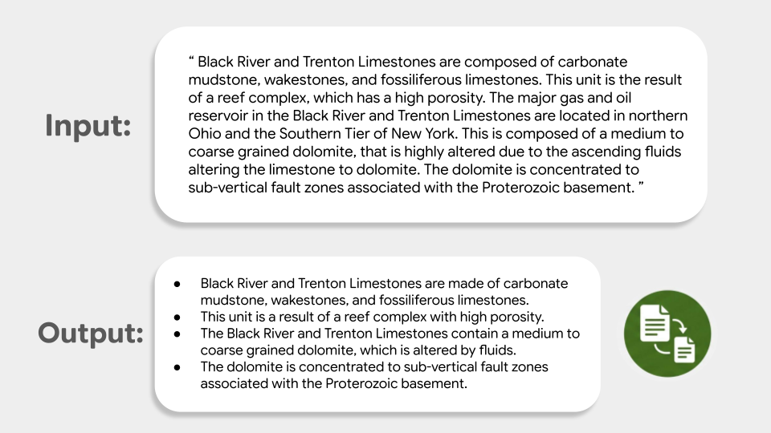

# 文本摘要指南 (Text summarization guide)

> 本文译自官方文档：[原文链接](https://developers.google.com/edge/mediapipe/solutions/text/text_summarizer)
> 为保持内容与版式一致，图片位置、章节顺序、代码示例均与原页对齐。

MediaPipe Text Summarizer(文本摘要器)任务允许您识别文本中最重要的信息，并在保持原始上下文含义的同时生成较短的版本。此任务使用机器学习 (ML) 模型处理文本数据，并输出摘要字符串。

此任务支持两种模式：

* **TLDR**：生成 1–2 句的简短段落。
* **Keypoints**：生成 3–5 个要点的项目符号列表。

## 快速入门 (Get Started)

通过遵循您的目标平台的这些实现指南之一来开始使用此任务。这些特定平台的指南将引导您完成此任务的基本实现，包括推荐的模型，以及带有推荐配置选项的代码示例：

| 平台 (Platform) | 代码示例 (Code Example) | 指南 (Guide) |
| --- | --- | --- |
| Android | [代码示例](https://github.com/google-ai-edge/mediapipe-samples/tree/main/examples/text_summarizer/android) | [指南](text_summarizer/android.md) |
| iOS | [代码示例](https://github.com/google-ai-edge/mediapipe-samples/tree/main/examples/text_summarizer/ios) | [指南](text_summarizer/ios.md) |
| Python | [Colab](https://github.com/google-ai-edge/mediapipe-samples/blob/main/examples/text_summarizer/python/text_summarizer.ipynb) | [指南](text_summarizer/python.md) |

## 任务详情 (Task details)

本节介绍了此任务的功能、输入、输出和配置选项。

### 功能 (Features)

* **输入文本处理** - 支持没有图内标记化 (in-graph tokenization) 的模型的图外标记化 (out-of-graph tokenization)。

| 任务输入 (Task inputs) | 任务输出 (Task outputs) |
| --- | --- |
| Text Summarizer 接受以下输入数据类型：    * 字符串 (String) | Text Summarizer 输出以下结果：    * 字符串 (String)：表示摘要。 |

### 配置选项 (Configuration options)

此任务具有以下配置选项：

| 选项名称 (Option Name) | 描述 (Description) | 取值范围 (Value Range) | 默认值 (Default Value) |
| --- | --- | --- | --- |
| `mode` | 文本摘要器 (text summarizer) 任务的摘要模式。可以是简短的摘要段落或要点的项目符号列表。 | `TextSummarizerMode.TLDR`、`TextSummarizerMode.KEYPOINTS` | `TextSummarizerMode.KEYPOINTS` |
| `max_num_tokens` | 摘要 (summarization) 任务的最大令牌 (tokens) 数。如果设置，当输入和输出超过此值时，摘要将被截断。如果未设置，则默认限制由模型容量决定。 | `Integer` | `None` (模型容量 8k) |

## 模型 (Models)

我们提供了一个默认的推荐模型，供您在开始使用此任务进行开发时使用。

### Summarization 200M 模型（推荐） (Summarization 200M model (recommended))

一个轻量级的、2 亿参数的模型，经过微调以实时生成两种类型的摘要：TLDR 和 Keypoints (要点)。此模型受 [Gemma 使用条款 (Gemma Terms of Use)](https://ai.google.dev/gemma/terms) 约束。

| 模型名称 (Model name) | 输入 (Input) | 量化类型 (Quantization type) | 使用条款 (Terms of use) | 版本 (Versions) |
| --- | --- | --- | --- | --- |
| [Summarization 200M](https://storage.googleapis.com/mediapipe-models/text_summarizer/200m/latest/summarization_quant_200m_2modes.litertlm) | 字符串 (string) | 混合精度 (Int4 + Int8) | [Gemma](https://ai.google.dev/gemma/terms) | [最新版 (Latest)](https://storage.googleapis.com/mediapipe-models/text_summarizer/200m/latest/summarization_quant_200m_2modes.litertlm) |

## 任务基准测试 (Task benchmarks)

以下是 Pixel 10 Pro CPU 上整个流水线 (pipeline) 的任务基准测试，显示了 **Keypoints** 和 **TLDR** 模式下的平均延迟。
设备端 (on-device) 模型推理 (inference) 的峰值内存使用量根据输入长度（100 到 2000 个单词）从大约 200MB 到 350MB 不等。

### MediaPipe 端到端基准测试 (MediaPipe E2E Benchmark)

| 设备 (Device) | 输入单词数(令牌数) (Input Words (tokens)) | 预填充 (令牌/秒) (Prefill (tokens/s)) | 解码 (令牌/秒) (Decode (tokens/s)) | 端到端延迟 (E2E Latency (ms)) |
| --- | --- | --- | --- | --- |
| Pixel 10 Pro CPU | 100 (~200 tokens) | 980 | 133 | 900 |
|  | 500 (~900 tokens) | 950 | 130 | 1790 |
|  | 1000 (~1900 tokens) | 690 | 100 | 5,000 |
|  | 2000 (~3600 tokens) | 470 | 55 | 12,000-17,000 |

---

*页面内容遵循 [CC BY 4.0](https://creativecommons.org/licenses/by/4.0/) 许可；代码示例遵循 [Apache 2.0](https://www.apache.org/licenses/LICENSE-2.0) 许可。*