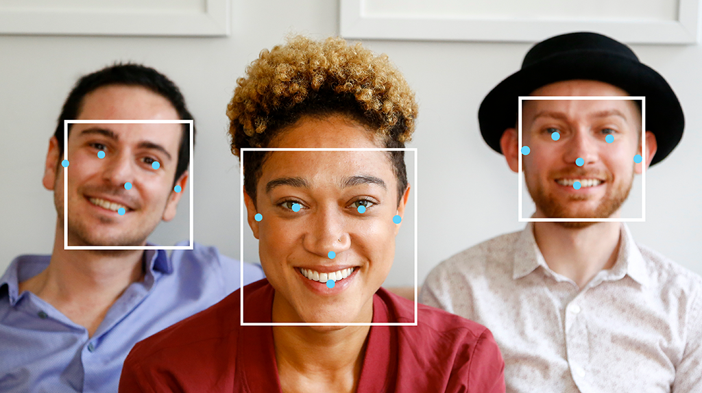

# 人脸检测指南 (Face Detection Guide)

> 本文译自官方文档:[原文链接](https://developers.google.com/edge/mediapipe/solutions/vision/face_detector)
> 为保持内容与版式一致,图片位置、章节顺序、代码示例均与原页对齐。

MediaPipe Face Detector(人脸检测器)任务可让您检测图像或视频中的人脸。您可以使用此任务定位画面中的人脸及面部特征。该任务使用机器学习(ML)模型,支持单张图像或连续的图像数据流输入。任务输出人脸位置,以及以下面部关键点:左眼、右眼、鼻尖、嘴巴、左耳屏(tragion)和右耳屏。

[立即试用!](https://google-ai-edge.github.io/mediapipe-samples-web/#/vision/face_detector)

## 开始使用

请按照以下适用于目标平台的实现指南之一开始使用此任务。这些平台专属指南将引导您完成此任务的基础实现,包括推荐的模型,以及带有推荐配置选项的代码示例:

| 平台 | 代码示例 | 指南 |
|---|---|---|
| Android | [代码示例](https://github.com/google-ai-edge/mediapipe-samples/tree/main/examples/face_detector/android) | [指南](android.md) |
| iOS | [代码示例](https://github.com/google-ai-edge/mediapipe-samples/tree/main/examples/face_detector/ios) | [指南](ios.md) |
| Python | [Colab](https://colab.sandbox.google.com/github/googlesamples/mediapipe/blob/main/examples/face_detector/python/face_detector.ipynb) | [指南](python.md) |
| Web | [代码示例](https://github.com/google-ai-edge/mediapipe-samples-web/blob/main/src/tasks/face-detector.ts) | [指南](web_js.md) |

## 任务详情

本节介绍此任务的功能、输入、输出及配置选项。

### 功能特性 (Features)

- **输入图像处理** - 处理包括图像旋转、缩放、归一化和色彩空间转换。
- **分数阈值** - 根据预测分数过滤结果。

| 任务输入 | 任务输出 |
|---|---|
| Face Detector 接受以下数据类型之一作为输入:  - 静态图片 - 已解码视频帧 - 实时视频流 | Face Detector 输出以下结果:  - 图像帧中检测到的人脸的边界框。 - 每张检测到的人脸的 6 个面部关键点的坐标。 |

### 配置选项

此任务具有以下配置选项:

| 选项名称 | 说明 | 取值范围 | 默认值 |
|---|---|---|---|
| `running_mode` | 设置任务的运行模式。共有三种模式:  IMAGE:单张图像输入模式。  VIDEO:视频已解码帧模式。  LIVE_STREAM:输入数据实时流(如来自摄像头)模式。在此模式下,必须调用 `resultListener` 来设置监听器,以异步接收结果。 | `{IMAGE, VIDEO, LIVE_STREAM}` | `IMAGE` |
| `min_detection_confidence` | 人脸检测被视为成功所需的最低置信度分数。 | `Float [0,1]` | `0.5` |
| `min_suppression_threshold` | 人脸检测被视为重叠所需的最低非极大值抑制阈值。 | `Float [0,1]` | `0.3` |
| `result_callback` | 设置结果监听器,使 Face Detector 处于实时流模式时异步接收检测结果。仅在运行模式设置为 `LIVE_STREAM` 时才可使用。 | 不适用 | 未设置 |

## 模型

人脸检测模型会因预期用途(如近距检测与远距检测)而异。模型通常还需要在性能、准确性、分辨率与资源需求之间进行权衡,某些情况下还会包含额外功能。

本节列出的模型均为 BlazeFace 的变体。BlazeFace 是一种为移动端 GPU 推理优化的轻量且精准的人脸检测器。BlazeFace 模型适用于 3D 面部关键点估计、表情分类与人脸区域分割等应用。BlazeFace 使用与 [MobileNetV1/V2](https://arxiv.org/abs/1704.04861) 类似的轻量特征提取网络。

### BlazeFace (short-range)

用于检测智能手机摄像头或网络摄像头拍摄的自拍式图像中单张或多张人脸的轻量模型。该模型针对短距离前置手机摄像头图像进行了优化。模型架构采用带自定义编码器的 Single Shot Detector(SSD)卷积网络技术。更多信息,请参阅 [Single Shot MultiBox Detector](https://arxiv.org/abs/1512.02325) 研究论文。

| 模型名称 | 输入尺寸 | 量化类型 | 模型卡 | 版本 |
|---|---|---|---|---|
| [BlazeFace (short-range)](https://storage.googleapis.com/mediapipe-models/face_detector/blaze_face_short_range/float16/latest/blaze_face_short_range.tflite) | 128 x 128 | float 16 | [info](https://storage.googleapis.com/mediapipe-assets/MediaPipe%20BlazeFace%20Model%20Card%20\(Short%20Range\).pdf) | [Latest](https://storage.googleapis.com/mediapipe-models/face_detector/blaze_face_short_range/float16/latest/blaze_face_short_range.tflite) |

### BlazeFace (full-range)

用于检测智能手机摄像头或网络摄像头拍摄的图像中单张或多张人脸的相对轻量模型。该模型针对全范围图像(如后置手机摄像头拍摄的图像)进行了优化。模型架构采用与 [CenterNet](https://arxiv.org/abs/1904.08189) 卷积网络类似的技术,并带自定义编码器。

| 模型名称 | 输入尺寸 | 量化类型 | 模型卡 | 版本 |
|---|---|---|---|---|
| [BlazeFace (full-range)](https://storage.googleapis.com/mediapipe-models/face_detector/blaze_face_full_range/float16/latest/blaze_face_full_range.tflite) | 128 x 128 | float 16 | [info](https://storage.googleapis.com/mediapipe-assets/MediaPipe%20BlazeFace%20Model%20Card%20\(Full%20Range\).pdf) | [Latest](https://storage.googleapis.com/mediapipe-models/face_detector/blaze_face_full_range/float16/latest/blaze_face_full_range.tflite) |

### BlazeFace Sparse (full-range)

常规 full-range BlazeFace 模型的轻量版本,体积约为其 60% 大小。该模型针对全范围图像(如后置手机摄像头拍摄的图像)进行了优化。模型架构采用与 [CenterNet](https://arxiv.org/abs/1904.08189) 卷积网络类似的技术,并带自定义编码器。

| 模型名称 | 输入尺寸 | 量化类型 | 模型卡 | 版本 |
|---|---|---|---|---|
| [BlazeFace Sparse (full-range)](https://storage.googleapis.com/mediapipe-models/face_detector/blaze_face_full_range/float16/latest/blaze_face_full_range_sparse.tflite) | 128 x 128 | float 16 | [info](https://storage.googleapis.com/mediapipe-assets/MediaPipe%20BlazeFace%20Sparse%20Model%20Card%20\(Full%20Range\).pdf) | [Latest](https://storage.googleapis.com/mediapipe-models/face_detector/blaze_face_full_range/float16/latest/blaze_face_full_range_sparse.tflite) |

## 任务基准测试

以下是基于上述预训练模型的完整流程的任务基准测试。延迟结果为 Pixel 6 上使用 CPU / GPU 的平均延迟。

| 模型名称 | CPU 延迟 | GPU 延迟 |
|---|---|---|
| BlazeFace (short-range) | 2.94ms | 7.41ms |

---

*页面内容遵循 [CC BY 4.0](https://creativecommons.org/licenses/by/4.0/) 许可;代码示例遵循 [Apache 2.0](https://www.apache.org/licenses/LICENSE-2.0) 许可。*