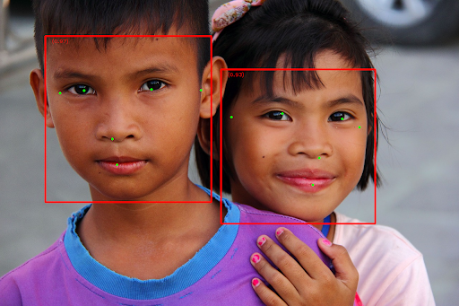

# iOS 人脸检测指南 (Face detection guide for iOS)

> 本文译自官方文档:[原文链接](https://developers.google.com/edge/mediapipe/solutions/vision/face_detector/ios)
> 为保持内容与版式一致,图片位置、章节顺序、代码示例均与原页对齐。

人脸检测器(Face Detector)任务允许您在图像或视频中检测人脸。您可以使用此任务定位一帧画面中的人脸和面部特征。此任务使用一个机器学习(ML)模型,适用于单张图像或连续的图像流。任务会输出人脸的位置,以及以下面部关键点:左眼、右眼、鼻尖、嘴巴、左耳屏点和右耳屏点。

本说明中描述的代码示例可在 [GitHub](https://github.com/google-ai-edge/mediapipe-samples/tree/main/examples/face_detector/ios) 上获取。您可以通过查看此 [Web 演示](https://google-ai-edge.github.io/mediapipe-samples-web/#/vision/face_detector)来观看此任务的实际运行效果。有关此任务的功能、模型和配置选项的更多信息,请参阅[概览](../face_detector.md)。

## 代码示例 (Code example)

MediaPipe Tasks 示例代码是 iOS 人脸检测器应用的一个简单实现。该示例使用物理 Android 设备上的摄像头,在连续的视频流中检测人脸。该应用还可以检测设备相册中图像和视频里的人脸。

您可以将该应用作为自己 iOS 应用的起点,也可以在修改现有应用时参考它。人脸检测器示例代码托管在 [GitHub](https://github.com/google-ai-edge/mediapipe-samples/tree/main/examples/face_detector/ios) 上。

### 下载代码 (Download the code)

以下说明介绍如何使用 [git](https://git-scm.com) 命令行工具创建示例代码的本地副本。

要下载示例代码:

1.  使用以下命令克隆 git 代码库:

    ```
    git clone https://github.com/google-ai-edge/mediapipe-samples
    ```

2.  或者,配置您的 git 实例使用稀疏检出,以便只保留人脸检测器示例应用所需的文件:

    ```
    cd mediapipe-samples
    git sparse-checkout init --cone
    git sparse-checkout set examples/face_detector/ios/
    ```

创建示例代码的本地版本后,您可以在 Xcode 中打开项目并运行应用。有关说明,请参阅 [iOS 环境配置指南](../../../setup_ios.md)。

### 关键组件 (Key components)

以下文件包含人脸检测器示例应用的关键代码:

-   [FaceDetectorService.swift](https://github.com/googlesamples/mediapipe/blob/main/examples/face_detector/ios/FaceDetector/Services/FaceDetectorService.swift):初始化检测器,处理模型选择并在输入数据上运行推理。
-   [CameraViewController](https://github.com/googlesamples/mediapipe/blob/main/examples/face_detector/ios/FaceDetector/ViewContoller/CameraViewController.swift):实现实时摄像头输入模式的界面,并可视化检测结果。
-   [MediaLibraryViewController.swift](https://github.com/googlesamples/mediapipe/blob/main/examples/face_detector/ios/FaceDetector/ViewContoller/CameraViewController.swift):实现静态图像和视频文件输入模式的界面,并可视化检测结果。

## 环境配置 (Setup)

本节介绍为使用人脸检测器配置开发环境和代码项目的关键步骤。有关使用 MediaPipe 任务配置开发环境的一般信息(包括平台版本要求),请参阅 [iOS 环境配置指南](../../../setup_ios.md)。

### 依赖项 (Dependencies)

人脸检测器使用 `MediaPipeTasksVision` 库,该库可以通过 [Swift Package Manager](https://github.com/swiftlang/swift-package-manager)(SPM)安装。该库同时兼容 Swift 和 Objective-C 应用,不需要任何额外的语言特定设置。

要将 `MediaPipeTasksVision` 库添加到您的 Xcode 项目中:

1.  在 Xcode 中打开您的项目后,选择 **File > Add Package Dependencies...**。
2.  在右上角的搜索字段中,输入代码库 URL:`https://github.com/google-ai-edge/mediapipe`
3.  选择 `mediapipe` 包,并选择您的依赖规则(例如,**Up to Next Major Version** 或 `master` 分支)。
4.  点击 **Add Package**,然后选择 `MediaPipeTasksVision` 并将其添加到您的应用目标。

如果您使用 `Package.swift` 文件,请使用以下代码添加 MediaPipe 包和 `MediaPipeTasksVision` 目标依赖:

```
dependencies: [
    .package(
        url: "https://github.com/google-ai-edge/mediapipe",
        branch: "master"
    ),
],
targets: [
    .target(
        name: "MyFaceDetectorApp",
        dependencies: [
            .product(name: "MediaPipeTasksVision", package: "mediapipe"),
        ]
    ),
]
```

有关配置依赖项的更多信息,请参阅 [iOS 环境配置指南](../../../setup_ios.md)。

> **注意:** 以下各节提供 Swift 和 Objective-C 两种代码示例。适用时,说明文字会引用 Swift 方法名。

### 模型 (Model)

MediaPipe 人脸检测器任务需要一个与此任务兼容的已训练模型。有关人脸检测器可用已训练模型的更多信息,请参阅任务概览的[模型章节](../face_detector.md#models)。

选择并下载模型,然后使用 Xcode 将其添加到您的项目目录。有关如何在 Xcode 项目中添加文件的说明,请参阅 [Managing files and folders in your Xcode project](https://developer.apple.com/documentation/xcode/managing-files-and-folders-in-your-xcode-project)。

使用 `BaseOptions.modelAssetPath` 属性来指定应用包中模型的路径。代码示例请参阅下一节。

## 创建任务 (Create the task)

您可以通过调用其中一个初始化器来创建人脸检测器任务。`FaceDetector(options:)` 初始化器接受配置选项的值。

如果您不需要使用自定义配置选项初始化的人脸检测器,可以使用 `FaceDetector(modelPath:)` 初始化器以默认选项创建人脸检测器。有关配置选项的更多信息,请参阅[配置概览](#configuration)。

人脸检测器任务支持 3 种输入数据类型:静态图像、视频文件和实时视频流。默认情况下,`FaceDetector(modelPath:)` 会为静态图像初始化任务。如果您希望任务被初始化为处理视频文件或实时视频流,请使用 `FaceDetector(options:)` 指定视频或实时流运行模式。实时流模式还需要额外的 `faceDetectorLiveStreamDelegate` 配置选项,该选项使人脸检测器能够将人脸检测结果异步传递给委托。

选择与您的运行模式对应的选项卡,查看如何创建任务并运行推理。

### Swift

### 图像 (Image)

```
import MediaPipeTasksVision

let modelPath = Bundle.main.path(forResource: "model",
                                      ofType: "tflite")

let options = FaceDetectorOptions()
options.baseOptions.modelAssetPath = modelPath
options.runningMode = .image

let faceDetector = try FaceDetector(options: options)
```

### 视频 (Video)

```
import MediaPipeTasksVision

let modelPath = Bundle.main.path(forResource: "model",
                                      ofType: "tflite")

let options = FaceDetectorOptions()
options.baseOptions.modelAssetPath = modelPath
options.runningMode = .video

let faceDetector = try FaceDetector(options: options)
```

### 实时流 (Livestream)

```
import MediaPipeTasksVision

// Class that conforms to the `FaceDetectorLiveStreamDelegate` protocol and
// implements the method that the face detector calls once it finishes
// detecting faces in each input frame.
class FaceDetectorResultProcessor: NSObject, FaceDetectorLiveStreamDelegate {

  func faceDetector(
    _ faceDetector: FaceDetector,
    didFinishDetection result: FaceDetectorResult?,
    timestampInMilliseconds: Int,
    error: Error?) {

    // Process the face detection result or errors here.

  }
}

let modelPath = Bundle.main.path(
  forResource: "model",
  ofType: "tflite")

let options = FaceDetectorOptions()
options.baseOptions.modelAssetPath = modelPath
options.runningMode = .liveStream

// Assign an object of the class to the `faceDetectorLiveStreamDelegate`
// property.
let processor = FaceDetectorResultProcessor()
options.faceDetectorLiveStreamDelegate = processor

let faceDetector = try FaceDetector(options: options)
```

### Objective-C

### 图像 (Image)

```
@import MediaPipeTasksVision;

NSString *modelPath = [[NSBundle mainBundle] pathForResource:@"model"
                                                      ofType:@"tflite"];

MPPFaceDetectorOptions *options = [[MPPFaceDetectorOptions alloc] init];
options.baseOptions.modelAssetPath = modelPath;
options.runningMode = MPPRunningModeImage;

MPPFaceDetector *faceDetector =
      [[MPPFaceDetector alloc] initWithOptions:options error:nil];
```

### 视频 (Video)

```
@import MediaPipeTasksVision;

NSString *modelPath = [[NSBundle mainBundle] pathForResource:@"model"
                                                      ofType:@"tflite"];

MPPFaceDetectorOptions *options = [[MPPFaceDetectorOptions alloc] init];
options.baseOptions.modelAssetPath = modelPath;
options.runningMode = MPPRunningModeVideo;

MPPFaceDetector *faceDetector =
      [[MPPFaceDetector alloc] initWithOptions:options error:nil];
```

### 实时流 (Livestream)

```
@import MediaPipeTasksVision;

// Class that conforms to the `MPPFaceDetectorLiveStreamDelegate` protocol
// and implements the method that the face detector calls once it finishes
// detecting faces in each input frame.

@interface APPFaceDetectorResultProcessor : NSObject @end

@implementation APPFaceDetectorResultProcessor

-   (void)faceDetector:(MPPFaceDetector *)faceDetector
    didFinishDetectionWithResult:(MPPFaceDetectorResult *)faceDetectorResult
         timestampInMilliseconds:(NSInteger)timestampInMilliseconds
                           error:(NSError *)error {

    // Process the face detector result or errors here.

}

@end

NSString *modelPath = [[NSBundle mainBundle] pathForResource:@"model"
                                                      ofType:@"tflite"];

MPPFaceDetectorOptions *options = [[MPPFaceDetectorOptions alloc] init];
options.baseOptions.modelAssetPath = modelPath;
options.runningMode = MPPRunningModeLiveStream;

// Assign an object of the class to the `faceDetectorLiveStreamDelegate`
// property.
APPFaceDetectorResultProcessor *processor = [APPFaceDetectorResultProcessor new];
options.faceDetectorLiveStreamDelegate = processor;

MPPFaceDetector *faceDetector =
      [[MPPFaceDetector alloc] initWithOptions:options error:nil];
```

> **注意:** 如果使用视频模式或实时流模式,人脸检测器会使用追踪来避免每一帧都触发检测模型,这有助于降低延迟。

### 配置选项 (Configuration options)

此任务对 iOS 应用有以下配置选项:

| 选项名称 | 说明 | 取值范围 | 默认值 |
|---|---|---|---|
| `runningMode` | 设置任务的运行模式。共有三种模式:<br><br>IMAGE:用于单张图像输入的模式。<br><br>VIDEO:用于视频已解码帧的模式。<br><br>LIVE_STREAM:用于输入数据实时流(例如来自摄像头)的模式。在此模式下,必须调用 resultListener 来设置监听器以异步接收结果。 | `{RunningMode.image, RunningMode.video, RunningMode.liveStream}` | `RunningMode.image` |
| `minDetectionConfidence` | 人脸检测被认为成功所需的最低置信度分数。 | `Float [0,1]` | `0.5` |
| `minSuppressionThreshold` | 人脸检测被认为重叠所需的最低非极大值抑制阈值。 | `Float [0,1]` | `0.3` |

#### 实时流配置 (Livestream configuration)

当运行模式设置为实时流时,人脸检测器需要额外的 `faceDetectorLiveStreamDelegate` 配置选项,该选项使人脸检测器能够异步传递检测结果。委托实现 `faceDetector(_:didFinishDetection:timestampInMilliseconds:error:)` 方法,人脸检测器在处理完每一帧的人脸检测结果后调用该方法。

| 选项名称 | 说明 | 取值范围 | 默认值 |
|---|---|---|---|
| `faceDetectorLiveStreamDelegate` | 使人脸检测器能够在实时流模式下异步接收人脸检测结果。其实例被设置为此属性的类必须实现 `faceDetector(_:didFinishDetection:timestampInMilliseconds:error:)` 方法。 | 不适用 | 未设置 |

## 准备数据 (Prepare data)

在将输入图像或帧传递给人脸检测器之前,您需要将其转换为 `MPImage` 对象。`MPImage` 支持不同类型的 iOS 图像格式,并且可以在任何运行模式下将其用于推理。有关 `MPImage` 的更多信息,请参阅 [MPImage API](https://developers.google.com/edge/api/mediapipe/swift/vision/Classes/MPImage)。

根据您的用例和应用所需的运行模式选择一种 iOS 图像格式。`MPImage` 接受 `UIImage`、`CVPixelBuffer` 和 `CMSampleBuffer` 这些 iOS 图像格式。

### UIImage

`UIImage` 格式非常适合以下运行模式:

-   图像:来自应用包、用户相册或文件系统的格式为 `UIImage` 的图像可以转换为 `MPImage` 对象。
-   视频:使用 [AVAssetImageGenerator](https://developer.apple.com/documentation/avfoundation/avassetimagegenerator) 将视频帧提取为 [CGImage](https://developer.apple.com/documentation/coregraphics/cgimage) 格式,然后将其转换为 `UIImage` 图像。

### Swift

```
// Load an image on the user's device as an iOS `UIImage` object.

// Convert the `UIImage` object to a MediaPipe's Image object having the default
// orientation `UIImage.Orientation.up`.
let image = try MPImage(uiImage: image)
```

### Objective-C

```
// Load an image on the user's device as an iOS `UIImage` object.

// Convert the `UIImage` object to a MediaPipe's Image object having the default
// orientation `UIImageOrientationUp`.
MPImage *image = [[MPPImage alloc] initWithUIImage:image error:nil];
```

该示例使用默认的 [UIImage.Orientation.Up](https://developer.apple.com/documentation/uikit/uiimage/orientation/up) 方向初始化 `MPImage`。您可以使用任何受支持的 [UIImage.Orientation](https://developer.apple.com/documentation/uikit/uiimage/orientation) 值来初始化 `MPImage`。人脸检测器不支持镜像方向,例如 `.upMirrored`、`.downMirrored`、`.leftMirrored`、`.rightMirrored`。

有关 `UIImage` 的更多信息,请参阅 [UIImage Apple Developer Documentation](https://developer.apple.com/documentation/uikit/uiimage)。

### CVPixelBuffer

`CVPixelBuffer` 格式非常适合生成帧并使用 iOS [CoreImage](https://developer.apple.com/documentation/coreimage) 框架进行处理的应用程序。

`CVPixelBuffer` 格式非常适合以下运行模式:

-   图像:使用 iOS 的 `CoreImage` 框架经过一些处理后生成 `CVPixelBuffer` 图像的应用程序,可以在图像运行模式下将其发送给人脸检测器。
-   视频:视频帧可以转换为 `CVPixelBuffer` 格式进行处理,然后在视频模式下发送给人脸检测器。
-   实时流:使用 iOS 摄像头生成帧的应用程序,可以在发送给人脸检测器之前在实时流模式下转换为 `CVPixelBuffer` 格式进行处理。

### Swift

```
// Obtain a CVPixelBuffer.

// Convert the `CVPixelBuffer` object to a MediaPipe's Image object having the default
// orientation `UIImage.Orientation.up`.
let image = try MPImage(pixelBuffer: pixelBuffer)
```

### Objective-C

```
// Obtain a CVPixelBuffer.

// Convert the `CVPixelBuffer` object to a MediaPipe's Image object having the
// default orientation `UIImageOrientationUp`.
MPImage *image = [[MPPImage alloc] initWithUIImage:image error:nil];
```

有关 `CVPixelBuffer` 的更多信息,请参阅 [CVPixelBuffer Apple Developer Documentation](https://developer.apple.com/documentation/corevideo/cvpixelbuffer-q2e)。

### CMSampleBuffer

`CMSampleBuffer` 格式存储统一媒体类型的媒体样本,非常适合实时流运行模式。来自 iOS 摄像头的实时帧由 iOS [AVCaptureVideoDataOutput](https://developer.apple.com/documentation/avfoundation/avcapturevideodataoutput) 以 `CMSampleBuffer` 格式异步传递。

### Swift

```
// Obtain a CMSampleBuffer.

// Convert the `CMSampleBuffer` object to a MediaPipe's Image object having the default
// orientation `UIImage.Orientation.up`.
let image = try MPImage(sampleBuffer: sampleBuffer)
```

### Objective-C

```
// Obtain a `CMSampleBuffer`.

// Convert the `CMSampleBuffer` object to a MediaPipe's Image object having the
// default orientation `UIImageOrientationUp`.
MPImage *image = [[MPPImage alloc] initWithSampleBuffer:sampleBuffer error:nil];
```

有关 `CMSampleBuffer` 的更多信息,请参阅 [CMSampleBuffer Apple Developer Documentation](https://developer.apple.com/documentation/coremedia/cmsamplebuffer)。

## 运行任务 (Run the task)

要运行人脸检测器,请使用与所分配运行模式对应的 `detect()` 方法:

-   静态图像:`detect(image:)`
-   视频:`detect(videoFrame:timestampInMilliseconds:)`
-   实时流:`detectAsync(image:timestampInMilliseconds:)`

人脸检测器会返回输入图像或帧中检测到的人脸。

以下代码示例展示了如何在不同的运行模式下运行人脸检测器:

### Swift

### 图像 (Image)

```
let result = try faceDetector.detect(image: image)
```

### 视频 (Video)

```
let result = try faceDetector.detect(
  videoFrame: image,
  timestampInMilliseconds: timestamp)
```

### 实时流 (Livestream)

```
try faceDetector.detectAsync(
  image: image,
  timestampInMilliseconds: timestamp)
```

### Objective-C

### 图像 (Image)

```
MPPFaceDetectorResult *result = [faceDetector detectInImage:image
                                                      error:nil];
```

### 视频 (Video)

```
MPPFaceDetectorResult *result = [faceDetector detectInVideoFrame:image
                                         timestampInMilliseconds:timestamp
                                                           error:nil];
```

### 实时流 (Livestream)

```
BOOL success = [faceDetector detectAsyncInImage:image
                        timestampInMilliseconds:timestamp
                                          error:nil];
```

人脸检测器代码示例更详细地展示了每种模式的实现:`detect(image:)`、`detect(videoFrame:timestampInMilliseconds:)` 和 `detectAsync(image:timestampInMilliseconds:)`。示例代码允许用户在处理模式之间切换,这可能不是您的用例所需要的。

请注意以下事项:

-   在视频模式或实时流模式下运行时,您还必须向人脸检测器任务提供输入帧的时间戳。
-   在图像或视频模式下运行时,人脸检测器任务会阻塞当前线程,直到处理完输入的图像或帧。为避免阻塞当前线程,请使用 iOS [Dispatch](https://developer.apple.com/documentation/dispatch) 或 [NSOperation](https://developer.apple.com/documentation/foundation/nsoperation) 框架在后台线程中执行处理。
-   在实时流模式下运行时,人脸检测器任务会立即返回,不会阻塞当前线程。它会在处理完每个输入帧后,以人脸检测结果调用 `faceDetector(_:didFinishDetection:timestampInMilliseconds:error:)` 方法。人脸检测器会在专用的串行调度队列上异步调用此方法。要在用户界面上显示结果,请在处理完结果后将结果派发到主队列。如果在人脸检测器任务忙于处理另一帧时调用 `detectAsync` 函数,人脸检测器会忽略新的输入帧。

## 处理并显示结果 (Handle and display results)

运行推理后,人脸检测器任务会返回一个 `FaceDetectorResult` 对象,其中包含检测到的人脸的边界框,以及每个检测到的人脸的置信度分数。

以下展示了此任务输出数据的示例:

```
FaceDetectionResult:
  Detections:
    Detection #0:
      BoundingBox:
        origin_x: 126
        origin_y: 100
        width: 463
        height: 463
      Categories:
        Category #0:
          index: 0
          score: 0.9729152917861938
      NormalizedKeypoints:
        NormalizedKeypoint #0:
          x: 0.18298381567001343
          y: 0.2961040139198303
        NormalizedKeypoint #1:
          x: 0.3302789330482483
          y: 0.29289937019348145
        ... (6 keypoints for each face)
    Detection #1:
      BoundingBox:
        origin_x: 616
        origin_y: 193
        width: 430
        height: 430
      Categories:
        Category #0:
          index: 0
          score: 0.9251380562782288
      NormalizedKeypoints:
        NormalizedKeypoint #0:
          x: 0.6151331663131714
          y: 0.3713381886482239
        NormalizedKeypoint #1:
          x: 0.7460576295852661
          y: 0.38825345039367676
        ... (6 keypoints for each face)
```

下图展示了任务输出的可视化效果:



如需要不带边界框的图像,请参阅[原始图像](https://pixabay.com/photos/brother-sister-girl-family-boy-977170/)。

人脸检测器示例代码演示了如何显示结果。详情请参阅[代码示例](https://github.com/google-ai-edge/mediapipe-samples/tree/main/examples/face_detector/ios)。

---

*页面内容遵循 [CC BY 4.0](https://creativecommons.org/licenses/by/4.0/) 许可;代码示例遵循 [Apache 2.0](https://www.apache.org/licenses/LICENSE-2.0) 许可。*