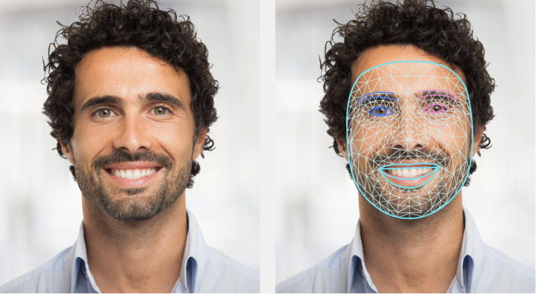
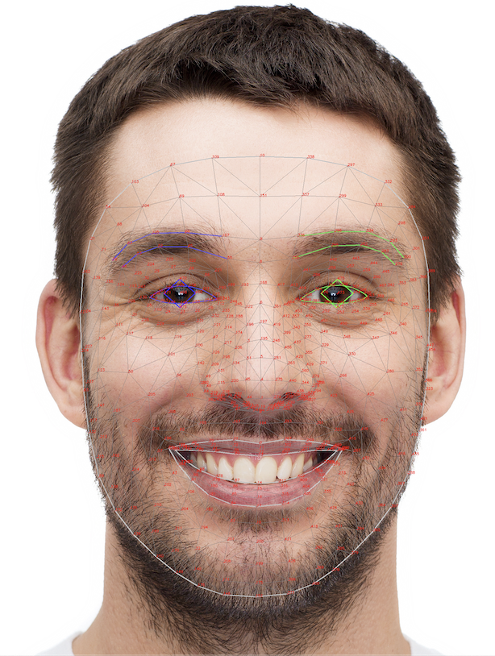

# 面部关键点检测指南 (Face landmark detection guide)

> 本文译自官方文档:[原文链接](https://developers.google.com/edge/mediapipe/solutions/vision/face_landmarker)
> 为保持内容与版式一致,图片位置、章节顺序、代码示例均与原页对齐。

MediaPipe 面部关键点检测器(Face Landmarker)任务允许您在图像和视频中检测面部关键点和面部表情。您可以使用此任务识别人类面部表情、应用面部滤镜和特效,以及创建虚拟化身。此任务使用机器学习(ML)模型,适用于单张图像或连续的图像流。任务输出 3 维面部关键点、blendshape(混合变形)分数(表示面部表情的系数)以实时推断详细的面部表面,以及执行特效渲染所需变换的变换矩阵。

[立即尝试!](https://google-ai-edge.github.io/mediapipe-samples-web/#/vision/face_landmarker)

## 开始使用 (Get Started)

通过以下适用于您目标平台的实现指南之一开始使用此任务。这些平台专属指南将带您完成此任务的基本实现,包括推荐的模型,以及带有推荐配置选项的代码示例:

| 平台 | 代码示例 | 指南 |
|---|---|---|
| Android | [代码示例](https://github.com/google-ai-edge/mediapipe-samples/tree/main/examples/face_landmarker/android) | [指南](face_landmarker/android.md) |
| Python | [Colab](https://colab.research.google.com/github/googlesamples/mediapipe/blob/main/examples/face_landmarker/python/%5BMediaPipe_Python_Tasks%5D_Face_Landmarker.ipynb) | [指南](face_landmarker/python.md) |
| Web | [代码示例](https://github.com/google-ai-edge/mediapipe-samples-web/blob/main/src/tasks/face-landmarker.ts) | [指南](face_landmarker/web_js.md) |

## 任务详情 (Task details)

本节介绍此任务的功能、输入、输出和配置选项。

### 特性 (Features)

-   **输入图像处理** — 处理包括图像旋转、缩放、归一化和色彩空间转换。
-   **分数阈值** — 根据预测分数过滤结果。

### 任务输入 (Task inputs)

面部关键点检测器接受以下数据类型之一的输入:

-   静态图像
-   已解码的视频帧
-   实时视频流

### 任务输出 (Task outputs)

面部关键点检测器输出以下结果:

-   每个检测到的人脸的完整人脸网格,带有表示面部表情的 blendshape 分数和面部关键点坐标。
-   面部 Blendshape 和面部变换矩阵

### 配置选项 (Configurations options)

此任务有以下配置选项:

| 选项名称 | 说明 | 取值范围 | 默认值 |
|---|---|---|---|
| `running_mode` | 设置任务的运行模式。共有三种模式:  IMAGE:用于单张图像输入的模式。  VIDEO:用于视频已解码帧的模式。  LIVE_STREAM:用于输入数据实时流(例如来自摄像头)的模式。在此模式下,必须调用 resultListener 来设置监听器以异步接收结果。 | `{IMAGE, VIDEO, LIVE_STREAM}` | `IMAGE` |
| `num_faces` | 面部关键点检测器可以检测的最大人脸数量。仅当 `num_faces` 设置为 1 时才应用平滑。 | `Integer > 0` | `1` |
| `min_face_detection_confidence` | 人脸检测被认为成功所需的最低置信度分数。 | `Float [0.0,1.0]` | `0.5` |
| `min_face_presence_confidence` | 面部关键点检测中人脸存在得分的最低置信度分数。 | `Float [0.0,1.0]` | `0.5` |
| `min_tracking_confidence` | 人脸追踪被认为成功所需的最低置信度分数。 | `Float [0.0,1.0]` | `0.5` |
| `output_face_blendshapes` | 面部关键点检测器是否输出面部 blendshape。面部 blendshape 用于渲染 3D 人脸模型。  **注意:** `*Left` 和 `*Right` blendshape 对应的是被检测对象的脸,而不是观察者。传入水平镜像的图像将使这些输出反转。 | `Boolean` | `False` |
| `output_facial_transformation_matrixes` | 面部关键点检测器是否输出面部变换矩阵。面部关键点检测器使用该矩阵将面部关键点从标准人脸模型变换到检测到的人脸,以便用户可以对检测到的关键点应用特效。 | `Boolean` | `False` |
| `result_callback` | 设置结果监听器,在面部关键点检测器处于实时流模式时异步接收关键点检测器结果。仅在运行模式设置为 `LIVE_STREAM` 时才能使用。 | `ResultListener` | `N/A` |

## 模型 (Models)

面部关键点检测器使用一系列模型来预测面部关键点。第一个模型检测人脸,第二个模型在检测到的人脸上定位关键点,第三个模型使用这些关键点来识别人脸特征和表情。

以下模型被打包成一个可下载的模型包:

-   **人脸检测模型**:检测人脸是否存在,并给出几个关键面部关键点。
-   **人脸网格模型**:添加人脸的完整映射。该模型输出 478 个 3 维面部关键点的估计值。
-   **Blendshape 预测模型**:接收人脸网格模型的输出,预测 52 个 blendshape 分数,这些系数表示不同的面部表情。

> **注意:** `*Left` 和 `*Right` blendshape 对应的是被检测对象的脸,而不是观察者。传入水平镜像的图像将使这些输出反转。

人脸检测模型是 [BlazeFace 短距](../face_detector.md#blazeface_short-range)模型,这是一种轻量级且准确的人脸检测器,针对移动 GPU 推理进行了优化。有关更多信息,请参阅[人脸检测器](../face_detector.md)任务。

下图展示了模型包输出的面部关键点完整映射。

如需更详细的面部关键点视图,请参阅[全尺寸图像](https://storage.googleapis.com/mediapipe-assets/documentation/mediapipe_face_landmark_fullsize.png)。

| 模型包 | 输入形状 | 数据类型 | 模型卡 | 版本 |
|---|---|---|---|---|
| [FaceLandmarker](https://storage.googleapis.com/mediapipe-models/face_landmarker/face_landmarker/float16/latest/face_landmarker.task) | FaceDetector: 192 x 192 FaceMesh-V2: 256 x 256 Blendshape: 1 x 146 x 2 | float 16 | [FaceDetector](https://storage.googleapis.com/mediapipe-assets/MediaPipe%20BlazeFace%20Model%20Card%20\(Short%20Range\).pdf) [FaceMesh-V2](https://storage.googleapis.com/mediapipe-assets/Model%20Card%20MediaPipe%20Face%20Mesh%20V2.pdf) [Blendshape](https://storage.googleapis.com/mediapipe-assets/Model%20Card%20Blendshape%20V2.pdf) | [Latest](https://storage.googleapis.com/mediapipe-models/face_landmarker/face_landmarker/float16/latest/face_landmarker.task) |

---

*页面内容遵循 [CC BY 4.0](https://creativecommons.org/licenses/by/4.0/) 许可;代码示例遵循 [Apache 2.0](https://www.apache.org/licenses/LICENSE-2.0) 许可。*