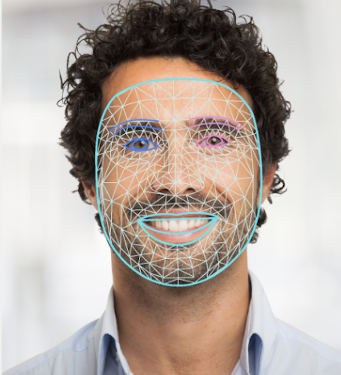

# Web 面部关键点检测指南 (Face landmark detection guide for Web)

> 本文译自官方文档：[原文链接](https://developers.google.com/edge/mediapipe/solutions/vision/face_landmarker/web_js)
> 为保持内容与版式一致，图片位置、章节顺序、代码示例均与原页对齐。

MediaPipe Face Landmarker 任务可让您检测图像和视频中的面部关键点 (face landmarks) 和面部表情。您可以使用此任务来识别人的面部表情、应用面部滤镜和特效，以及创建虚拟形象。此任务使用可处理单张图像或连续图像数据流的机器学习 (ML) 模型。该任务输出 3D 面部关键点、混合形状得分 (blendshape scores，表示面部表情的系数) 以实时推断详细的面部表面，以及变换矩阵 (transformation matrices) 以执行渲染特效所需的变换。

本说明向您展示如何将 Face Landmarker 用于 Web 和 JavaScript 应用。有关此任务的功能、模型和配置选项的更多信息，请参阅[概述](../face_landmarker.md)。

## 代码示例 (Code example)

Face Landmarker 的示例代码为您提供了在 JavaScript 中完整实现此任务的参考。这段代码可以帮助您测试该任务并开始构建您自己的面部关键点检测应用。您只需使用 Web 浏览器即可查看、运行和编辑 Face Landmarker [示例](https://stackblitz.com/github/google-ai-edge/mediapipe-samples-web/?file=src%2Ftasks%2Fface-landmarker.ts)。

## 环境配置 (Setup)

本节介绍专门为使用 Face Landmarker 配置开发环境的关键步骤。有关配置 Web 和 JavaScript 开发环境（包括平台版本要求）的通用信息，请参阅 [Web 环境配置指南](../../setup_web.md)。

### JavaScript 包 (JavaScript packages)

Face Landmarker 代码通过 MediaPipe 的 `@mediapipe/tasks-vision` [NPM](https://www.npmjs.com/search?q=%40mediapipe) 包提供。您可以按照平台[环境配置指南](../../setup_web.md#downloads)中的说明找到并下载这些库。

您可以使用以下命令通过 NPM 安装所需的包：

```bash
npm install @mediapipe/tasks-vision
```

如果您想通过内容分发网络 (CDN) 服务导入任务代码，请在 HTML 文件的 `<head>` 标签中添加以下代码：

```html
<!-- You can replace JSDeliver with another CDN if you prefer to -->
<head>
  <script src="https://cdn.jsdelivr.net/npm/@mediapipe/tasks-vision/vision_bundle.mjs"
    crossorigin="anonymous"></script>
</head>
```

### 模型 (Model)

MediaPipe Face Landmarker 任务需要一个与此任务兼容的训练好的模型。有关 Face Landmarker 的可用训练模型的更多信息，请参阅任务概述的[模型部分](../face_landmarker.md#models)。

选择并下载一个模型，然后将其存储在您的项目目录中：

```
<dev-project-root>/app/shared/models/
```

## 创建任务 (Create the task)

使用其中一个 Face Landmarker `createFrom...()` 函数来准备任务以运行推理。使用带有训练模型文件的相对或绝对路径的 `createFromModelPath()` 函数。如果您的模型已加载到内存中，则可以使用 `createFromModelBuffer()` 方法。

以下代码示例演示了使用 `createFromOptions()` 函数来设置任务。`createFromOptions` 函数允许您使用配置选项自定义 Face Landmarker。有关更多信息，请参阅[配置选项](#configuration_options)。

以下代码演示了如何使用自定义选项构建和配置任务：

```javascript
const vision = await FilesetResolver.forVisionTasks(
  // path/to/wasm/root
  "https://cdn.jsdelivr.net/npm/@mediapipe/tasks-vision@latest/wasm"
);
const faceLandmarker = await faceLandmarker.createFromOptions(
    vision,
    {
      baseOptions: {
        modelAssetPath: "path/to/model"
      },
      runningMode: runningMode
    });
```

### 配置选项 (Configuration options)

此任务为 Web 和 JavaScript 应用程序提供以下配置选项：

| 选项名称 (Option Name) | 说明 (Description) | 值范围 (Value Range) | 默认值 (Default Value) |
| --- | --- | --- | --- |
| `running_mode` | 设置任务的运行模式。有两种模式：IMAGE：用于单张图像输入的模式。VIDEO：用于视频解码帧或输入数据实时流（例如来自摄像头的）的模式。 | {`IMAGE, VIDEO`} | `IMAGE` |
| `numFaces` | `FaceLandmarker` 可以检测到的最大面部数量。仅当 `num_faces` 设置为 1 时才应用平滑处理。 | `Integer > 0` | `1` |
| `minFaceDetectionConfidence` | 面部检测被视为成功的最低置信度得分。 | `Float [0.0,1.0]` | `0.5` |
| `minFacePresenceConfidence` | 面部关键点检测中面部存在得分的最低置信度得分。 | `Float [0.0,1.0]` | `0.5` |
| `minTrackingConfidence` | 面部跟踪被视为成功的最低置信度得分。 | `Float [0.0,1.0]` | `0.5` |
| `outputFaceBlendshapes` | Face Landmarker 是否输出面部混合形状 (face blendshapes)。面部混合形状用于渲染 3D 面部模型。<br>**注意:** `*Left` 和 `*Right` 混合形状对应于主体的面部，而不是观察者的方向。传入水平镜像的图像将反转这些输出。 | `Boolean` | `False` |
| `outputFacialTransformationMatrixes` | FaceLandmarker 是否输出面部变换矩阵。FaceLandmarker 使用矩阵将面部关键点从规范的面部模型变换到检测到的面部，以便用户可以将特效应用在检测到的关键点上。 | `Boolean` | `False` |

## 准备数据 (Prepare data)

Face Landmarker 可以检测主机浏览器支持的任何格式图像中的面部。该任务还处理数据输入的预处理，包括缩放、旋转和值归一化。要检测视频中的面部关键点，您可以使用 API 快速一次处理一帧，使用该帧的时间戳来确定面部在视频中出现的时间。

## 运行任务 (Run the task)

Face Landmarker 使用 `detect()`（运行模式为 `IMAGE`）和 `detectForVideo()`（运行模式为 `VIDEO`）方法来触发推理。该任务处理数据，尝试检测面部关键点，然后报告结果。

对 Face Landmarker `detect()` 和 `detectForVideo()` 方法的调用是同步运行的，并且会阻塞用户界面线程。如果您检测设备摄像头的视频帧中的面部，则每次检测都会阻塞主线程。您可以通过实现 Web Workers 以在另一个线程上运行 `detect()` 和 `detectForVideo()` 方法来防止这种情况。

以下代码演示了如何使用任务模型执行处理：

### 图像 (Image)

```javascript
const image = document.getElementById("image") as HTMLImageElement;
const faceLandmarkerResult = faceLandmarker.detect(image);
```

### 视频 (Video)

```javascript
await faceLandmarker.setOptions({ runningMode: "VIDEO" });

let lastVideoTime = -1;
function renderLoop(): void {
  const video = document.getElementById("video");

  if (video.currentTime !== lastVideoTime) {
    const faceLandmarkerResult = faceLandmarker.detectForVideo(video);
    processResults(detections);
    lastVideoTime = video.currentTime;
  }

  requestAnimationFrame(() => {
    renderLoop();
  });
}
```

有关运行 Face Landmarker 任务的更完整实现，请参阅[示例](https://github.com/google-ai-edge/mediapipe-samples-web/blob/main/src/workers/face-landmarker.worker.ts)。

## 处理和显示结果 (Handle and display results)

Face Landmarker 每次检测运行都会返回一个结果对象。结果对象包含每个检测到的面部的面部网格 (face mesh)，以及每个面部关键点的坐标。结果对象还可以选择包含混合形状 (blendshapes)，它表示面部表情，以及用于将面部特效应用到检测到的关键点上的面部变换矩阵。

以下显示了此任务的输出数据示例：

```text
FaceLandmarkerResult:
  face_landmarks:
    NormalizedLandmark #0:
      x: 0.5971359014511108
      y: 0.485361784696579
      z: -0.038440968841314316
    NormalizedLandmark #1:
      x: 0.3302789330482483
      y: 0.29289937019348145
      z: -0.09489090740680695
    ... (478 landmarks for each face)
  face_blendshapes:
    browDownLeft: 0.8296722769737244
    browDownRight: 0.8096957206726074
    browInnerUp: 0.00035583582939580083
    browOuterUpLeft: 0.00035752105759456754
    ... (52 blendshapes for each face)
  facial_transformation_matrixes:
    [9.99158978e-01, -1.23036895e-02, 3.91213447e-02, -3.70770246e-01]
    [1.66496094e-02,  9.93480563e-01, -1.12779640e-01, 2.27719707e+01]
    ...
```

> **注意:** `*Left` 和 `*Right` 混合形状对应于主体的面部，而不是观察者的方向。传入水平镜像的图像将反转这些输出。

下图展示了该任务输出的视图：



Face Landmarker 示例代码演示了如何显示从任务返回的结果，请参阅[示例](https://github.com/google-ai-edge/mediapipe-samples-web/blob/main/src/tasks/face-landmarker.ts)。

---

*页面内容遵循 [CC BY 4.0](https://creativecommons.org/licenses/by/4.0/) 许可；代码示例遵循 [Apache 2.0](https://www.apache.org/licenses/LICENSE-2.0) 许可。*
