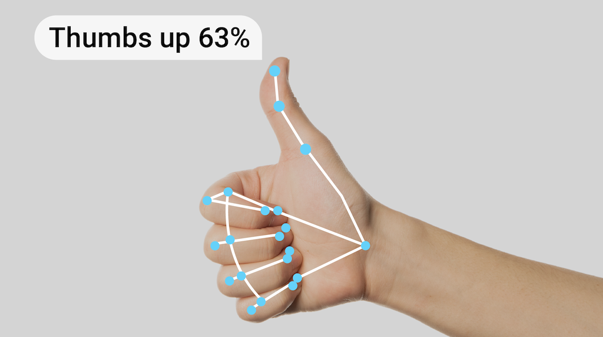

# 手势识别 (Gesture Recognition)

> 本文译自官方文档：[原文链接](https://developers.google.com/edge/mediapipe/solutions/vision/gesture_recognizer)
> 为保持内容与版式一致，图片位置、章节顺序、代码示例均与原页对齐。



MediaPipe 手势识别器 (Gesture Recognizer) 任务可让您实时识别手势，并提供识别出的手势结果以及检测到的手部的关键点 (landmarks)。您可以使用此任务来识别用户的特定手势，并调用与这些手势对应的应用程序功能。

此任务使用机器学习 (ML) 模型对图像数据进行操作，并接受静态数据或连续流 (stream)。该任务输出图像坐标中的手部关键点、世界坐标中的手部关键点、惯用手（左手/右手）以及多只手的类目 (categories)。

[试一试！arrow_forward](https://google-ai-edge.github.io/mediapipe-samples-web/#/vision/gesture_recognizer)

## 开始使用 (Get Started)

请遵循目标平台的以下实施指南之一开始使用此任务。这些特定平台的指南将引导您完成此任务的基本实施，使用推荐的模型，并提供带有推荐配置选项的代码示例：

| 平台 | 代码示例 | 指南 |
| --- | --- | --- |
| Android | [代码示例](https://github.com/google-ai-edge/mediapipe-samples/tree/main/examples/gesture_recognizer/android) | [指南](android.md) |
| Python | [Colab](https://colab.research.google.com/github/googlesamples/mediapipe/blob/main/examples/gesture_recognizer/python/gesture_recognizer.ipynb) | [指南](python.md) |
| Web | [代码示例](https://github.com/google-ai-edge/mediapipe-samples-web/blob/main/src/tasks/gesture-recognizer.ts) | [指南](web_js.md) |

> **注意：** 如果您有兴趣使用自己的数据集创建自定义手势识别器，请参阅[手势识别器定制 (Gesture Recognizer customization)](customize.md) 教程。

## 任务详细信息 (Task details)

本节描述了此任务的特性、输入、输出和配置选项。

### 特性 (Features)

* **输入图像处理** - 处理包括图像旋转、调整大小、归一化 (normalization) 和颜色空间转换。
* **分数阈值 (Score threshold)** - 根据预测分数过滤结果。
* **标签允许列表和拒绝列表 (Label allowlist and denylist)** - 指定模型识别的手势类别。

| 任务输入 | 任务输出 |
| --- | --- |
| 手势识别器 (Gesture Recognizer) 接受以下数据类型之一的输入：<br> * 静态图像 (Still images) <br> * 解码的视频帧 (Decoded video frames) <br> * 实时视频流 (Live video feed) | 手势识别器 (Gesture Recognizer) 输出以下结果：<br> * 手势的类别 (Categories) <br> * 检测到的手的惯用手 (Handedness) <br> * 图像坐标中检测到的手部关键点 (landmarks) <br> * 世界坐标中检测到的手部关键点 (landmarks) |

> **注意：** 此任务支持修改提供的 ML 模型和自定义模型。有关在此任务中使用修改后的模型或自定义模型的更多信息，请参阅[自定义模型 (Custom models)](#custom_models)。

### 配置选项 (Configurations options)

此任务具有以下配置选项：

| 选项名称 | 描述 | 取值范围 | 默认值 |
| --- | --- | --- | --- |
| `running_mode` | 设置任务的运行模式。共有三种模式：<br> `IMAGE`：用于单张图像输入的模式。<br> `VIDEO`：用于视频解码帧的模式。<br> `LIVE_STREAM`：用于输入数据实时流（例如来自摄像头）的模式。在此模式下，必须调用 `resultListener` 来设置侦听器以异步接收结果。 | {`IMAGE`, `VIDEO`, `LIVE_STREAM`} | `IMAGE` |
| `num_hands` | `GestureRecognizer` 可以检测到的最大手部数量。 | `任何整数 > 0` | `1` |
| `min_hand_detection_confidence` | 在手掌检测模型 (palm detection model) 中，手部检测被认为成功的最低置信度分数 (confidence score)。 | `0.0 - 1.0` | `0.5` |
| `min_hand_presence_confidence` | 手部关键点检测模型 (hand landmark detection model) 中手部存在分数的最低置信度分数。在手势识别器的 `VIDEO` 模式和 `LIVE_STREAM` 模式下，如果手部关键点模型的手部存在置信度分数低于此阈值，则会触发手掌检测模型。否则，使用轻量级手部跟踪算法来确定随后进行关键点检测的手部位置。 | `0.0 - 1.0` | `0.5` |
| `min_tracking_confidence` | 手部跟踪被认为成功的最低置信度分数。这是当前帧和上一帧中手部之间的边界框 (bounding box) IoU 阈值。在手势识别器的 `VIDEO` 模式和流模式下，如果跟踪失败，手势识别器会触发手部检测。否则，跳过手部检测。 | `0.0 - 1.0` | `0.5` |
| `canned_gestures_classifier_options` | 用于配置预制手势分类器 (canned gestures classifier) 行为的选项。预制手势有 `["None", "Closed_Fist", "Open_Palm", "Pointing_Up", "Thumb_Down", "Thumb_Up", "Victory", "ILoveYou"]`<br> - Display names locale（显示名称区域设置）：如果有的话，通过 TFLite 模型元数据 (Model Metadata) 指定的用于显示名称的区域设置。<br> - Max results（最大结果数）：要返回的得分最高的分类结果的最大数量。如果 < 0，将返回所有可用结果。<br> - Score threshold（分数阈值）：结果被拒绝的分数下限。如果设置为 0，将返回所有可用结果。<br> - Category allowlist（类别允许列表）：类别名称的允许列表。如果非空，类别不在此集合中的分类结果将被过滤掉。与拒绝列表互斥。<br> - Category denylist（类别拒绝列表）：类别名称的拒绝列表。如果非空，类别在此集合中的分类结果将被过滤掉。与允许列表互斥。 | * Display names locale：`任意字符串` <br> * Max results：`任意整数` <br> * Score threshold：`0.0 - 1.0` <br> * Category allowlist：`字符串向量 (vector of strings)` <br> * Category denylist：`字符串向量 (vector of strings)` | * Display names locale：`"en"` <br> * Max results：`-1` <br> * Score threshold：`0` <br> * Category allowlist：空 <br> * Category denylist：空 |
| `custom_gestures_classifier_options` | 用于配置自定义手势分类器行为的选项。<br> - Display names locale（显示名称区域设置）：如果有的话，通过 TFLite 模型元数据 (Model Metadata) 指定的用于显示名称的区域设置。<br> - Max results（最大结果数）：要返回的得分最高的分类结果的最大数量。如果 < 0，将返回所有可用结果。<br> - Score threshold（分数阈值）：结果被拒绝的分数下限。如果设置为 0，将返回所有可用结果。<br> - Category allowlist（类别允许列表）：类别名称的允许列表。如果非空，类别不在此集合中的分类结果将被过滤掉。与拒绝列表互斥。<br> - Category denylist（类别拒绝列表）：类别名称的拒绝列表。如果非空，类别在此集合中的分类结果将被过滤掉。与允许列表互斥。 | * Display names locale：`任意字符串` <br> * Max results：`任意整数` <br> * Score threshold：`0.0 - 1.0` <br> * Category allowlist：`字符串向量 (vector of strings)` <br> * Category denylist：`字符串向量 (vector of strings)` | * Display names locale：`"en"` <br> * Max results：`-1` <br> * Score threshold：`0` <br> * Category allowlist：空 <br> * Category denylist：空 |
| `result_callback` | 设置结果侦听器，以便在手势识别器处于实时流模式 (live stream mode) 时异步接收分类结果。仅在运行模式 (running mode) 设置为 `LIVE_STREAM` 时使用。 | `ResultListener` | N/A |

## 模型 (Models)

手势识别器 (Gesture Recognizer) 使用的模型包 (model bundle) 包含两个预先打包的模型包：一个手部关键点模型包和一个手势分类模型包。关键点模型 (landmark model) 检测手的存在和手部几何形状，手势识别模型根据手部几何形状识别手势。

| 模型名称 | 输入形状 | 量化类型 (Quantization type) | 模型卡 (Model Card) | 版本 |
| --- | --- | --- | --- | --- |
| [HandGestureClassifier](https://storage.googleapis.com/mediapipe-models/gesture_recognizer/gesture_recognizer/float16/latest/gesture_recognizer.task) | 192 x 192, 224 x 224 | FP16 | [info](https://storage.googleapis.com/mediapipe-assets/gesture_recognizer/model_card_hand_gesture_classification_with_faireness_2022.pdf) | [Latest](https://storage.googleapis.com/mediapipe-models/gesture_recognizer/gesture_recognizer/float16/latest/gesture_recognizer.task) |

此任务还支持使用 MediaPipe Model Maker 修改模型包。有关使用 Model Maker 自定义此任务模型的更多信息，请参阅[为手势识别器自定义模型 (Customize models for Gesture Recognizer)](customize.md) 页面。

### 手部关键点模型包 (Hand landmark model bundle)

手部关键点模型包 (hand landmark model bundle) 在检测到的手部区域内检测 21 个手部关节坐标的关键点定位。该模型在约 3 万张真实世界图像，以及叠加在各种背景上的数个渲染合成手部模型上进行了训练。参见以下 21 个关键点的定义：


手部关键点检测器模型包包含手掌检测模型 (palm detection model) 和手部关键点检测模型 (hand landmarks detection model)。手掌检测模型从整个输入图像中定位手的区域，而手部关键点检测模型在由手掌检测模型定义的裁剪后的手部图像上寻找关键点。

由于手掌检测模型非常耗时，在视频模式 (`VIDEO`) 或实时流模式 (`LIVE_STREAM`) 下，手势识别器 (Gesture Recognizer) 会使用在当前帧中由检测到的手部关键点定义的边界框 (bounding box) 来定位下一帧中的手部区域。这减少了手势识别器触发手掌检测模型的次数。只有当手部关键点模型无法再识别出所需数量的手存在时，或者手部跟踪失败时，才会调用手掌检测模型来重新定位手部。

> **注意：** 如果您的应用仅需要手部关键点检测，请使用[手部关键点检测器 (Hand landmarker)](../hand_landmarker.md) 任务。

### 手势分类模型包 (Gesture classification model bundle)

手势分类模型包 (Gesture classification model bundle) 可以识别这些常见手势：

```devsite-click-to-copy
0 - 未识别的手势，标签：Unknown
1 - 握拳，标签：Closed_Fist
2 - 张开手掌，标签：Open_Palm
3 - 指向上方，标签：Pointing_Up
4 - 拇指向下，标签：Thumb_Down
5 - 拇指向上，标签：Thumb_Up
6 - 胜利，标签：Victory
7 - 爱心，标签：ILoveYou
```

如果模型检测到手但没有识别出手势，手势识别器返回的结果为 "None"。如果模型没有检测到手，手势识别器返回空。

手势分类模型包包含一个两步神经网络流水线，包含一个手势嵌入模型 (gesture embedding model) ，后接一个手势分类模型 (gesture classification model)。请在[手势分类模型卡 (Gesture classification model card)](https://storage.googleapis.com/mediapipe-assets/gesture_recognizer/model_card_hand_gesture_classification_with_faireness_2022.pdf) 中查看更多详情。

手势嵌入模型将图像特征编码为特征向量，分类模型是一个轻量级手势分类器，以特征向量为输入。提供的预制手势分类模型包包含了预制手势分类器，可检测上面介绍的 7 种常见手势。您可以通过训练自己的自定义手势分类器来扩展模型包以识别更多手势。更多详细信息请参见下面的[自定义模型 (Custom models)](#custom_models)部分。

包含预制手势分类器和自定义手势分类器的手势识别器在两个分类器都识别到其类目中的同一手势时，会优先使用自定义手势。如果只有一个手势分类器识别出该手势，手势识别器会直接输出识别出的手势。

### 任务基准测试 (Task benchmarks)

以下是基于上述预训练模型的整个流水线的任务基准测试。延迟结果是在 Pixel 6 上使用 CPU / GPU 的平均延迟 (latency)。

| 模型名称 | CPU 延迟 | GPU 延迟 |
| --- | --- | --- |
| GestureRecognizer | 16.76ms | 20.87ms |

### 自定义模型 (Custom models) {#custom_models}

如果您想改进或更改此任务中提供的模型的功能，可以使用 Model Maker 来修改现有模型。与 MediaPipe 一起使用的自定义模型必须是 `.task` 格式，即模型包文件 (model bundle file)。在构建自己的模型之前，您应该考虑使用 Model Maker 来修改此任务提供的模型。

有关定制此任务模型的更多信息，请参阅[为手势识别器自定义模型 (Customize models for Gesture Recognizer)](customize.md)。

---

*页面内容遵循 [CC BY 4.0](https://creativecommons.org/licenses/by/4.0/) 许可；代码示例遵循 [Apache 2.0](https://www.apache.org/licenses/LICENSE-2.0) 许可。*
