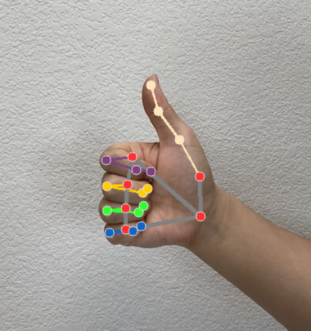

# 手势识别 Python 指南 (Gesture recognition guide for Python)

> 本文译自官方文档：[原文链接](https://developers.google.com/edge/mediapipe/solutions/vision/gesture_recognizer/python)
> 为保持内容与版式一致，图片位置、章节顺序、代码示例均与原页对齐。

MediaPipe 手势识别器 (Gesture Recognizer) 任务可让您实时识别手势，并提供识别出的手势结果和检测到的手部关键点 (landmarks)。这些说明向您展示如何在 Python 应用程序中使用手势识别器。

您可以通过查看 [Web 演示](https://google-ai-edge.github.io/mediapipe-samples-web/#/vision/gesture_recognizer) 来了解此任务的实际运行情况。有关此任务的功能、模型和配置选项的更多信息，请参阅[总览 (Overview)](../gesture_recognizer.md)。

## 代码示例 (Code example)

手势识别器的示例代码提供了此任务在 Python 中的完整实现供您参考。此代码可帮助您测试此任务并开始构建自己的手势识别器。您只需使用 Web 浏览器即可查看、运行和编辑手势识别器[示例代码](https://colab.research.google.com/github/googlesamples/mediapipe/blob/main/examples/gesture_recognizer/python/gesture_recognizer.ipynb)。

如果您要在 Raspberry Pi 上实现手势识别器，请参阅 [Raspberry Pi 示例应用](https://github.com/google-ai-edge/mediapipe-samples/tree/main/examples/gesture_recognizer/raspberry_pi)。

## 环境配置 (Setup)

本节描述了专为使用手势识别器而设置开发环境和代码项目的关键步骤。有关设置 MediaPipe 任务开发环境（包括平台版本要求）的一般信息，请参阅 [Python 环境配置指南 (Setup guide for Python)](../../setup_python.md)。

### 包 (Packages)

MediaPipe 手势识别器任务需要 mediapipe PyPI 包。您可以使用以下命令安装并导入这些依赖项：

```bash
$ python -m pip install mediapipe
```

### 导入 (Imports)

导入以下类以访问手势识别器任务函数：

```python
import mediapipe as mp
from mediapipe.tasks import python
from mediapipe.tasks.python import vision
```

### 模型 (Model)

MediaPipe 手势识别器任务需要一个与该任务兼容的已训练的模型包。有关手势识别器可用预训练模型的更多信息，请参阅任务总览中的[模型部分 (Models section)](../gesture_recognizer.md#models)。

选择并下载模型，然后将其存储在本地目录中：

```python
model_path = '/absolute/path/to/gesture_recognizer.task'
```

如以下所示，在模型名称参数中指定模型的路径：

```python
base_options = BaseOptions(model_asset_path=model_path)
```

## 创建任务 (Create the task)

MediaPipe 手势识别器任务使用 `create_from_options` 函数来设置任务。`create_from_options` 函数接受要处理的配置选项的值。有关配置选项的更多信息，请参阅[配置选项 (Configuration options)](#configuration_options)。

以下代码演示了如何构建和配置此任务。

这些示例还展示了针对图像、视频文件和实时视频流任务构建的不同变体。

### 图像 (Image)

```python
import mediapipe as mp

BaseOptions = mp.tasks.BaseOptions
GestureRecognizer = mp.tasks.vision.GestureRecognizer
GestureRecognizerOptions = mp.tasks.vision.GestureRecognizerOptions
VisionRunningMode = mp.tasks.vision.RunningMode

# Create a gesture recognizer instance with the image mode:
options = GestureRecognizerOptions(
    base_options=BaseOptions(model_asset_path='/path/to/model.task'),
    running_mode=VisionRunningMode.IMAGE)
with GestureRecognizer.create_from_options(options) as recognizer:
  # The detector is initialized. Use it here.
  # ...
```

### 视频 (Video)

```python
import mediapipe as mp

BaseOptions = mp.tasks.BaseOptions
GestureRecognizer = mp.tasks.vision.GestureRecognizer
GestureRecognizerOptions = mp.tasks.vision.GestureRecognizerOptions
VisionRunningMode = mp.tasks.vision.RunningMode

# Create a gesture recognizer instance with the video mode:
options = GestureRecognizerOptions(
    base_options=BaseOptions(model_asset_path='/path/to/model.task'),
    running_mode=VisionRunningMode.VIDEO)
with GestureRecognizer.create_from_options(options) as recognizer:
  # The detector is initialized. Use it here.
  # ...
```

### 实时流 (Live stream)

```python
import mediapipe as mp

BaseOptions = mp.tasks.BaseOptions
GestureRecognizer = mp.tasks.vision.GestureRecognizer
GestureRecognizerOptions = mp.tasks.vision.GestureRecognizerOptions
GestureRecognizerResult = mp.tasks.vision.GestureRecognizerResult
VisionRunningMode = mp.tasks.vision.RunningMode

# Create a gesture recognizer instance with the live stream mode:
def print_result(result: GestureRecognizerResult, output_image: mp.Image, timestamp_ms: int):
    print('gesture recognition result: {}'.format(result))

options = GestureRecognizerOptions(
    base_options=BaseOptions(model_asset_path='/path/to/model.task'),
    running_mode=VisionRunningMode.LIVE_STREAM,
    result_callback=print_result)
with GestureRecognizer.create_from_options(options) as recognizer:
  # The detector is initialized. Use it here.
  # ...
```

> **注意：** 如果使用实时流模式，您需要在创建任务时注册一个结果侦听器。每当任务完成对视频帧的处理时，都会以检测结果和输入图像作为参数调用该侦听器。

> **注意：** 如果使用视频模式或实时流模式，手势识别器会使用跟踪算法，以避免在每一帧上触发手掌检测模型，这有助于降低手势识别器的延迟。

### 配置选项 (Configuration options)

此任务具有针对 Python 应用程序的以下配置选项：

| 选项名称 | 描述 | 取值范围 | 默认值 |
| --- | --- | --- | --- |
| `running_mode` | 设置任务的运行模式。共有三种模式：<br> `IMAGE`：用于单张图像输入的模式。<br> `VIDEO`：用于视频解码帧的模式。<br> `LIVE_STREAM`：用于输入数据实时流（例如来自摄像头）的模式。在此模式下，必须调用 `resultListener` 来设置侦听器以异步接收结果。 | {`IMAGE`, `VIDEO`, `LIVE_STREAM`} | `IMAGE` |
| `num_hands` | `GestureRecognizer` 可以检测到的最大手部数量。 | `任何整数 > 0` | `1` |
| `min_hand_detection_confidence` | 在手掌检测模型中，手部检测被认为成功的最低置信度分数。 | `0.0 - 1.0` | `0.5` |
| `min_hand_presence_confidence` | 手部关键点检测模型中手部存在分数的最低置信度分数。在手势识别器的视频模式和实时流模式下，如果手部关键点模型的手部存在置信度分数低于此阈值，则会触发手掌检测模型。否则，使用轻量级手部跟踪算法来确定随后进行关键点检测的手部位置。 | `0.0 - 1.0` | `0.5` |
| `min_tracking_confidence` | 手部跟踪被认为成功的最低置信度分数。这是当前帧和上一帧中手部之间的边界框 IoU 阈值。在手势识别器的视频模式和流模式下，如果跟踪失败，手势识别器会触发手部检测。否则，跳过手部检测。 | `0.0 - 1.0` | `0.5` |
| `canned_gestures_classifier_options` | 用于配置预制手势分类器行为的选项。预制手势有 `["None", "Closed_Fist", "Open_Palm", "Pointing_Up", "Thumb_Down", "Thumb_Up", "Victory", "ILoveYou"]`<br> - Display names locale（显示名称区域设置）：如果有的话，通过 TFLite 模型元数据指定的用于显示名称的区域设置。<br> - Max results（最大结果数）：要返回的得分最高的分类结果的最大数量。如果 < 0，将返回所有可用结果。<br> - Score threshold（分数阈值）：结果被拒绝的分数下限。如果设置为 0，将返回所有可用结果。<br> - Category allowlist（类别允许列表）：类别名称的允许列表。如果非空，类别不在此集合中的分类结果将被过滤掉。与拒绝列表互斥。<br> - Category denylist（类别拒绝列表）：类别名称的拒绝列表。如果非空，类别在此集合中的分类结果将被过滤掉。与允许列表互斥。 | * Display names locale：`任意字符串` <br> * Max results：`任意整数` <br> * Score threshold：`0.0-1.0` <br> * Category allowlist：`字符串向量 (vector of strings)` <br> * Category denylist：`字符串向量 (vector of strings)` | * Display names locale：`"en"` <br> * Max results：`-1` <br> * Score threshold：`0` <br> * Category allowlist：空 <br> * Category denylist：空 |
| `custom_gestures_classifier_options` | 用于配置自定义手势分类器行为的选项。<br> - Display names locale（显示名称区域设置）：如果有的话，通过 TFLite 模型元数据指定的用于显示名称的区域设置。<br> - Max results（最大结果数）：要返回的得分最高的分类结果的最大数量。如果 < 0，将返回所有可用结果。<br> - Score threshold（分数阈值）：结果被拒绝的分数下限。如果设置为 0，将返回所有可用结果。<br> - Category allowlist（类别允许列表）：类别名称的允许列表。如果非空，类别不在此集合中的分类结果将被过滤掉。与拒绝列表互斥。<br> - Category denylist（类别拒绝列表）：类别名称的拒绝列表。如果非空，类别在此集合中的分类结果将被过滤掉。与允许列表互斥。 | * Display names locale：`任意字符串` <br> * Max results：`任意整数` <br> * Score threshold：`0.0-1.0` <br> * Category allowlist：`字符串向量 (vector of strings)` <br> * Category denylist：`字符串向量 (vector of strings)` | * Display names locale：`"en"` <br> * Max results：`-1` <br> * Score threshold：`0` <br> * Category allowlist：空 <br> * Category denylist：空 |
| `result_callback` | 设置结果侦听器，以便在手势识别器处于实时流模式时异步接收分类结果。仅在运行模式设置为 `LIVE_STREAM` 时使用。 | `ResultListener` | N/A |

## 准备数据 (Prepare data)

将您的输入准备为图像文件或 numpy 数组，然后将其转换为 `mediapipe.Image` 对象。如果您的输入是视频文件或来自网络摄像头的实时流，您可以使用外部库（例如 [OpenCV](https://github.com/opencv/opencv)）将输入帧加载为 numpy 数组。

### 图像 (Image)

```python
import mediapipe as mp

# Load the input image from an image file.
mp_image = mp.Image.create_from_file('/path/to/image')

# Load the input image from a numpy array.
mp_image = mp.Image(image_format=mp.ImageFormat.SRGB, data=numpy_image)
```

### 视频 (Video)

```python
import mediapipe as mp

# Use OpenCV’s VideoCapture to load the input video.

# Load the frame rate of the video using OpenCV’s CV_CAP_PROP_FPS
# You’ll need it to calculate the timestamp for each frame.

# Loop through each frame in the video using VideoCapture#read()

# Convert the frame received from OpenCV to a MediaPipe’s Image object.
mp_image = mp.Image(image_format=mp.ImageFormat.SRGB, data=numpy_frame_from_opencv)
```

### 实时流 (Live stream)

```python
import mediapipe as mp

# Use OpenCV’s VideoCapture to start capturing from the webcam.

# Create a loop to read the latest frame from the camera using VideoCapture#read()

# Convert the frame received from OpenCV to a MediaPipe’s Image object.
mp_image = mp.Image(image_format=mp.ImageFormat.SRGB, data=numpy_frame_from_opencv)
```

## 运行任务 (Run the task)

手势识别器使用 `recognize`、`recognize_for_video` 和 `recognize_async` 函数来触发推理。对于手势识别，这涉及预处理输入数据、检测图像中的手部、检测手部关键点以及从关键点中识别手势。

以下代码演示了如何使用任务模型执行处理。

### 图像 (Image)

```python
# Perform gesture recognition on the provided single image.
# The gesture recognizer must be created with the image mode.
gesture_recognition_result = recognizer.recognize(mp_image)
```

### 视频 (Video)

```python
# Perform gesture recognition on the provided single image.
# The gesture recognizer must be created with the video mode.
gesture_recognition_result = recognizer.recognize_for_video(mp_image, frame_timestamp_ms)
```

### 实时流 (Live stream)

```python
# Send live image data to perform gesture recognition.
# The results are accessible via the `result_callback` provided in
# the `GestureRecognizerOptions` object.
# The gesture recognizer must be created with the live stream mode.
recognizer.recognize_async(mp_image, frame_timestamp_ms)
```

请注意以下事项：

*   在视频模式或实时流模式下运行时，您还必须向手势识别器任务提供输入帧的时间戳。
*   在图像或视频模式下运行时，手势识别器任务会阻塞当前线程，直到完成输入图像或帧的处理。
*   在实时流模式下运行时，手势识别器任务会立即返回并且不会阻塞当前线程。在处理完每一帧输入后，它会使用识别结果调用其结果侦听器。如果在手势识别器任务正忙于处理另一帧时调用识别函数，任务将忽略新的输入帧。

有关在图像上运行手势识别器的完整示例，请参阅[代码示例](https://colab.research.google.com/github/googlesamples/mediapipe/blob/main/examples/gesture_recognizer/python/gesture_recognizer.ipynb#scrollTo=Iy4r2_ePylIa)了解详细信息。

## 处理和显示结果 (Handle and display results)

手势识别器会为每次识别运行生成一个手势检测结果对象。结果对象包含图像坐标中的手部关键点、世界坐标中的手部关键点、惯用手（左手/右手）以及检测到的手部的手势类别。

以下显示了此任务的输出数据示例：

产生的 `GestureRecognizerResult` 包含四个组件，每个组件都是一个数组，其中每个元素包含单只检测到的手部的检测结果。

*   Handedness（惯用手）

    惯用手代表检测到的手是左手还是右手。
*   Gestures（手势）

    检测到的手部被识别出的手势类别。
*   Landmarks（关键点）

    共有 21 个手部关键点，每个关键点由 `x`、`y` 和 `z` 坐标组成。`x` 和 `y` 坐标分别由图像宽度和高度归一化到 [0.0, 1.0]。`z` 坐标代表关键点深度，以手腕处的深度作为原点。值越小，关键点离相机越近。`z` 的大小比例与 `x` 大致相同。
*   World Landmarks（世界坐标关键点）

    这 21 个手部关键点也以世界坐标呈现。每个关键点由 `x`、`y` 和 `z` 组成，表示以手部几何中心为原点、单位为米的真实世界 3D 坐标。

```
GestureRecognizerResult:
  Handedness:
    Categories #0:
      index        : 0
      score        : 0.98396
      categoryName : Left
  Gestures:
    Categories #0:
      score        : 0.76893
      categoryName : Thumb_Up
  Landmarks:
    Landmark #0:
      x            : 0.638852
      y            : 0.671197
      z            : -3.41E-7
    Landmark #1:
      x            : 0.634599
      y            : 0.536441
      z            : -0.06984
    ... (21 landmarks for a hand)
  WorldLandmarks:
    Landmark #0:
      x            : 0.067485
      y            : 0.031084
      z            : 0.055223
    Landmark #1:
      x            : 0.063209
      y            : -0.00382
      z            : 0.020920
    ... (21 world landmarks for a hand)
```

下图显示了任务输出的可视化：



手势识别器示例代码演示了如何显示从任务返回的识别结果，有关详细信息，请参阅[代码示例](https://colab.research.google.com/github/googlesamples/mediapipe/blob/main/examples/gesture_recognizer/python/gesture_recognizer.ipynb#scrollTo=Iy4r2_ePylIa)。

---

*页面内容遵循 [CC BY 4.0](https://creativecommons.org/licenses/by/4.0/) 许可；代码示例遵循 [Apache 2.0](https://www.apache.org/licenses/LICENSE-2.0) 许可。*
