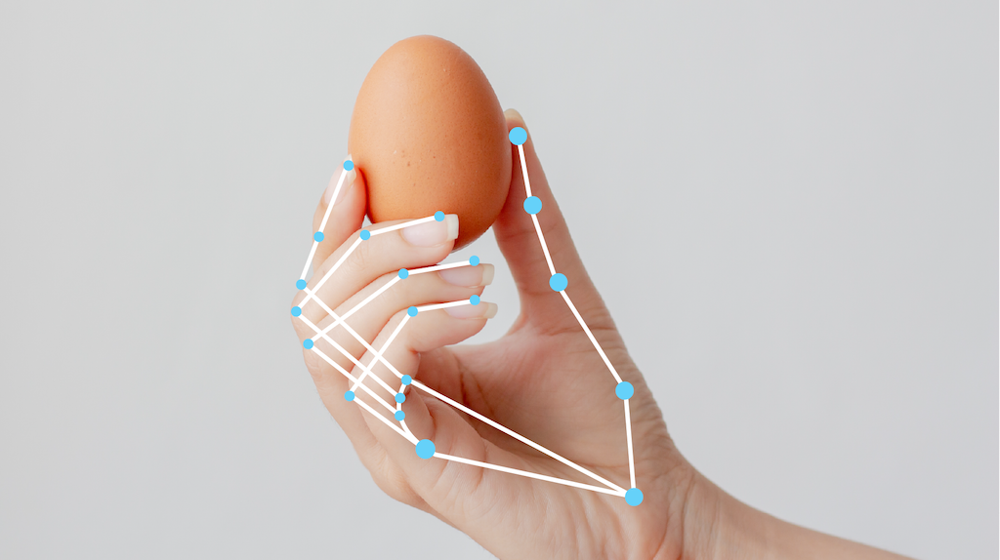
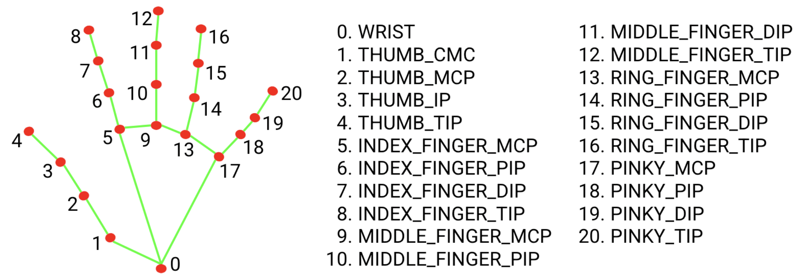

# 手部关键点检测指南 (Hand landmarks detection guide)

> 本文译自官方文档:[原文链接](https://developers.google.com/edge/mediapipe/solutions/vision/hand_landmarker)
> 为保持内容与版式一致,图片位置、章节顺序、代码示例均与原页对齐。

MediaPipe Hand Landmarker(手部关键点检测器)任务可让您检测图像中手部的关键点 (landmark)。您可以使用此任务定位手部关键点并在其上渲染视觉效果。此任务以图像数据作为静态数据或连续数据流输入,配合机器学习 (ML) 模型运行,并输出图像坐标下的手部关键点、世界坐标下的手部关键点以及检测到的多只手的手性(左手/右手)。

[立即试用!](https://google-ai-edge.github.io/mediapipe-samples-web/#/vision/hand_landmarker)

## 开始使用

通过为目标平台实施指南开始使用此任务。这些平台专属指南将引导您完成此任务的基本实现,包括推荐的模型,以及带有推荐配置选项的代码示例:

| 平台 | 代码示例 | 指南 |
|---|---|---|
| Android | [代码示例](https://github.com/google-ai-edge/mediapipe-samples/tree/main/examples/hand_landmarker/android) | [指南](android.md) |
| Python | [Colab](https://colab.research.google.com/github/googlesamples/mediapipe/blob/main/examples/hand_landmarker/python/hand_landmarker.ipynb) | [指南](python.md) |
| Web | [代码示例](https://github.com/google-ai-edge/mediapipe-samples-web/blob/main/src/tasks/hand-landmarker.ts) | [指南](web_js.md) |

## 任务详情

本节介绍此任务的功能、输入、输出和配置选项。

### 特性

-   **输入图像处理** — 处理包括图像旋转、调整大小、归一化和色彩空间转换。
-   **分数阈值** — 根据预测分数过滤结果。

| 任务输入 | 任务输出 |
|---|---|
| Hand Landmarker 接受以下任一数据类型作为输入:    - 静态图像   - 解码后的视频帧   - 实时视频流 | Hand Landmarker 输出以下结果:    - 检测到手的手性   - 图像坐标下检测到手部的关键点   - 世界坐标下检测到手部的关键点 |

### 配置选项

此任务具有以下配置选项:

| 选项名称 | 描述 | 取值范围 | 默认值 |
|---|---|---|---|
| `running_mode` | 设置任务的运行模式。共有三种模式:   IMAGE:适用于单张图像输入的模式。   VIDEO:适用于视频解码帧的模式。   LIVE_STREAM:适用于输入数据实时数据流的模式,例如来自摄像头的输入。在此模式下,必须调用 resultListener 来设置监听器,以便异步接收结果。 | `{IMAGE, VIDEO, LIVE_STREAM}` | `IMAGE` |
| `num_hands` | Hand landmark detector(手部关键点检测器)检测到的最大手数。 | `任意整数 > 0` | `1` |
| `min_hand_detection_confidence` | 手掌检测模型中认为手部检测成功所需的最低置信度分数。 | `0.0 - 1.0` | `0.5` |
| `min_hand_presence_confidence` | 手部关键点检测模型中手部存在分数的最低置信度分数。在视频模式和实时数据流模式下,如果手部关键点模型的手部存在置信度分数低于此阈值,Hand Landmarker 将触发手掌检测模型。否则,一个轻量级的手部跟踪算法会确定手部的位置,用于后续的关键点检测。 | `0.0 - 1.0` | `0.5` |
| `min_tracking_confidence` | 认为手部跟踪成功所需的最低置信度分数。这是当前帧与上一帧手部之间边界框的 IoU 阈值。在 Hand Landmarker 的视频模式和数据流模式下,如果跟踪失败,Hand Landmarker 将触发手部检测。否则,它会跳过手部检测。 | `0.0 - 1.0` | `0.5` |
| `result_callback` | 设置结果监听器,当手部关键点检测器处于实时数据流模式时,异步接收检测结果。仅在运行模式设置为 `LIVE_STREAM` 时适用。 | 不适用 | 不适用 |

## 模型

Hand Landmarker 使用一个包含两个打包模型的模型包:一个手掌检测模型和一个手部关键点检测模型。运行此任务需要一个同时包含这两个模型的模型包。

| 模型名称 | 输入形状 | 量化类型 | 模型卡 | 版本 |
|---|---|---|---|---|
| [HandLandmarker (完整版)](https://storage.googleapis.com/mediapipe-models/hand_landmarker/hand_landmarker/float16/latest/hand_landmarker.task) | 192 x 192, 224 x 224 | float 16 | [info](https://storage.googleapis.com/mediapipe-assets/Model%20Card%20Hand%20Tracking%20\(Lite_Full\)%20with%20Fairness%20Oct%202021.pdf) | [最新版](https://storage.googleapis.com/mediapipe-models/hand_landmarker/hand_landmarker/float16/latest/hand_landmarker.task) |

手部关键点模型包检测检测到的手部区域内 21 个手部指节坐标的关键点位置。该模型在大约 3 万张真实世界图像,以及叠加在各种背景上的多个渲染合成手部模型上进行了训练。

手部关键点检测器模型包包含一个手掌检测模型和一个手部关键点检测模型。手掌检测模型在输入图像中定位手部,而手部关键点检测模型在由手掌检测模型定义的裁剪手部图像上识别特定的手部关键点。

由于运行手掌检测模型耗时较长,在视频或实时数据流运行模式下,Hand Landmarker 使用手部关键点模型在一帧中定义的边界框来定位后续帧中手部所在的区域。只有当手部关键点模型不再识别出手部的存在,或未能跟踪帧内手部时,Hand Landmarker 才会重新触发手掌检测模型。这减少了 Hand Landmarker 触发手掌检测模型的次数。

## 任务基准测试

以下是基于上述预训练模型的整个管道的任务基准测试。延迟结果是 Pixel 6 上使用 CPU / GPU 的平均延迟。

| 模型名称 | CPU 延迟 | GPU 延迟 |
|---|---|---|
| HandLandmarker (完整版) | 17.12ms | 12.27ms |

---

*页面内容遵循 [CC BY 4.0](https://creativecommons.org/licenses/by/4.0/) 许可;代码示例遵循 [Apache 2.0](https://www.apache.org/licenses/LICENSE-2.0) 许可。*