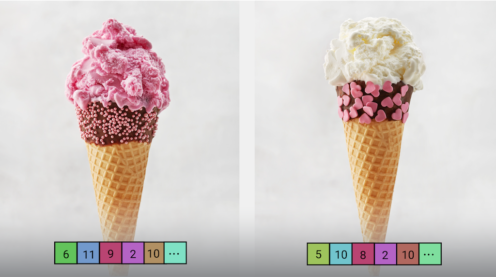

# 图像嵌入任务指南 (Image embedding task guide)

> 本文译自官方文档:[原文链接](https://developers.google.com/edge/mediapipe/solutions/vision/image_embedder)
> 为保持内容与版式一致,图片位置、章节顺序、代码示例均与原页对齐。

MediaPipe Image Embedder(图像嵌入器)任务可让您创建图像的数值表示,这有助于完成各种基于 ML 的图像任务。此功能通常用于通过数学比较技术(如余弦相似度 (Cosine Similarity))比较两张图像的相似度。此任务使用机器学习 (ML) 模型,以静态数据或连续数据流的形式处理图像数据,并输出图像数据的数值表示,即一组高维特征向量(也称为嵌入向量)的列表,以浮点形式或量化形式输出。

[立即试用!](https://google-ai-edge.github.io/mediapipe-samples-web/#/vision/image_embedder)

## 开始使用

通过为目标平台实施指南开始使用此任务。这些平台专属指南将引导您完成此任务的基本实现,使用推荐的模型,并提供带有推荐配置选项的代码示例:

| 平台 | 代码示例 | 指南 |
|---|---|---|
| Android | [代码示例](https://github.com/google-ai-edge/mediapipe-samples/tree/main/examples/image_embedder/android) | [指南](android.md) |
| Python | [Colab](https://colab.research.google.com/github/googlesamples/mediapipe/blob/main/examples/image_embedder/python/image_embedder.ipynb) | [指南](python.md) |
| Web | [代码示例](https://github.com/google-ai-edge/mediapipe-samples-web/blob/main/src/tasks/image-embedder.ts) | [指南](web_js.md) |

## 任务详情

本节介绍此任务的功能、输入、输出和配置选项。

### 特性

-   **输入图像处理** — 处理包括图像旋转、调整大小、归一化和色彩空间转换。
-   **感兴趣区域** — 对图像的某个区域而非整张图像执行嵌入。
-   **嵌入相似度计算** — 内置工具函数,用于计算两个特征向量之间的[余弦相似度](https://en.wikipedia.org/wiki/Cosine_similarity)。
-   **量化** — 支持对特征向量进行标量量化。

| 任务输入 | 任务输出 |
|---|---|
| 输入可以是以下数据类型之一:  - 静态图片  - 已解码的视频帧  - 实时视频流 | Image Embedder 输出一个嵌入列表,其中包含:  - 嵌入 (Embedding):特征向量本身,以浮点形式或标量量化形式呈现。  - 头索引 (Head index):产生此嵌入的头的索引。  - 头名称 (Head name,可选):产生此嵌入的头的名称。 |

### 配置选项

此任务有以下配置选项:

| 选项名称 | 说明 | 取值范围 | 默认值 |
|---|---|---|---|
| `running_mode` | 设置任务的运行模式。共有三种模式:  IMAGE:用于单张图像输入的模式。  VIDEO:用于视频已解码帧的模式。  LIVE_STREAM:用于输入数据实时流(如来自摄像头)的模式。在此模式下,必须调用 resultListener 来设置监听器,以异步接收结果。 | {`IMAGE, VIDEO, LIVE_STREAM`} | `IMAGE` |
| `l2_normalize` | 是否使用 L2 范数对返回的特征向量进行归一化。仅当模型尚不包含原生的 L2_NORMALIZATION TFLite Op 时才使用此选项。大多数情况下模型已包含该 Op,因此 L2 归一化已通过 TFLite 推理实现,无需此选项。 | `Boolean` | `False` |
| `quantize` | 返回的嵌入是否应通过标量量化量化为字节。嵌入被隐式假定为单位范数,因此任何维度都保证值在 \[-1.0, 1.0\] 范围内。如果并非如此,请使用 l2_normalize 选项。 | `Boolean` | `False` |
| `result_callback` | 设置结果监听器,以便在 Image Embedder 处于实时流模式时异步接收嵌入结果。只能在运行模式设置为 `LIVE_STREAM` 时使用。 | N/A | 未设置 |

> **注意:** `resultListener` 依赖于 `runningMode`。仅当 `runningMode` 设置为 `LIVE_STREAM` 时才需设置 `resultListener`。

## 模型

Image Embedder 需要一个图像嵌入模型,下载后存储在您的项目目录中。通过此任务开始开发时,请从目标平台的默认推荐模型入手。其他可用模型通常在性能、准确率、分辨率和资源需求之间进行权衡,有些情况下还会包含附加功能。

### MobileNetV3 模型

此模型家族使用 [MobileNet V3](https://arxiv.org/abs/1905.02244) 架构,并使用 [ImageNet](https://www.image-net.org) 数据训练。此模型在卷积层中使用 0.75 的深度(特征数量)倍率,以调整准确率与延迟之间的权衡。此外,MobileNet V3 有 small 和 large 两种不同大小,以适应低资源或高资源的使用场景。

| 模型名称 | 输入形状 | 量化类型 | 版本 |
|---|---|---|---|
| [MobileNet-V3 (small)](https://storage.googleapis.com/mediapipe-models/image_embedder/mobilenet_v3_small/float32/latest/mobilenet_v3_small.tflite) | 224 x 224 | None (float32) | [最新](https://storage.googleapis.com/mediapipe-models/image_embedder/mobilenet_v3_small/float32/latest/mobilenet_v3_small.tflite) |
| [MobileNet-V3 (large)](https://storage.googleapis.com/mediapipe-models/image_embedder/mobilenet_v3_large/float32/latest/mobilenet_v3_large.tflite) | 224 x 224 | None (float32) | [最新](https://storage.googleapis.com/mediapipe-models/image_embedder/mobilenet_v3_large/float32/latest/mobilenet_v3_large.tflite) |

### 任务基准测试

以下为基于上述预训练模型的完整管线的任务基准测试。延迟结果为 Pixel 6 上使用 CPU / GPU 的平均延迟。

| 模型名称 | CPU 延迟 | GPU 延迟 |
|---|---|---|
| MobileNet-V3 (small) | 3.94ms | 7.83ms |
| MobileNet-V3 (large) | 9.75ms | 9.08ms |

---

*页面内容遵循 [CC BY 4.0](https://creativecommons.org/licenses/by/4.0/) 许可;代码示例遵循 [Apache 2.0](https://www.apache.org/licenses/LICENSE-2.0) 许可。*