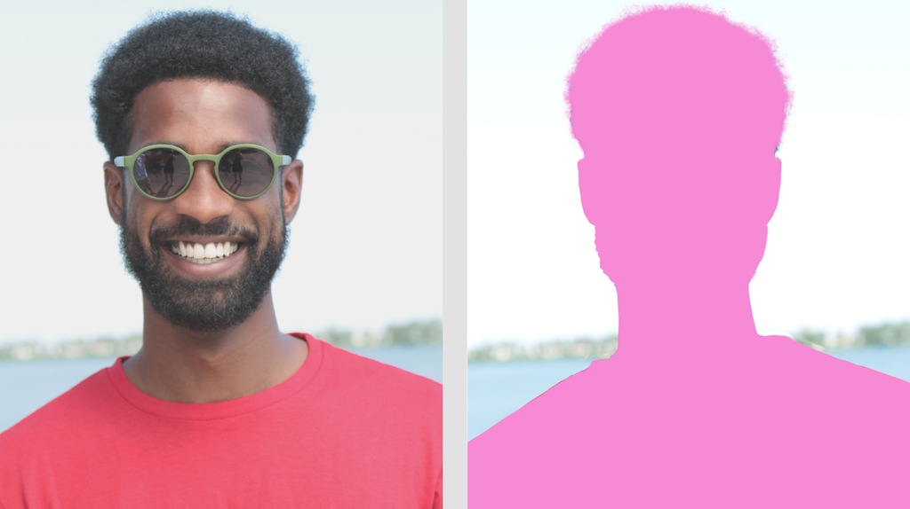

# 图像分割器 (Image Segmenter)

> 本文译自官方文档：[原文链接](https://developers.google.com/edge/mediapipe/solutions/vision/image_segmenter)
> 为保持内容与版式一致，图片位置、章节顺序、代码示例均与原页对齐。



MediaPipe 图像分割器 (Image Segmenter) 任务允许您根据预定义的类别将图像划分为多个区域。您可以使用此功能来识别特定的对象或纹理，然后应用视觉效果，如背景模糊。此任务包含几个专门训练用于在图像数据中分割人物及其特征的模型，包括：

* 人物和背景
* 仅人物头发
* 人物头发、面部、皮肤、衣服和配饰

此任务通过机器学习 (ML) 模型在单张图像或连续视频流上处理图像数据。它输出分割区域的列表，表示图像中的对象或区域，具体取决于您选择的[模型](#models)。

[试试看！arrow_forward](https://google-ai-edge.github.io/mediapipe-samples-web/#/vision/image_segmenter)

## 入门指南 (Get Started)

请按照适用于您目标平台的实施指南之一开始使用此任务。这些特定平台的指南将引导您完成此任务的基本实施，包括推荐模型以及带有推荐配置选项的代码示例：

| 平台 | 代码示例 | 指南 |
| --- | --- | --- |
| Android | [代码示例](https://github.com/google-ai-edge/mediapipe-samples/tree/main/examples/image_segmentation/android) | [指南](image_segmenter/android.md) |
| Python | [Colab](https://colab.research.google.com/github/googlesamples/mediapipe/blob/main/examples/image_segmentation/python/image_segmentation.ipynb) | [指南](image_segmenter/python.md) |
| Web | [代码示例](https://github.com/google-ai-edge/mediapipe-samples-web/blob/main/src/tasks/image-segmenter.ts) | [指南](image_segmenter/web_js.md) |

## 任务详情 (Task details)

本节介绍此任务的功能、输入、输出和配置选项。

### 特性 (Features)

* **输入图像处理** - 处理包括图像旋转、调整大小、归一化和颜色空间转换。

| 任务输入 | 任务输出 |
| --- | --- |
| 输入可以是以下数据类型之一：<br> * 静态图像<br> * 解码的视频帧<br> * 实时视频流 | 图像分割器输出分割后的图像数据，根据您设置的配置选项，可以包含以下一项或两项：<br> * `CATEGORY_MASK`：包含 uint8 格式图像的分割掩码的列表。每个像素值指示它是否属于模型支持的特定分割类别。<br> * `CONFIDENCE_MASK`：包含 float32 格式像素值的分割掩码的通道列表。每个像素值指示其属于模型支持的特定类别的置信度。 |

### 配置选项 (Configurations options)

此任务具有以下配置选项：

| 选项名称 | 描述 | 值范围 | 默认值 |
| --- | --- | --- | --- |
| `running_mode` | 设置任务的运行模式。有三种模式：<br> `IMAGE`：单张图像输入的模式。<br> `VIDEO`：视频解码帧的模式。<br> `LIVE_STREAM`：输入数据（例如来自相机）的实时流模式。在此模式下，必须调用 `resultListener` 来设置异步接收结果的监听器。 | {`IMAGE`, `VIDEO`, `LIVE_STREAM`} | `IMAGE` |
| `output_category_mask` | 如果设置为 `True`，则输出包含作为 uint8 图像的分割掩码，其中每个像素值指示获胜类别值。 | {`True`, `False`} | `False` |
| `output_confidence_masks` | 如果设置为 `True`，则输出包含作为浮点值图像的分割掩码，其中每个浮点值代表该类别的置信度得分映射。 | {`True`, `False`} | `True` |
| `display_names_locale` | 设置模型元数据中提供的显示名称的标签语言（如果可用）。默认为 `en`（英语）。您可以使用 [TensorFlow Lite Metadata Writer API](https://www.tensorflow.org/lite/models/convert/metadata_writer_tutorial) 向自定义模型的元数据中添加本地化标签。 | 区域代码 | `en` |
| `result_callback` | 当图像分割器处于 `LIVE_STREAM` 模式时，设置结果监听器以异步接收分割结果。只能在运行模式设置为 `LIVE_STREAM` 时使用。 | N/A | N/A |

## 模型 (Models)

图像分割器可与多个 ML 模型一起使用。以下大多数分割模型都是为对人物图像执行分割而构建和训练的。但是，[DeepLab-v3](#deeplab-v3) 模型是作为通用图像分割器构建的。请选择最适合您应用的模型。

### 自拍分割模型 (Selfie segmentation model)

此模型可以分割人物的肖像，并可用于替换或修改图像中的背景。该模型输出两个类别：索引 0 处的背景和索引 1 处的人物。此模型具有不同输入形状的版本，包括方形版本和横向版本，对于输入始终为该形状的应用程序（例如视频通话），横向版本可能更高效。

| 模型名称 | 输入形状 | 量化类型 | 模型卡 | 版本 |
| --- | --- | --- | --- | --- |
| [SelfieSegmenter (square)](https://storage.googleapis.com/mediapipe-models/image_segmenter/selfie_segmenter/float16/latest/selfie_segmenter.tflite) | 256 x 256 | float 16 | [info](https://storage.googleapis.com/mediapipe-assets/Model%20Card%20MediaPipe%20Selfie%20Segmentation.pdf) | [Latest](https://storage.googleapis.com/mediapipe-models/image_segmenter/selfie_segmenter/float16/latest/selfie_segmenter.tflite) |
| [SelfieSegmenter (landscape)](https://storage.googleapis.com/mediapipe-models/image_segmenter/selfie_segmenter_landscape/float16/latest/selfie_segmenter_landscape.tflite) | 144 x 256 | float 16 | [info](https://storage.googleapis.com/mediapipe-assets/Model%20Card%20MediaPipe%20Selfie%20Segmentation.pdf) | [Latest](https://storage.googleapis.com/mediapipe-models/image_segmenter/selfie_segmenter_landscape/float16/latest/selfie_segmenter_landscape.tflite) |

### 头发分割模型 (Hair segmentation model)

此模型接受人物图像，定位其头部的头发，并输出其头发的图像分割映射。您可以使用此模型重新着色头发或应用其他头发效果。该模型输出以下分割类别：

```
0 - background
1 - hair
```

| 模型名称 | 输入形状 | 量化类型 | 模型卡 | 版本 |
| --- | --- | --- | --- | --- |
| [HairSegmenter](https://storage.googleapis.com/mediapipe-models/image_segmenter/hair_segmenter/float32/latest/hair_segmenter.tflite) | 512 x 512 | None (float32) | [info](https://storage.googleapis.com/mediapipe-assets/Model%20Card%20-%20Hair%20Segmentation.pdf) | [Latest](https://storage.googleapis.com/mediapipe-models/image_segmenter/hair_segmenter/float32/latest/hair_segmenter.tflite) |

### 多类别自拍分割模型 (Multi-class selfie segmentation model)

此模型接受人物图像，定位不同区域（如头发、皮肤和衣服）的区域，并输出这些项目的图像分割映射。您可以使用此模型将各种效果应用于图像或视频中的人物。该模型输出以下分割类别：

```
0 - background
1 - hair
2 - body-skin
3 - face-skin
4 - clothes
5 - others (accessories)
```

| 模型名称 | 输入形状 | 量化类型 | 模型卡 | 版本 |
| --- | --- | --- | --- | --- |
| [SelfieMulticlass (256 x 256)](https://storage.googleapis.com/mediapipe-models/image_segmenter/selfie_multiclass_256x256/float32/latest/selfie_multiclass_256x256.tflite) | 256 x 256 | None (float32) | [info](https://storage.googleapis.com/mediapipe-assets/Model%20Card%20Multiclass%20Segmentation.pdf) | [Latest](https://storage.googleapis.com/mediapipe-models/image_segmenter/selfie_multiclass_256x256/float32/latest/selfie_multiclass_256x256.tflite) |

### DeepLab-v3 模型

此模型可识别多个类别的分割，包括背景、人、猫、狗和盆栽。该模型使用空洞空间金字塔池化来捕获更远距离的信息。有关更多信息，请参阅 [DeepLab-v3](https://tfhub.dev/tensorflow/lite-model/deeplabv3/latest/metadata/2)。

| 模型名称 | 输入形状 | 量化类型 | 版本 |
| --- | --- | --- | --- |
| [DeepLab-V3](https://storage.googleapis.com/mediapipe-models/image_segmenter/deeplab_v3/float32/latest/deeplab_v3.tflite) | 257 x 257 | None (float32) | [Latest](https://storage.googleapis.com/mediapipe-models/image_segmenter/deeplab_v3/float32/latest/deeplab_v3.tflite) |

## 任务基准测试 (Task benchmarks)

以下是基于上述预训练模型的数据流图的任务基准测试。延迟结果是在 Pixel 6 上使用 CPU / GPU 的平均延迟。

| 模型名称 | CPU 延迟 | GPU 延迟 |
| --- | --- | --- |
| SelfieSegmenter (square) | 33.46ms | 35.15ms |
| SelfieSegmenter (landscape) | 34.19ms | 33.55ms |
| HairSegmenter | 57.90ms | 52.14ms |
| SelfieMulticlass (256 x 256) | 217.76ms | 71.24ms |
| DeepLab-V3 | 123.93ms | 103.30ms |

---

*页面内容遵循 [CC BY 4.0](https://creativecommons.org/licenses/by/4.0/) 许可；代码示例遵循 [Apache 2.0](https://www.apache.org/licenses/LICENSE-2.0) 许可。*