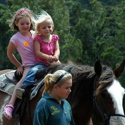
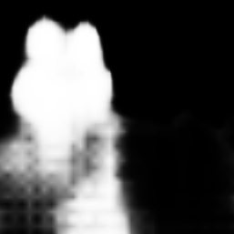
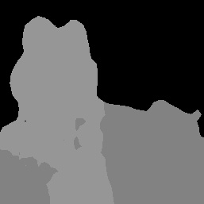

# 图像分割器 (Image Segmenter) - Python

> 本文译自官方文档：[原文链接](https://developers.google.com/edge/mediapipe/solutions/vision/image_segmenter/python)
> 为保持内容与版式一致，图片位置、章节顺序、代码示例均与原页对齐。

MediaPipe 图像分割器 (Image Segmenter) 任务允许您根据预定义的类别将图像划分为多个区域，以便应用视觉效果，如背景模糊。这些说明向您展示如何使用 Python 语言使用图像分割器。有关此任务的功能、模型和配置选项的更多信息，请参阅[概述](../image_segmenter.md)。

## 代码示例 (Code example)

图像分割器的代码示例提供了一个完整的 Python 实现供您参考。此代码可帮助您测试此任务并开始构建自己的图像分割器应用程序。您可以仅使用 Web 浏览器查看、运行和编辑图像分割器[代码示例](https://colab.research.google.com/github/googlesamples/mediapipe/blob/main/examples/image_segmentation/python/image_segmentation.ipynb)。

## 设置 (Setup)

本节介绍了特定于使用图像分割器设置开发环境和代码项目的关键步骤。有关设置用于使用 MediaPipe 任务的开发环境（包括平台版本要求）的一般信息，请参阅 [Python 环境配置指南](../../setup_python.md)。您可以在 [GitHub](https://github.com/google-ai-edge/mediapipe-samples/tree/main/examples/image_segmentation/python) 上查看此示例的源代码。

### 依赖包 (Packages)

MediaPipe 图像分割器任务需要 `mediapipe` 包。您可以使用以下命令安装所需的依赖项：

```
$ python -m pip install mediapipe
```

### 导入 (Imports)

导入以下类以访问图像分割器任务功能：

```
import mediapipe as mp
from mediapipe.tasks import python
from mediapipe.tasks.python import vision
```

### 模型 (Model)

MediaPipe 图像分割器任务需要一个与此任务兼容的训练好的模型。有关图像分割器可用预训练模型的更多信息，请参阅任务概述的[模型](../image_segmenter.md#models)部分。

选择并下载模型，然后将其存储在您的项目目录中：

```
model_path = '/absolute/path/to/model.tflite'
```

如以下所示，在模型名称参数中指定模型的路径：

```
base_options = BaseOptions(model_asset_path=model_path)
```

## 创建任务 (Create the task)

MediaPipe 图像分割器任务使用 `create_from_options` 函数来设置任务。`create_from_options` 函数接受配置选项的值来进行处理。有关任务配置的更多信息，请参阅[配置选项](#configuration_options)。

这些示例还展示了针对图像、视频文件和实时视频流的任务构建变体。

### 图像 (Image)

```
BaseOptions = mp.tasks.BaseOptions
ImageSegmenter = mp.tasks.vision.ImageSegmenter
ImageSegmenterOptions = mp.tasks.vision.ImageSegmenterOptions
VisionRunningMode = mp.tasks.vision.RunningMode

# Create a image segmenter instance with the image mode:
options = ImageSegmenterOptions(
    base_options=BaseOptions(model_asset_path='/path/to/model.task'),
    running_mode=VisionRunningMode.IMAGE,
    output_category_mask=True)
with ImageSegmenter.create_from_options(options) as segmenter:
```

### 视频 (Video)

```
BaseOptions = mp.tasks.BaseOptions
ImageSegmenter = mp.tasks.vision.ImageSegmenter
ImageSegmenterOptions = mp.tasks.vision.ImageSegmenterOptions
VisionRunningMode = mp.tasks.vision.RunningMode

# Create a image segmenter instance with the video mode:
options = ImageSegmenterOptions(
    base_options=BaseOptions(model_asset_path='/path/to/model.task'),
    running_mode=VisionRunningMode.VIDEO,
    output_category_mask=True)
with ImageSegmenter.create_from_options(options) as segmenter:
```

### 实时流 (Live stream)

```
BaseOptions = mp.tasks.BaseOptions
ImageSegmenter = mp.tasks.vision.ImageSegmenter
ImageSegmenterOptions = mp.tasks.vision.ImageSegmenterOptions
VisionRunningMode = mp.tasks.vision.RunningMode

# Create a image segmenter instance with the live stream mode:
def print_result(result: List[Image], output_image: Image, timestamp_ms: int):
    print('segmented masks size: {}'.format(len(result)))

options = ImageSegmenterOptions(
    base_options=BaseOptions(model_asset_path='/path/to/model.task'),
    running_mode=VisionRunningMode.VIDEO,
    output_category_mask=True)
with ImageSegmenter.create_from_options(options) as segmenter:
```

> **注意：** 如果您使用实时流模式，您需要在创建任务时注册一个结果监听器。每当任务完成对视频帧的处理，带有检测结果和输入图像作为参数，监听器就会被调用。
> 
> **注意：** 如果您使用视频模式或实时流模式，图像分割器会使用追踪（tracking）来避免在每一帧上触发手掌检测模型，这有助于降低图像分割器的延迟。

### 配置选项 (Configuration options)

此任务具有针对 Python 应用程序的以下配置选项：

| 选项名称 | 描述 | 值范围 | 默认值 |
| --- | --- | --- | --- |
| `running_mode` | 设置任务的运行模式。有三种模式：<br> `IMAGE`：单张图像输入的模式。<br> `VIDEO`：视频解码帧的模式。<br> `LIVE_STREAM`：输入数据（例如来自相机）的实时流模式。在此模式下，必须调用 `resultListener` 来设置异步接收结果的监听器。 | {`IMAGE`, `VIDEO`, `LIVE_STREAM`} | `IMAGE` |
| `output_category_mask` | 如果设置为 `True`，则输出包含作为 uint8 图像的分割掩码，其中每个像素值指示获胜类别值。 | {`True`, `False`} | `False` |
| `output_confidence_masks` | 如果设置为 `True`，则输出包含作为浮点值图像的分割掩码，其中每个浮点值代表该类别的置信度得分映射。 | {`True`, `False`} | `True` |
| `display_names_locale` | 设置模型元数据中提供的显示名称的标签语言（如果可用）。默认为 `en`（英语）。您可以使用 [TensorFlow Lite Metadata Writer API](https://www.tensorflow.org/lite/models/convert/metadata_writer_tutorial) 向自定义模型的元数据中添加本地化标签。 | 区域代码 | `en` |
| `result_callback` | 当图像分割器处于 `LIVE_STREAM` 模式时，设置结果监听器以异步接收分割结果。只能在运行模式设置为 `LIVE_STREAM` 时使用。 | N/A | N/A |

## 准备数据 (Prepare data)

将您的输入准备为图像文件或 NumPy 数组，然后将其转换为 `mediapipe.Image` 对象。如果您的输入是视频文件或网络摄像头的实时流，您可以使用诸如 [OpenCV](https://github.com/opencv/opencv) 等外部库将输入帧加载为 NumPy 数组。

### 图像 (Image)

```
# Load the input image from an image file.
mp_image = mp.Image.create_from_file('/path/to/image')

# Load the input image from a numpy array.
mp_image = mp.Image(image_format=mp.ImageFormat.SRGB, data=numpy_image)
```

### 视频 (Video)

```
# Use OpenCV’s VideoCapture to load the input video.
# Load the frame rate of the video using OpenCV’s CV_CAP_PROP_FPS
# You need the frame rate to calculate the timestamp for each frame.
# Loop through each frame in the video using VideoCapture#read()

# Convert the frame received from OpenCV to a MediaPipe’s Image object.
mp_image = mp.Image(image_format=mp.ImageFormat.SRGB, data=numpy_frame_from_opencv)
```

### 实时流 (Live stream)

```
# Use OpenCV’s VideoCapture to start capturing from the webcam.
# Create a loop to read the latest frame from the camera using VideoCapture#read()

# Convert the frame received from OpenCV to a MediaPipe’s Image object.
mp_image = mp.Image(image_format=mp.ImageFormat.SRGB, data=numpy_frame_from_opencv)
```

有关为图像分割器准备数据的代码示例，请参阅[代码示例](https://colab.research.google.com/github/googlesamples/mediapipe/blob/main/examples/image_segmentation/python/image_segmentation.ipynb)。

## 运行任务 (Run the task)

图像分割器使用 `segment`、`segment_for_video` 和 `segment_async` 函数触发推理。对于图像分割，这涉及预处理输入数据、运行分割模型以及对原始模型输出进行后处理以获得分割掩码。

以下代码示例展示了如何执行带有任务模型的处理。

### 图像 (Image)

```
# Perform image segmentation on the provided single image.
# The image segmenter must be created with the image mode.
segmented_masks = segmenter.segment(mp_image)
```

### 视频 (Video)

```
# Perform image segmentation on the provided single image.
# The image segmenter must be created with the video mode.
segmented_masks = segmenter.segment_for_video(mp_image, frame_timestamp_ms)
```

### 实时流 (Live stream)

```
# Send live image data to perform image segmentation.
# The results are accessible via the `result_callback` provided in
# the `ImageSegmenterOptions` object.
# The image segmenter must be created with the live stream mode.
segmenter.segment_async(mp_image, frame_timestamp_ms)
```

请注意以下事项：

* 在视频模式或实时流模式下运行时，您还必须为图像分割器任务提供输入帧的时间戳。
* 在图像或视频模式下运行时，图像分割器任务会阻塞当前线程，直到完成输入图像或帧的处理。

有关运行图像分割器推理的更完整示例，请参阅[代码示例](https://colab.research.google.com/github/googlesamples/mediapipe/blob/main/examples/image_segmentation/python/image_segmentation.ipynb)。

## 处理和显示结果 (Handle and display results)

图像分割器输出一个 `Image` 数据的列表。如果 `output_type` 为 `CATEGORY_MASK`，则输出是一个包含作为 uint8 图像的单个分割掩码的列表。该像素指示输入图像的被识别类别索引。如果 `output_type` 为 `CONFIDENCE_MASK`，则输出是一个大小为类别数量的向量。每个分割掩码都是范围在 `[0,1]` 之间的浮点图像，代表属于该类别的像素的置信度得分。

以下部分展示了此任务输出数据的示例：

### 类别置信度 (Category confidence)

以下图像展示了类别置信度掩码的任务输出可视化结果。置信度掩码输出包含介于 `[0, 1]` 之间的浮点值。




**原始图像和类别置信度掩码输出。源图像来自 [Pascal VOC 2012](https://www.kaggle.com/datasets/huanghanchina/pascal-voc-2012) 数据集。**

> **注意：** 在第二张输出图像中，浮点输出值被缩放到 `[0, 255]` 范围内的值，并转换为 uint8 数据类型。

### 类别值 (Category value)

以下图像展示了类别值掩码的任务输出可视化结果。类别掩码范围为 `[0, 255]`，每个像素值代表模型输出中的获胜类别索引。获胜类别索引具有模型可以识别的类别中的最高分数。




**原始图像和类别掩码输出。源图像来自 [Pascal VOC 2012](https://www.kaggle.com/datasets/huanghanchina/pascal-voc-2012) 数据集。**

> **注意：** 在第二张输出图像中，像素值乘以 10 以增加对比度并改善可视化效果。

---

*页面内容遵循 [CC BY 4.0](https://creativecommons.org/licenses/by/4.0/) 许可；代码示例遵循 [Apache 2.0](https://www.apache.org/licenses/LICENSE-2.0) 许可。*