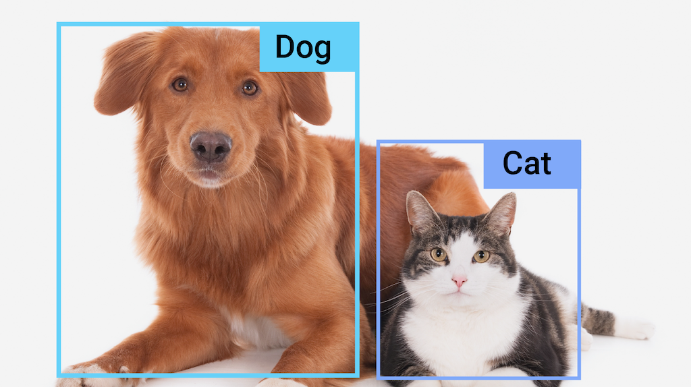

# 物体检测任务指南 (Object Detection Task Guide)

> 本文译自官方文档:[原文链接](https://developers.google.com/edge/mediapipe/solutions/vision/object_detector)
> 为保持内容与版式一致,图片位置、章节顺序、代码示例均与原页对齐。

MediaPipe Object Detector(物体检测器)任务可让您检测图像或视频中多类物体的存在与位置。例如,物体检测器可以在图像中定位狗。此任务基于机器学习(ML)模型对图像数据进行处理,接受静态数据或连续的视频流作为输入,并输出检测结果列表。每个检测结果表示图像或视频中出现的一个物体。

[立即试用!](https://google-ai-edge.github.io/mediapipe-samples-web/#/vision/object_detector)

## 开始使用

请按照以下适用于您所使用平台的实现指南之一开始使用此任务:

| 平台 | 代码示例 | 指南 |
|---|---|---|
| Android | [代码示例](https://github.com/google-ai-edge/mediapipe-samples/tree/main/examples/object_detection/android) | [指南](object_detector/android.md) |
| iOS | [代码示例](https://github.com/google-ai-edge/mediapipe-samples/tree/main/examples/object_detection/ios) | [指南](object_detector/ios.md) |
| Python | [Colab](https://colab.research.google.com/github/googlesamples/mediapipe/blob/main/examples/object_detection/python/object_detector.ipynb) | [指南](object_detector/python.md) |
| Web | [代码示例](https://github.com/google-ai-edge/mediapipe-samples-web/blob/main/src/tasks/object-detector.ts) | [指南](object_detector/web_js.md) |

这些平台专属指南将引导您完成此任务的基础实现,包括推荐的模型,以及带有推荐配置选项的代码示例。

## 任务详情

本节介绍此任务的功能、输入与输出。

### 功能特性 (Features)

- **输入图像处理** - 处理包括图像旋转、缩放、归一化和色彩空间转换。
- **标签映射表语言 (Label map locale)** - 设置显示名称所用的语言。
- **分数阈值** - 根据预测分数过滤结果。
- **Top-k 检测** - 过滤检测结果的数量。
- **标签允许列表与拒绝列表 (Label allowlist and denylist)** - 指定要检测的类别。

| 任务输入 | 任务输出 |
|---|---|
| Object Detector API 接受以下数据类型之一作为输入:  - 静态图片 - 已解码视频帧 - 实时视频流 | Object Detector API 针对检测到的物体输出以下结果:  - 物体类别 - 概率分数 - 边界框坐标 |

### 配置选项

此任务具有以下配置选项:

| 选项名称 | 说明 | 取值范围 | 默认值 |
|---|---|---|---|
| `running_mode` | 设置任务的运行模式。共有三种模式:  IMAGE:单张图像输入模式。  VIDEO:视频已解码帧模式。  LIVE_STREAM:输入数据实时流(如来自摄像头)模式。在此模式下,必须调用 resultListener 来设置监听器,以异步接收结果。 | {`IMAGE, VIDEO, LIVE_STREAM`} | `IMAGE` |
| `display_names` | 设置标签的语言,用于显示任务模型元数据中提供的显示名称(如果可用)。默认为英语 `en`。您可以使用 [TensorFlow Lite Metadata Writer API](https://ai.google.dev/edge/lite/models/metadata_writer_tutorial) 向自定义模型的元数据中添加本地化标签。 | 区域设置代码 | en |
| `max_results` | 设置要返回的按分数排序的检测结果的可选最大数量。 | 任意正数 | -1(返回所有结果) |
| `score_threshold` | 设置预测分数阈值,该阈值会覆盖模型元数据中提供的阈值(如果存在)。低于此值的结果将被丢弃。 | 任意浮点数 | 未设置 |
| `category_allowlist` | 设置可选的允许类别名称列表。如果非空,则类别名称不在此集合内的检测结果将被过滤掉。重复或未知的类别名称将被忽略。此选项与 `category_denylist` 互斥,同时使用两者会导致错误。 | 任意字符串 | 未设置 |
| `category_denylist` | 设置可选的不允许类别名称列表。如果非空,则类别名称在此集合内的检测结果将被过滤掉。重复或未知的类别名称将被忽略。此选项与 `category_allowlist` 互斥,同时使用两者会导致错误。 | 任意字符串 | 未设置 |

## 模型

Object Detector API 要求下载一个物体检测模型并将其存放在项目目录中。如果您还没有模型,请从默认的推荐模型开始。本节介绍的其他模型在延迟与准确性之间进行权衡。

### EfficientDet-Lite0 模型(推荐)

EfficientDet-Lite0 模型采用 EfficientNet-Lite0 主干网络,输入尺寸为 320x320,并使用 BiFPN 特征网络。该模型使用 [COCO 数据集](https://cocodataset.org/) 训练,这是一个包含 150 万个物体实例和 80 个物体标签的大规模物体检测数据集。请参阅受支持标签的[完整列表](https://storage.googleapis.com/mediapipe-tasks/object_detector/labelmap.txt)。EfficientDet-Lite0 提供 int8、float16 或 float32 三种版本。推荐此模型是因为它在延迟与准确性之间取得了平衡。它既准确又足够轻量,适用于许多使用场景。

| 模型名称 | 输入尺寸 | 量化类型 | 版本 |
|---|---|---|---|
| [EfficientDet-Lite0 (int8)](https://storage.googleapis.com/mediapipe-models/object_detector/efficientdet_lite0/int8/latest/efficientdet_lite0.tflite) | 320 x 320 | int8 | [Latest](https://storage.googleapis.com/mediapipe-models/object_detector/efficientdet_lite0/int8/latest/efficientdet_lite0.tflite) |
| [EfficientDet-Lite0 (float 16)](https://storage.googleapis.com/mediapipe-models/object_detector/efficientdet_lite0/float16/latest/efficientdet_lite0.tflite) | 320 x 320 | float 16 | [Latest](https://storage.googleapis.com/mediapipe-models/object_detector/efficientdet_lite0/float16/latest/efficientdet_lite0.tflite) |
| [EfficientDet-Lite0 (float 32)](https://storage.googleapis.com/mediapipe-models/object_detector/efficientdet_lite0/float16/latest/efficientdet_lite0.tflite) | 320 x 320 | None (float32) | [Latest](https://storage.googleapis.com/mediapipe-models/object_detector/efficientdet_lite0/float32/latest/efficientdet_lite0.tflite) |

### EfficientDet-Lite2 模型

EfficientDet-Lite2 模型采用 EfficientNet-Lite2 主干网络,输入尺寸为 448x448,并使用 BiFPN 特征网络。该模型使用 [COCO 数据集](https://cocodataset.org/) 训练,这是一个包含 150 万个物体实例和 80 个物体标签的大规模物体检测数据集。请参阅受支持标签的[完整列表](https://storage.googleapis.com/mediapipe-tasks/object_detector/labelmap.txt)。EfficientDet-Lite2 提供 int8、float16 或 float32 三种模型。该模型通常比 EfficientDet-Lite0 更准确,但也更慢、更消耗内存。此模型适用于准确性的优先级高于速度和体积的使用场景。

| 模型名称 | 输入尺寸 | 量化类型 | 版本 |
|---|---|---|---|
| [EfficientDet-Lite2 (int8)](https://storage.googleapis.com/mediapipe-models/object_detector/efficientdet_lite2/int8/latest/efficientdet_lite2.tflite) | 448 x 448 | int8 | [Latest](https://storage.googleapis.com/mediapipe-models/object_detector/efficientdet_lite2/int8/latest/efficientdet_lite2.tflite) |
| [EfficientDet-Lite2 (float 16)](https://storage.googleapis.com/mediapipe-models/object_detector/efficientdet_lite2/float16/latest/efficientdet_lite2.tflite) | 448 x 448 | float 16 | [Latest](https://storage.googleapis.com/mediapipe-models/object_detector/efficientdet_lite2/float16/latest/efficientdet_lite2.tflite) |
| [EfficientDet-Lite2 (float 32)](https://storage.googleapis.com/mediapipe-models/object_detector/efficientdet_lite2/float32/latest/efficientdet_lite2.tflite) | 448 x 448 | None (float32) | [Latest](https://storage.googleapis.com/mediapipe-models/object_detector/efficientdet_lite2/float32/latest/efficientdet_lite2.tflite) |

### SSD MobileNetV2 模型

SSD MobileNetV2 模型采用 MobileNetV2 主干网络,输入尺寸为 256x256,并使用 SSD 特征网络。该模型使用 [COCO 数据集](https://cocodataset.org/) 训练,这是一个包含 150 万个物体实例和 80 个物体标签的大规模物体检测数据集。请参阅受支持标签的[完整列表](https://storage.googleapis.com/mediapipe-tasks/object_detector/labelmap.txt)。SSD MobileNetV2 提供 int8 和 float 32 两种模型。该模型比 EfficientDet-Lite0 更快、更轻,但通常准确性也更低。此模型适用于需要快速、轻量且牺牲部分准确性的使用场景。

| 模型名称 | 输入尺寸 | 量化类型 | 版本 |
|---|---|---|---|
| [SSDMobileNet-V2 (int8)](https://storage.googleapis.com/mediapipe-models/object_detector/ssd_mobilenet_v2/float16/latest/ssd_mobilenet_v2.tflite) | 256 x 256 | int8 | [Latest](https://storage.googleapis.com/mediapipe-models/object_detector/ssd_mobilenet_v2/float16/latest/ssd_mobilenet_v2.tflite) |
| [SSDMobileNet-V2 (float 32)](https://storage.googleapis.com/mediapipe-models/object_detector/ssd_mobilenet_v2/float32/latest/ssd_mobilenet_v2.tflite) | 256 x 256 | None (float32) | [Latest](https://storage.googleapis.com/mediapipe-models/object_detector/ssd_mobilenet_v2/float32/latest/ssd_mobilenet_v2.tflite) |

### 模型要求与元数据

本节介绍如果您决定为此任务构建模型,自定义模型需要满足的要求。自定义模型必须采用 [TensorFlow Lite](https://developers.google.com/edge/lite/models/trained) 格式,并且必须包含描述模型运行参数的[元数据](https://developers.google.com/edge/lite/models/metadata_writer_tutorial#object_detectors)。

#### 设计要求

| 输入 | 尺寸 | 说明 |
|---|---|---|
| 输入图像 | 形状为 [1, height, width, 3] 的 Float32 张量 | 归一化后的输入图像。 |

| 输出 | 尺寸 | 说明 |
|---|---|---|
| `detection_boxes` | 形状为 [1, num_boxes, 4] 的 Float32 张量 | 每个检测到物体的边界框位置。 |
| `detection_classes` | 形状为 [1, num_boxes] 的 Float32 张量 | 每个检测到物体的类别名称索引。 |
| `detection_scores` | 形状为 [1, num_boxes] 的 float32 张量 | 每个检测到物体的预测分数。 |
| `num_boxes` | 大小为 1 的 Float32 张量 | 检测到的边界框数量。 |

#### 元数据要求

| 参数 | 说明 | 说明 |
|---|---|---|
| `input_norm_mean` | 输入张量归一化中使用的均值。 | 归一化后的输入图像。 |
| `input_norm_std` | 输入张量归一化中使用的场范数。 | 每个检测到物体的边界框位置。 |
| `label_file_paths` | 类别张量标签文件的路径。如果模型没有任何标签文件,请传入空列表。 | 每个检测到物体的类别名称索引。 |
| `score_calibration_md` | 分类张量中分数校准操作的信息。如果模型不使用分数校准,则不需要此参数。 | 每个检测到物体的预测分数。 |
| `num_boxes` | 大小为 1 的 Float32 张量 | 检测到的边界框数量。 |

## 任务基准测试

以下是上述预训练模型的任务基准测试结果。延迟结果为 Pixel 6 上使用 CPU / GPU 的平均延迟。

| 模型名称 | CPU 延迟 | GPU 延迟 |
|---|---|---|
| EfficientDet-Lite0 float32 model | 61.30ms | 27.83ms |
| EfficientDet-Lite0 float16 model | 53.97ms | 27.97ms |
| EfficientDet-Lite0 int8 model | 29.31ms | - |
| EfficientDet-Lite2 float32 model | 197.98ms | 41.15ms |
| EfficientDet-Lite2 float16 model | 198.77ms | 47.31ms |
| EfficientDet-Lite2 int8 model | 70.91ms | - |
| SSD MobileNetV2 float32 model | 36.30ms | 24.01ms |
| SSD MobileNetV2 float16 model | 37.35ms | 28.16ms |

---

*页面内容遵循 [CC BY 4.0](https://creativecommons.org/licenses/by/4.0/) 许可;代码示例遵循 [Apache 2.0](https://www.apache.org/licenses/LICENSE-2.0) 许可。*