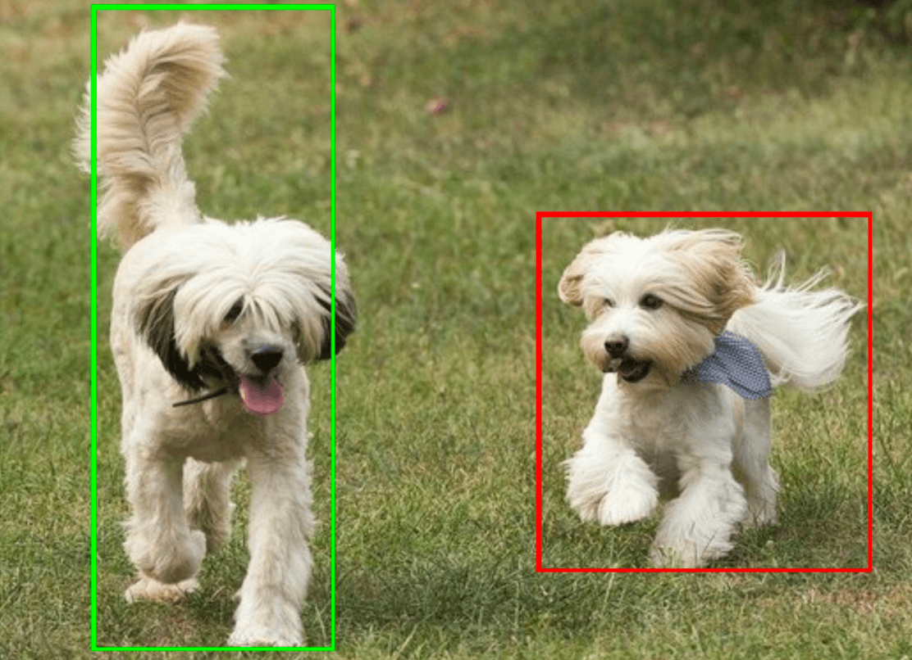

# 物体检测 (Object Detector) - Web/JS

> 本文译自官方文档：[原文链接](https://developers.google.com/edge/mediapipe/solutions/vision/object_detector/web_js)
> 为保持内容与版式一致，图片位置、章节顺序、代码示例均与原页对齐。

MediaPipe 物体检测 (Object Detector) 任务允许您检测多种类别物体的存在和位置。此任务接收图像数据并输出检测结果列表，每个结果代表在图像中识别出的物体。您可以仅使用 Web 浏览器查看、运行和编辑物体检测[示例](https://stackblitz.com/github/google-ai-edge/mediapipe-samples-web/?file=src%2Ftasks%2Fobject-detector.ts)。

有关此任务的功能、模型和配置选项的更多信息，请参阅[概述](../object_detector.md)。

## 设置 (Setup)

本节介绍了特定于使用物体检测设置开发环境的关键步骤。有关设置 Web 和 JavaScript 开发环境（包括平台版本要求）的一般信息，请参阅 [Web 环境配置指南](../../setup_web.md)。

### JavaScript 包 (JavaScript packages)

物体检测代码通过 MediaPipe `@mediapipe/tasks-vision` [NPM](https://www.npmjs.com/search?q=%40mediapipe) 包提供。您可以通过遵循平台[环境配置指南](../../setup_web.md)中的说明来查找并下载这些库。

您可以使用以下命令通过 NPM 安装所需的包：

```
npm install @mediapipe/tasks-vision
```

如果您希望通过内容分发网络 (CDN) 服务导入任务代码，请在您的 HTML 文件的 `<head>` 标签中添加以下代码：

```
<!-- You can replace JSDeliver with another CDN if you prefer to -->
<head>
  <script src="https://cdn.jsdelivr.net/npm/@mediapipe/tasks-vision/vision_bundle.mjs"
    crossorigin="anonymous"></script>
</head>
```

### 模型 (Model)

MediaPipe 物体检测任务需要一个与此任务兼容的训练好的模型。有关物体检测可用预训练模型的更多信息，请参阅任务概述中的[模型](../object_detector.md#models)部分。

选择并下载一个模型，然后将其存储在您的项目目录中：

```
<dev-project-root>/app/shared/models/
```

## 创建任务 (Create the task)

使用物体检测的 `ObjectDetector.createFrom...()` 函数之一来准备运行推理的任务。使用 `createFromModelPath()` 函数提供训练好的模型文件的相对或绝对路径。如果您的模型已加载到内存中，您可以使用 `createFromModelBuffer()` 方法。以下代码示例展示了如何使用 `createFromOptions()` 函数，该函数允许您设置更多配置选项。有关可用配置选项的更多信息，请参阅[配置选项](#configuration_options)部分。

以下代码演示了如何构建和配置此任务：

```
const vision = await FilesetResolver.forVisionTasks(
  // path/to/wasm/root
  "https://cdn.jsdelivr.net/npm/@mediapipe/tasks-vision@latest/wasm"
);
objectDetector = await ObjectDetector.createFromOptions(vision, {
  baseOptions: {
    modelAssetPath: `https://storage.googleapis.com/mediapipe-tasks/object_detector/efficientdet_lite0_uint8.tflite`
  },
  scoreThreshold: 0.5,
  runningMode: runningMode
});
```

有关创建物体检测任务的更完整实现，请参阅[代码示例](https://github.com/google-ai-edge/mediapipe-samples-web/blob/main/src/workers/object-detector.worker.ts)。

### 配置选项 (Configuration options)

此任务具有针对 Web 应用程序的以下配置选项：

| 选项名称 | 描述 | 值范围 | 默认值 |
| --- | --- | --- | --- |
| `runningMode` | 设置任务的运行模式。有两种模式：<br> `IMAGE`：单张图像输入的模式。<br> `VIDEO`：视频解码帧的模式，或输入数据实时流的模式（例如来自相机的流）。 | {`IMAGE`, `VIDEO`} | `IMAGE` |
| `displayNamesLocale` | 设置模型元数据中提供的显示名称的标签语言（如果可用）。默认为 `en`（英语）。您可以使用 [TensorFlow Lite Metadata Writer API](https://ai.google.dev/edge/lite/models/metadata_writer_tutorial) 向自定义模型的元数据中添加本地化标签。 | 区域代码 | `en` |
| `maxResults` | 设置要返回的可选最高得分检测结果的最大数量。 | 任意正数 | -1（返回所有结果） |
| `scoreThreshold` | 设置覆盖模型元数据中提供（如果有）的预测分数阈值。低于此值的结果将被拒绝。 | 任意浮点数 | 未设置 |
| `categoryAllowlist` | 设置允许的类别名称的可选列表。如果非空，则类别名称不在此集合中的检测结果将被过滤掉。重复或未知的类别名称将被忽略。此选项与 `categoryDenylist` 互斥，同时使用两者将导致错误。 | 任意字符串 | 未设置 |
| `categoryDenylist` | 设置不允许的类别名称的可选列表。如果非空，则类别名称在此集合中的检测结果将被过滤掉。重复或未知的类别名称将被忽略。此选项与 `categoryAllowlist` 互斥，同时使用两者将导致错误。 | 任意字符串 | 未设置 |

## 准备数据 (Prepare data)

物体检测可以检测主机浏览器支持的任何格式的图像中的物体。任务还会处理数据输入的预处理，包括调整大小、旋转和数值归一化。要检测视频中的物体，您可以使用该 API 一次快速处理一帧，使用帧的时间戳来确定视频中何时发生对应操作。

## 运行任务 (Run the task)

物体检测使用 `detect()` 处理单张图像，并使用 `detectForVideo()` 来检测视频帧中的物体。任务会处理数据，尝试识别物体，然后报告结果。

对 `detect()` 和 `detectForVideo()` 方法的调用是同步运行的，并且会阻塞用户界面线程。如果您从设备的摄像头识别视频帧中的物体，每次分类都会阻塞主线程。您可以通过实现 Web Workers 在另一个线程上运行检测来避免这种情况。

以下代码演示了如何使用任务模型执行处理：

### 图像 (Image)

```
const image = document.getElementById("image") as HTMLImageElement;
const detections = objectDetector.detect(image);
```

### 视频 (Video)

```
await objectDetector.setOptions({ runningMode: "video" });

let lastVideoTime = -1;
function renderLoop(): void {
  const video = document.getElementById("video");

  if (video.currentTime !== lastVideoTime) {
    const detections = detector.detectForVideo(video);
    processResults(detections);
    lastVideoTime = video.currentTime;
  }

  requestAnimationFrame(() => {
    renderLoop();
  });
}
```

有关运行物体检测任务的更完整实现，请参阅[代码示例](https://github.com/google-ai-edge/mediapipe-samples-web/blob/main/src/workers/object-detector.worker.ts)。

## 处理和显示结果 (Handle and display results)

物体检测在每次运行检测时都会生成一个检测结果对象。该结果对象包含一个检测列表，其中每个检测都包含所检测物体的边界框和类别信息，包括物体名称和置信度分数。

以下显示了此任务输出数据的示例：

```
ObjectDetectorResult:
 Detection #0:
  Box: (x: 355, y: 133, w: 190, h: 206)
  Categories:
   index       : 17
   score       : 0.73828
   class name  : dog
 Detection #1:
  Box: (x: 103, y: 15, w: 138, h: 369)
  Categories:
   index       : 17
   score       : 0.73047
   class name  : dog
```

以下图像显示了任务输出的可视化：



物体检测示例代码演示了如何显示任务返回的检测结果，有关详细信息，请参阅[代码示例](https://github.com/google-ai-edge/mediapipe-samples-web/blob/main/src/tasks/object-detector.ts)。

---

*页面内容遵循 [CC BY 4.0](https://creativecommons.org/licenses/by/4.0/) 许可；代码示例遵循 [Apache 2.0](https://www.apache.org/licenses/LICENSE-2.0) 许可。*