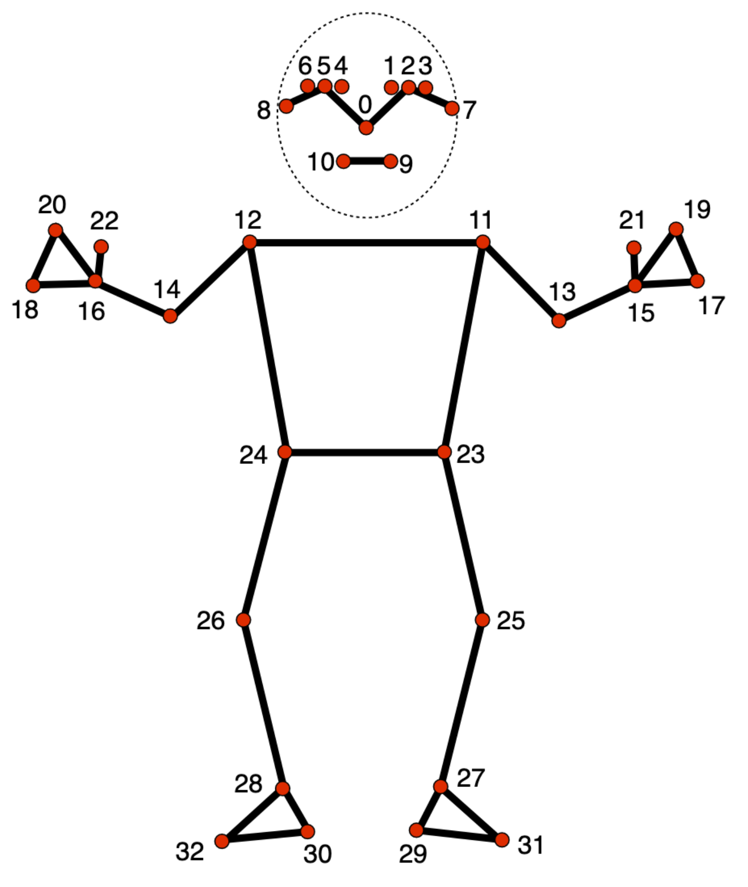

# 姿态关键点检测指南 (Pose landmark detection guide)

> 本文译自官方文档:[原文链接](https://developers.google.com/edge/mediapipe/solutions/vision/pose_landmarker)
> 为保持内容与版式一致,图片位置、章节顺序、代码示例均与原页对齐。


MediaPipe Pose Landmarker(姿态关键点检测器)任务可让您检测图像或视频中人体的关键点 (landmark)。您可以使用此任务识别关键身体部位位置、分析姿态,并对动作进行分类。此任务使用适用于单张图像或视频的机器学习 (ML) 模型。任务会输出图像坐标和 3 维世界坐标下的身体姿态关键点。

[立即试用!](https://google-ai-edge.github.io/mediapipe-samples-web/#/vision/pose_landmarker)

## 开始使用

通过为目标平台实施指南开始使用此任务。这些平台专属指南将引导您完成此任务的基本实现,包括推荐的模型,以及带有推荐配置选项的代码示例:

| 平台 | 代码示例 | 指南 |
|---|---|---|
| Android | [代码示例](https://github.com/google-ai-edge/mediapipe-samples/tree/main/examples/pose_landmarker/android) | [指南](android.md) |
| Python | [Colab](https://colab.research.google.com/github/googlesamples/mediapipe/blob/main/examples/pose_landmarker/python/%5BMediaPipe_Python_Tasks%5D_Pose_Landmarker.ipynb) | [指南](python.md) |
| Web | [代码示例](https://github.com/google-ai-edge/mediapipe-samples-web/blob/main/src/tasks/pose-landmarker.ts) | [指南](web_js.md) |

## 任务详情

本节介绍此任务的功能、输入、输出和配置选项。

### 特性

-   **输入图像处理** — 处理包括图像旋转、调整大小、归一化和色彩空间转换。
-   **分数阈值** — 根据预测分数过滤结果。

| 任务输入 | 任务输出 |
|---|---|
| Pose Landmarker 接受以下数据类型之一作为输入:<br><br>- 静态图片<br>- 已解码的视频帧<br>- 实时视频流 | Pose Landmarker 输出以下结果:<br><br>- 归一化图像坐标下的姿态关键点<br>- 世界坐标下的姿态关键点<br>- 可选:姿态的分割掩码 (segmentation mask) |

### 配置选项

此任务有以下配置选项:

| 选项名称 | 说明 | 取值范围 | 默认值 |
|---|---|---|---|
| `running_mode` | 设置任务的运行模式。共有三种模式:<br><br>IMAGE:用于单张图像输入的模式。<br><br>VIDEO:用于视频已解码帧的模式。<br><br>LIVE_STREAM:用于输入数据实时流(如来自摄像头)的模式。在此模式下,必须调用 resultListener 来设置监听器,以异步接收结果。 | {`IMAGE, VIDEO, LIVE_STREAM`} | `IMAGE` |
| `num_poses` | Pose Landmarker 可检测的最大姿态数量。 | `Integer > 0` | `1` |
| `min_pose_detection_confidence` | 姿态检测被视为成功所需的最低置信度分数。 | `Float [0.0,1.0]` | `0.5` |
| `min_pose_presence_confidence` | 姿态关键点检测中姿态存在分数所需的最低置信度分数。 | `Float [0.0,1.0]` | `0.5` |
| `min_tracking_confidence` | 姿态跟踪被视为成功所需的最低置信度分数。 | `Float [0.0,1.0]` | `0.5` |
| `output_segmentation_masks` | Pose Landmarker 是否输出检测到的姿态的分割掩码。 | `Boolean` | `False` |
| `result_callback` | 设置结果监听器,以便在 Pose Landmarker 处于实时流模式时异步接收关键点检测器结果。只能在运行模式设置为 `LIVE_STREAM` 时使用。 | `ResultListener` | `N/A` |

## 模型

Pose Landmarker 使用一系列模型来预测姿态关键点。第一个模型检测图像帧中是否存在人体,第二个模型在人体上定位关键点。

以下模型被打包成一个可下载的模型包:

-   **姿态检测模型**:通过几个关键姿态关键点检测人体的存在。
-   **姿态关键点检测器模型**:添加姿态的完整映射。该模型输出对 33 个 3 维姿态关键点的估计。

该模型包使用与 [MobileNetV2](https://arxiv.org/pdf/1801.04381.pdf) 类似的卷积神经网络,并针对端侧、实时健身应用进行了优化。此 [BlazePose](https://arxiv.org/pdf/2006.10204.pdf) 模型变体使用 [GHUM](https://openaccess.thecvf.com/content_CVPR_2020/papers/Xu_GHUM__GHUML_Generative_3D_Human_Shape_and_Articulated_Pose_CVPR_2020_paper.pdf)(一种 3D 人体形状建模管线)来估计图像或视频中个体完整的 3D 身体姿态。

| 模型包 | 输入形状 | 数据类型 | 模型卡 | 版本 |
|---|---|---|---|---|
| [Pose landmarker (lite)](https://storage.googleapis.com/mediapipe-models/pose_landmarker/pose_landmarker_lite/float16/latest/pose_landmarker_lite.task) | Pose detector: 224 x 224 x 3<br>Pose landmarker: 256 x 256 x 3 | float 16 | [信息](https://storage.googleapis.com/mediapipe-assets/Model%20Card%20BlazePose%20GHUM%203D.pdf) | [最新](https://storage.googleapis.com/mediapipe-models/pose_landmarker/pose_landmarker_lite/float16/latest/pose_landmarker_lite.task) |
| [Pose landmarker (Full)](https://storage.googleapis.com/mediapipe-models/pose_landmarker/pose_landmarker_full/float16/latest/pose_landmarker_full.task) | Pose detector: 224 x 224 x 3<br>Pose landmarker: 256 x 256 x 3 | float 16 | [信息](https://storage.googleapis.com/mediapipe-assets/Model%20Card%20BlazePose%20GHUM%203D.pdf) | [最新](https://storage.googleapis.com/mediapipe-models/pose_landmarker/pose_landmarker_full/float16/latest/pose_landmarker_full.task) |
| [Pose landmarker (Heavy)](https://storage.googleapis.com/mediapipe-models/pose_landmarker/pose_landmarker_heavy/float16/latest/pose_landmarker_heavy.task) | Pose detector: 224 x 224 x 3<br>Pose landmarker: 256 x 256 x 3 | float 16 | [信息](https://storage.googleapis.com/mediapipe-assets/Model%20Card%20BlazePose%20GHUM%203D.pdf) | [最新](https://storage.googleapis.com/mediapipe-models/pose_landmarker/pose_landmarker_heavy/float16/latest/pose_landmarker_heavy.task) |

### 姿态关键点检测器模型

姿态关键点检测器模型跟踪 33 个身体关键点位置,表示以下身体部位的近似位置:



```
0 - nose
1 - left eye (inner)
2 - left eye
3 - left eye (outer)
4 - right eye (inner)
5 - right eye
6 - right eye (outer)
7 - left ear
8 - right ear
9 - mouth (left)
10 - mouth (right)
11 - left shoulder
12 - right shoulder
13 - left elbow
14 - right elbow
15 - left wrist
16 - right wrist
17 - left pinky
18 - right pinky
19 - left index
20 - right index
21 - left thumb
22 - right thumb
23 - left hip
24 - right hip
25 - left knee
26 - right knee
27 - left ankle
28 - right ankle
29 - left heel
30 - right heel
31 - left foot index
32 - right foot index
```

模型输出包含每个关键点的归一化坐标 (`Landmarks`) 和世界坐标 (`WorldLandmarks`)。

---

*页面内容遵循 [CC BY 4.0](https://creativecommons.org/licenses/by/4.0/) 许可;代码示例遵循 [Apache 2.0](https://www.apache.org/licenses/LICENSE-2.0) 许可。*